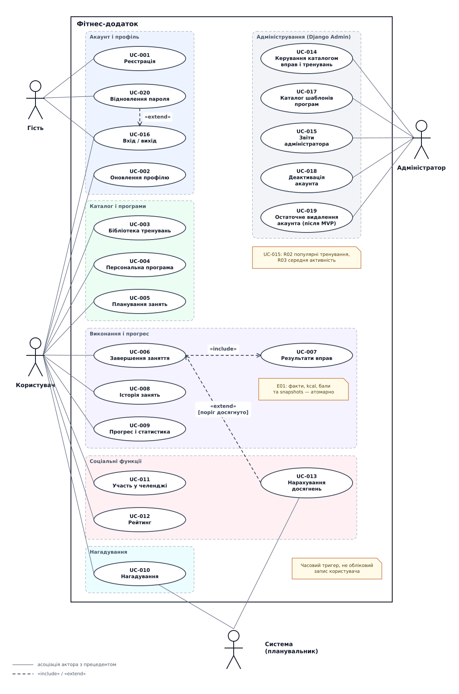

# Діаграма прецедентів фітнес-додатка



Діаграма відображає функціональну межу системи «Фітнес-додаток» і всі прецеденти UC-001—UC-020 з каталогу вимог. Редаговане джерело збережено у форматі draw.io, а SVG є самодостатнім експортом для пояснювальної записки.

SVG і draw.io генеруються з однієї моделі даних скриптом [`render_use_case_svg.py`](../diagrams/tools/render_use_case_svg.py) (лише стандартна бібліотека Python). Скрипт перевіряє, що жодна лінія асоціації чи `include`/`extend` не перетинає сторонній еліпс, і відмовляється генерувати діаграму, якщо розкладка зламана:

```bash
python3 docs/diagrams/tools/render_use_case_svg.py
```

Розкладка: кожен актор стоїть поруч зі своїми прецедентами — Гість і Користувач ліворуч від колонки користувацьких сценаріїв, Адміністратор праворуч від колонки Django Admin, Система знизу біля нагадувань і досягнень. Підписи еліпсів на діаграмі можуть бути коротшими або точнішими за назви з таблиці вимог (наприклад, «Бібліотека тренувань», «Нарахування досягнень»); ідентифікатори UC збігаються.

## Актори

- **Гість (Guest)** — неавтентифікований відвідувач, який реєструє обліковий запис, входить до системи або запускає безпечне відновлення пароля.
- **Користувач (User)** — автентифікований власник профілю й персональних даних. Переглядає бібліотеку, формує програму, планує та завершує заняття, читає власну історію і статистику, працює з нагадуваннями, рейтингом та челенджами.
- **Адміністратор (Administrator)** — бізнес-роль з окремими Django permissions. Керує спільним каталогом і шаблонами програм, переглядає лише агреговані звіти та, за окремим правом, деактивує акаунти. Роль не надає доступу до приватних профілів або сирої історії користувачів.
- **Система / планувальник (System / Scheduler)** — вторинний технічний актор для часового запуску показу нагадувань і системної перевірки досягнень. У поточному рішенні це не обліковий запис і не окремий фоновий сервіс: видимість нагадування обчислюється за часом, а клієнт отримує її через REST polling. Актор винесений за межу для явного показу автоматичної взаємодії, якої вимагає діаграма.

`User` не показано як спеціалізацію `Guest`: у вимогах це різні стани доступу до системи, а не успадковані бізнес-ролі. `Administrator` також не успадковує `User`, бо його права обмежені адміністративними операціями й не дають доступу до чужих персональних сценаріїв.

## Опис прецедентів і простежуваність

Позначення REST відповідають `docs/architecture/rest-api.md`. Позначка «немає окремого REST ID» означає, що поточний контракт відносить запис до Django Admin або залишає операцію поза MVP.

| UC | Назва | Актор(и) | Короткий опис | `include` / `extend` | Пов’язані FR / BR | REST-операції |
|---|---|---|---|---|---|---|
| UC-001 | Реєстрація | Гість | Створює `User` лише з унікальних email і пароля; профіль заповнюється окремо. | — | FR-001; BR-034 | A01, A02 |
| UC-002 | Оновлення профілю | Користувач | Читає й змінює власні фітнес-поля та необов’язкові імена; зміна ваги атомарно створює `WeightEntry`. | — | FR-003, FR-004; BR-001, BR-034 | P01–P04 |
| UC-003 | Бібліотека | Користувач | Переглядає категорії, вправи, Workout та їхній склад; застосовує пошук або фільтр. | — | FR-006–FR-010; BR-002–BR-004 | C01–C04 |
| UC-004 | Персональна програма | Користувач | За метою, рівнем і частотою отримує рекомендацію, створює незалежний `UserProgram` і редагує власну копію. | — | FR-011–FR-013; BR-005, BR-009 | G01–G07, G09 |
| UC-005 | Планування | Користувач | Створює, переглядає, переносить або скасовує `ScheduledSession`; створення слота атомарно створює одне нагадування. | —; створення нагадування є постумовою, але його читання в UC-010 — окремий сценарій | FR-014, FR-017, FR-023, FR-026; BR-005, BR-008, BR-023, BR-025, BR-026 | S01–S05 |
| UC-006 | Завершення заняття | Користувач | Ідемпотентно й атомарно фіксує `CompletedSession`, snapshots, фактичні результати, оцінку kcal і бали; запускає перевірки нагород та участей у челенджах. | **`include` UC-007**; база для умовного `extend` з UC-013 | FR-018–FR-021, FR-027–FR-030; BR-010–BR-015, BR-021, BR-022, BR-029, BR-030 | E01; результати реакцій читаються через M01–M04 і H04 |
| UC-007 | Результати вправ | Користувач (лише через `include` з UC-006, без прямої асоціації) | Валідує і записує хоча б один фактично виконаний `ExerciseResult` з параметрами, що відповідають типу вправи. | Включається UC-006 | FR-019; BR-004, BR-010, BR-029, BR-030, BR-033 | E01 |
| UC-008 | Історія | Користувач | Показує відфільтрований список і незмінні деталі лише власних завершених занять. | — | FR-022; BR-003, BR-009, BR-012, BR-013, BR-016, BR-020, BR-029 | E02, E03 |
| UC-009 | Прогрес | Користувач | Показує поточний прогрес програми, графік ваги та особисті підсумки за період із committed фактів. | — | FR-015, FR-031, FR-032; BR-006, BR-019, BR-027, BR-029 | G08, P05, R01 |
| UC-010 | Нагадування | Користувач; Система / планувальник | За часовою умовою повертає власні видимі нагадування, показує актуальність і дозволяє ідемпотентно позначити повідомлення прочитаним. | — | FR-023–FR-026; BR-023–BR-027 | N01–N03; життєвий цикл також змінюють S02, S04, S05 |
| UC-011 | Челендж | Користувач | Переглядає челенджі, одноразово вступає до доступного челенджу та бачить власний прогрес; E01 враховується лише після вступу і в межах періоду. | Формального `extend` немає: вступ є самостійним, а оновлення прогресу — атомарна реакція E01 | FR-029; BR-022, BR-029, BR-030 | H01–H04; E01 оновлює/визначає прогрес |
| UC-012 | Рейтинг | Користувач | Вмикає opt-in і псевдонім, переглядає рейтинг за період та власний підсумок без розкриття приватних даних. | — | FR-028, FR-035; BR-014, BR-015, BR-017, BR-028, BR-029 | A06, L01, M01 |
| UC-013 | Досягнення | Система / планувальник | Після успішного E01 перевіряє детерміновані умови та одноразово створює `UserAchievement`, якщо умову виконано. | **`extend` UC-006** з умовою «правило досягнення виконано» | FR-027; BR-021, BR-029, BR-030 | M03, M04; створення виконує handler E01 |
| UC-014 | Каталог адміністратора | Адміністратор | Створює, змінює, публікує або архівує визначення Exercise і Workout з валідним складом. | — | FR-007–FR-009, FR-037; BR-002–BR-004, BR-028 | C01–C04 — читання; запис — Django Admin, окремого REST ID немає |
| UC-015 | Звіти адміністратора | Адміністратор | За період переглядає агреговану популярність Workout і середню активність без доступу до чужих сирих фактів. | — | FR-033, FR-034, FR-040; BR-018, BR-020, BR-027–BR-030 | R02, R03 |
| UC-016 | Вхід/вихід | Гість; Користувач | Створює автентифіковану сесію за валідними даними або відкликає її під час виходу. | Базовий UC для умовного `extend` з UC-020 | FR-002, FR-005; BR-028 | A01, A03, A04 |
| UC-017 | Каталог шаблонів програм | Адміністратор | Через Django Admin атомарно створює, змінює, публікує або архівує `ProgramTemplate`, з якого User робить незалежну копію. | — | FR-011, FR-013, FR-038; BR-003, BR-005, BR-028 | G01, G03 — використання шаблону; запис — Django Admin, окремого REST ID немає |
| UC-018 | Деактивація акаунта | Адміністратор з окремим правом | Встановлює `is_active=false`, блокує новий вхід і зберігає персональні записи та їхню участь в агрегатах. | — | FR-036; BR-028, BR-032 | Немає окремого REST ID; обмежена admin-дія |
| UC-019 | Остаточне видалення акаунта (після MVP) | Окремо уповноважений адміністратор | Після явного підтвердження атомарно видаляє User і залежні персональні записи, не видаляючи спільні каталоги. | —; не є автоматичним продовженням UC-018 | FR-041; BR-028, BR-032 | Немає REST ID; механізм після MVP |
| UC-020 | Відновлення пароля | Гість | Повертає однакову відповідь для відомої й невідомої адреси, перевіряє одноразовий токен і валідатори нового пароля, після чого повертає до входу. | **`extend` UC-016** як необов’язковий шлях відновлення доступу | FR-042; BR-035 | A07, A08 |

## Використані залежності

- `UC-006 «include» UC-007`: без щонайменше одного валідного фактичного результату завершення заняття відхиляється, тому це обов’язкова частина базового сценарію.
- `UC-013 «extend» UC-006`: досягнення створюється лише тоді, коли після успішного завершення виконано одну з умов BR-021; за невиконаної умови UC-006 однаково завершується успішно.
- `UC-020 «extend» UC-016`: відновлення пароля є умовним альтернативним шляхом отримання доступу, а не обов’язковою частиною кожного входу.

Розрахунок калорій, створення snapshots і нарахування основних балів не винесено в окремі прецеденти: за BR-010—BR-015 і E01 це обов’язкові внутрішні кроки UC-006. Аналогічно, SQL-агрегації звітів є внутрішньою реалізацією UC-009 та UC-015, а не окремими цілями акторів.

## Відповідність варіанту 4 і звітам

Функції варіанта 4 покрито так: реєстрація та профіль — UC-001, UC-002, UC-016 і UC-020; бібліотека — UC-003 і UC-014; індивідуальні програми та розклад — UC-004, UC-005 і UC-017; виконання, калорії, вправи та вага — UC-006—UC-009; нагадування — UC-010; досягнення, рейтинг і челенджі — UC-011—UC-013. Перший обов’язковий звіт, «Графік прогресу користувача», входить до UC-009 і відповідає P05/R01. Два агреговані звіти, «Найпопулярніші тренування» та «Середня активність користувачів за період», входять до UC-015 і відповідають R02/R03. Усі три звіти читають фактичні `CompletedSession` або датовані `WeightEntry`; саме планування не збільшує статистику.

## Межі та неоднозначності джерел

- `requirements.md` називає `System` внутрішнім компонентом, а завдання на діаграму вимагає вторинного актора `System/Scheduler`. Тому актор використаний лише як позначення зовнішнього часового тригера/автоматичної реакції; він не моделює окрему роль доступу. BR-023—BR-026 прямо фіксують, що cron або окремий worker для MVP не потрібні.
- UC-019 позначено «після MVP» і не має REST-контракту; таблиця вимог говорить про «уповноваженого актора» та окремий механізм, але не вводить нової бізнес-ролі. На діаграмі його пов’язано з Administrator із застереженням про окреме право.
- Керування Exercise, Workout і `ProgramTemplate` спроєктовано через Django Admin, тому C/G операції покривають читання й використання, але не утворюють REST CRUD для адміністративного запису.
