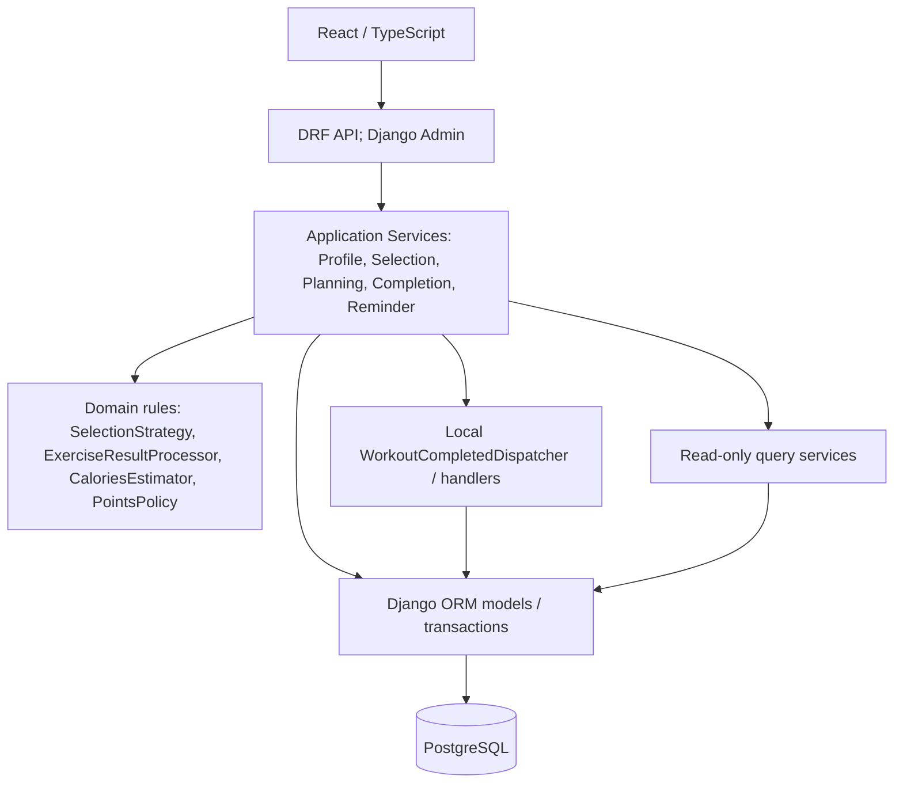

# Архітектурні стилі, GRASP і SOLID — фітнес-додаток, варіант 4

## Призначення, джерела та статус

Цей документ оцінює **проєктну модель до реалізації**. У репозиторії немає Django/React-коду, міграцій та тестів; UML показує заплановані класи, а не перевірені Python-типи чи фізичні пакети. Тому `DESIGNED` означає явне архітектурне рішення, **не** працюючий код. Статуси принципів: `DESIGNED` — прямо закладено в моделі; `PLANNED` — намір без достатньо визначеної відповідальності; `PARTIAL` — підхід діє локально, але має відомі межі; `NOT_APPLICABLE` — додаткова конструкція не виправдана; `NEEDS_VERIFICATION` — твердження можна підтвердити лише кодом або тестом. Статуси бізнес-правил `CONFIRMED`, `PROPOSED`, `OPEN` зберігають значення з [вимог](../analysis/requirements.md) і [бізнес-правил](../analysis/business-rules.md); ці дві шкали не підміняють одна одну.

Основні джерела: [доменна модель](domain-model.md) §§2, 4, 9–15, [ERD](erd.md) §§3–6, 9–10, [REST API](rest-api.md) §§1–3, 6, 9–11, [UML Class Diagram](../diagrams/class-diagram.drawio), зокрема сторінка «Прикладні сервіси та GoF», [додаткові GoF-пропозиції](additional-gof-proposals.md) §§2–3, [план](../PLAN_VARIANT_4.md) §§4–5 та [методичка](../kursova_DPZSP.pdf) §1, «Проєкт 4», §3 і додаток В. Методичка вітає сучасні стилі, GRASP і SOLID, але не вимагає формального CQRS або кількості GRASP/SOLID-патернів. Чинний стек `Django + DRF / PostgreSQL / React + TypeScript` підтверджено NFR-002 і OQ-02; FastAPI у старому плані §5.1 — уже відхилена історична альтернатива.

## 1. Architectural Styles and Approaches

### 1.1. Модульний моноліт

**Статус: `DESIGNED`; фізичні межі пакетів — `NEEDS_VERIFICATION`.** Один Django deployment і спільна PostgreSQL дають локальну транзакцію для завершення заняття, балів, стану програми та обов'язкових нагород (BR-030). Для курсової це зберігає зрозумілі запуск, налагодження й наскрізні перевірки. Мікросервіси додали б мережеві контракти, узгодженість між БД і експлуатацію кількох процесів, яких поточні вимоги не окуповують. Модульність тут означає **логічні межі відповідальності**, а не доведену кількість Django apps.

| Логічний модуль доменної моделі §4 | Власна відповідальність | Дозволені локальні взаємодії |
|---|---|---|
| Identity & Profile | `User`, `Profile`, `WeightEntry`, приватність і стан акаунта | Planning читає параметри профілю; Execution читає історичну вагу; Reporting читає виміри за правами. |
| Catalog | Спільні `Exercise`, `Workout`, `ProgramTemplate` і входження | Planning копіює опубліковані визначення; Execution зберігає походження `Workout`, але не змінює каталог. |
| Planning | `UserProgram`, персональний склад, `ScheduledSession`, поточний прогрес | Викликає `ReminderService` для слота; Execution під lock програми закриває виконаний слот і, за умовами, програму. |
| Execution | `CompletedSession`, `ExerciseResult`, snapshots, завершення | Читає власність і план; викликає доменні політики та локальний dispatcher; передає факти Engagement. |
| Engagement | `PointTransaction`, нагороди, участь у челенджах, рейтинг | Отримує необхідні зміни в транзакції Execution; рейтинг читає committed ledger і факти. |
| Notifications | Один внутрішній `Notification` на слот, його час і стан | Синхронно оновлюється з Planning; optional інформація після завершення не замінює reminder. |
| Reporting | Особисті й агреговані SQL-проєкції | Читає `WeightEntry`, `CompletedSession`, `PointTransaction` і походження `Workout`; не створює `Statistics`. |

Межу між модулями проводять через явні сервіси, політики та ідентифікатори/ORM-зв'язки, без внутрішнього HTTP або брокера. Перехресна ORM-залежність лишається реальною ціною спільної БД; її слід тримати видимою й уникати імпорту приватних деталей чужого модуля там, де достатньо вузького виклику. Немає підстав стверджувати, що модулі вже розміщено в окремих Python-пакетах.

### 1.2. Шари та напрям залежностей

**Статус: `DESIGNED` концептуально; імпорти — `NEEDS_VERIFICATION`.** React/TypeScript відображає стан і викликає API; DRF автентифікує, перевіряє форму запиту/базові permissions та формує HTTP-відповідь; application services координують один use case, власність, транзакцію і стан; domain components утримують повторювані правила добору, валідації та обчислень; Django ORM/PostgreSQL зберігають сутності, FK/UQ/CHECK та виконують запити. Django Admin є окремим HTTP-входом для дозволеного адміністрування каталогу.

Намір такий: UI не знає ORM; DRF не виконує багатокрокову бізнес-операцію; сервіс використовує доменні правила і сховище. Доменна модель у Django може прямо посилатися на ORM-моделі, а query services свідомо будують SQL. Це багатошарова архітектура, **не доведене** дотримання Clean Architecture або жорсткого Dependency Rule. Фактичні цикли імпортів, side effects моделей/сигналів та розміщення правил перевіряють після появи коду.

### 1.3. Service Layer і межі операцій

**Статус: `DESIGNED`; код і транзакції — `NEEDS_VERIFICATION`.** `ProfileService` створює й оновлює приватний Profile із необов’язковими іменами; лише фактичну зміну `weight_kg` супроводжує `WeightEntry` (BR-001/034). Тонкий `PasswordResetService` у `accounts` (**PROPOSED**) координує email і стандартні Django token/validator/hasher для A07/A08 без доменної таблиці (BR-035); DRF views відповідають за HTTP-форму й CSRF; `ProgramSelectionService` вибирає `ProgramTemplate` через `SelectionStrategy` і атомарно копіює персональний склад (BR-005); `ProgramPlanningService` керує станом програми, складом і слотами під lock `UserProgram` (BR-006–009/030); `ReminderService` синхронізує один `Notification` зі слотом (BR-023–026); `WorkoutCompletionService` виконує E01 як одну транзакцію (BR-029/030). Сервіс повторно перевіряє власника й стан об'єкта, навіть коли DRF уже перевірив доступ до маршруту: ID вкладеного слота, вправи чи програми не можна вважати довіреним.

Сервіси визначають порядок і межу `transaction.atomic()`, а не дублюють усі формули. `CaloriesEstimator` володіє MET-оцінкою та причиною її відсутності, `PointsPolicy` — формулою балів, `ExerciseResultProcessor` — типовою валідацією. DRF serializer перевіряє форму/типи вхідних даних; доменне правило перевіряє смисл і стан; ORM-обмеження страхують унікальність та посилання. Великий `WorkoutCompletionService` лишається доречним як **один** контролер транзакції, якщо не поглинає код незалежних правил.

### 1.4. Модель домену: план, факт і проєкція

**Статус: `DESIGNED`.** `ProgramTemplate` — спільне визначення, `UserProgram` — незалежна редагована копія з життєвим станом і замороженим порогом бонусу. `ScheduledSession` — змінний намір, `CompletedSession` — незмінний історичний факт, а `WorkoutExercise`/`UserProgramExercise` задають план на відміну від фактичного `ExerciseResult`. `PointTransaction` — авторитетний ledger: баланс є сумою записів, не другим полем; workout points і бонус мають різні джерела. Прогрес активної програми, рейтинг, популярність і звіти є похідними read-only запитами; при закритті програми фіксується лише підсумковий snapshot. Це дозволяє редагувати план і каталог, не переписуючи минулі kcal, бали чи походження виконання (FR-012/018/022/033, BR-020/029).

### 1.5. Локальні події

**Статус: `DESIGNED`; доставка — `NEEDS_VERIFICATION`.** `WorkoutCompletionService` формує `WorkoutCompleted`, а `WorkoutCompletedDispatcher` викликає `WorkoutCompletedHandler`. `AchievementHandler` і `ChallengeHandler`, **якщо зберігається стан участі**, є обов'язковими синхронними реакціями всередині тієї самої `atomic()`; їхня помилка відкочує факт, результати, бали і стан програми. `NotificationHandler` для інформаційного повідомлення є optional і викликається після commit; його помилка не відкочує завершення. Основні `PointTransaction` і бонус записує сам completion service; рейтинг, статистика та популярність лише читають committed дані. Повтор уже завершеного запиту не повинен повторно викликати dispatcher (BR-030).

Це локальний Observer, а не розподілена event-driven архітектура. `transaction.on_commit()` сам по собі не дає durable delivery: падіння процесу або callback може втратити optional повідомлення. У MVP немає брокера, outbox чи worker; обов'язкові наслідки залишаються синхронними.

### 1.6. Lightweight Command/Query Separation

**Статус: `DESIGNED` для легкого розділення команд і запитів; повний CQRS — `NOT_APPLICABLE` для поточного обсягу.** Команди E01/G03/S02 тощо змінюють доменний стан через application services; `StatisticsQueryService`, `LeaderboardQueryService`, `ReportQueryService` повертають read-only статистичні проєкції. Обидва шляхи користуються тими самими Django ORM-моделями та PostgreSQL. Окремих command model і read model не встановлено, асинхронної синхронізації проєкцій немає. Спільна фізична БД **сама по собі не виключає CQRS**; вирішальна відмінність тут — відсутність окремо визначених моделей команд і читання. Для трьох звітів та рейтингу достатньо lightweight Command/Query Separation; повний CQRS не виправданий вимогами курсової.

## 2. GRASP Patterns

Кожен пункт нижче описує **розподіл відповідальності**, а не автоматичну властивість Django. Рівень `DESIGNED` стосується лише UML і текстової моделі.

### 2.1. Information Expert — `PARTIAL`

**Суть:** правило доручають об'єкту, який має потрібну інформацію. `UserProgram` містить статус, `bonus_target_sessions` і підсумковий snapshot; `ScheduledSession` знає власний час/стан; `CompletedSession` зберігає історичні значення; `PointTransaction` містить бал і джерело. Прості локальні інваріанти цих об'єктів природно розміщувати поруч із даними. Проте поточна модель явно віддає переходи й міжсутнісні перевірки `ProgramPlanningService`/`WorkoutCompletionService`, а суму ledger — `LeaderboardQueryService` чи іншому запиту: окремий рядок `PointTransaction` не знає всіх транзакцій користувача. **Користь:** одне джерело стану; **межа:** сервісна модель може лишити сутності пасивними. **Перевірка:** локальні правила не дублюються в serializers і сервісах, а міжагрегатна координація не маскується методом однієї сутності.

### 2.2. Creator — `PARTIAL`

**Суть:** створення доцільно доручити власнику, контейнеру або учаснику, що має потрібні дані. `ProgramSelectionService` бере `ProgramTemplate` і створює `UserProgram` з персональними входженнями; `ProgramPlanningService` створює `ScheduledSession` разом з викликом `ReminderService` для `Notification`; `WorkoutCompletionService` створює `CompletedSession` та його `ExerciseResult`. У першому випадку шаблон є джерелом копії, у другому слот є власником reminder, у третьому завершення є контейнером результатів. У наявному дизайні **ідентифіковану Creator-відповідальність виконують сервіси**, бо створення перетинає агрегати й транзакцію; не доведено, що її реалізує метод доменної сутності. ORM `objects.create()` — механізм запису, не доказ GRASP Creator. Це також не GoF `Factory Method`: немає базового creator з перевизначеним фабричним методом. **Користь:** повний граф створюється атомарно; **ризик:** сервіс конструює надто багато низькорівневих деталей. **Перевірка:** G03/S02/E01 створюють увесь необхідний граф, без часткових записів і без доданої лише для назви «factory».

### 2.3. Controller — `DESIGNED`

**Суть:** системну операцію приймає об'єкт, відповідальний за use case. `ProgramPlanningService` координує G06/G07/S02–S05, `WorkoutCompletionService` — E01, `ProfileService` — P02/P03, а `PasswordResetService` (**PROPOSED**) — A07/A08 з Django auth primitives. DRF ViewSet/serializer — HTTP adapter для запиту й відповіді, а не місце для lock, бонусу чи кількох ORM-записів; доменні сутності не мають знати HTTP. Це GRASP Controller, **не** термін «controller» з MVC. **Користь:** один вхід до інваріанта; **ризик:** надмірне зосередження правил у контролері. **Перевірка:** mutation views делегують use case сервісу, а обхід сервісу не дозволяє змінити ті самі сутності без перевірок.

### 2.4. Low Coupling — `PARTIAL`

**Суть:** зменшити зайві залежності між класами. DRF залежить від вузьких операцій сервісу; `ProgramSelectionService` від `SelectionStrategy`, completion workflow від `WorkoutCompletedDispatcher` і контракту handler. Це ізолює зміну алгоритму добору або реакції від HTTP. Водночас application services і query services прямо залежать від Django ORM та спільної схеми; `WorkoutCompletionService` торкається Planning, Engagement і Notifications. ORM сама не гарантує low coupling. **Користь:** локальні зміни правил; **ризик:** циклічні імпорти або читання чужих таблиць із прихованими side effects. **Перевірка:** карта імпортів і code review показують явні, односторонні виклики; новий handler не змушує редагувати completion алгоритм, окрім реєстрації.

### 2.5. High Cohesion — `PARTIAL`

**Суть:** клас має пов'язану причину для зміни. `CaloriesEstimator` оцінює kcal, `PointsPolicy` обчислює бали, `ReminderService` веде lifecycle reminder, `ProgramSelectionService` відповідає за рекомендацію, `StatisticsQueryService` — за статистичні проєкції. `WorkoutCompletionService` має одну причину існування — атомарне завершення E01, але багато кроків. Координація цих кроків сама по собі не порушує cohesion; перенесення до нього формул MET, типів вправ, критеріїв досягнень або SQL-звітів уже порушило б її. **Користь:** окремі зміни не розносяться по сервісах; **ризик:** god service. **Перевірка:** причини зміни та залежності методів, а не кількість рядків; спеціалізовані правила мають власні цільові перевірки.

### 2.6. Polymorphism — `DESIGNED`

**Суть:** змінну поведінку викликають через спільний контракт. `SelectionStrategy.rank()` реалізують три стратегії цілі; `ExerciseResultProcessor.process()` утримує спільний алгоритм, а три підкласи змінюють типовий крок; `WorkoutCompletedHandler.handle()` виконують відповідні handlers. **Користь:** різні склади шаблону, типи вправ і реакції обробляються без повторення великого `if` у клієнті. **Межа:** вибір реалізації за goal/category і реєстрація handlers все одно потребують явного dispatch; для MET з однією формулою нова ієрархія не потрібна. **Перевірка:** однакові contract tests для реалізацій і відсутність дубльованого загального алгоритму.

### 2.7. Pure Fabrication — `DESIGNED`

**Суть:** технічний об'єкт без прямого фізичного аналога отримує відповідальність для кращої cohesion/coupling. `StatisticsQueryService` збирає read-only статистику з фактів, а `WorkoutCompletedDispatcher` маршрутизує локальні реакції. Вони не потребують таблиць `Statistics` або `Event`. `ProgramPlanningService` теж прикладний координатор, але сама назва service не доводить Pure Fabrication; суттєва причина — винесення міжсутнісного сценарію. **Користь:** не перевантажувати `CompletedSession`; **ризик:** зайві прокладки. **Перевірка:** кожен клас має конкретну операцію та клієнта; видалення порожньої обгортки не погіршило б інваріант — її не слід вводити.

### 2.8. Indirection — `DESIGNED`

**Суть:** посередник роз'єднує клієнта й кілька реалізацій. `WorkoutCompletedDispatcher` отримує `WorkoutCompleted` від `WorkoutCompletionService` та викликає `WorkoutCompletedHandler`, тому completion workflow не імпортує кожен `AchievementHandler`/`ChallengeHandler`/optional `NotificationHandler`. **Користь:** незалежне додавання реакції; **ціна:** реєстрація, порядок, помилки й transaction phase стають окремим контрактом. Посередник виправданий саме обраним Observer з різними обов'язковими та optional реакціями. **Перевірка:** обов'язкові handlers виконуються до commit, optional після; збій/повтор мають визначену поведінку.

### 2.9. Protected Variations — `DESIGNED`

**Суть:** стабільний клієнт захищено контрактом у точці очікуваної зміни. `SelectionStrategy` приховує критерій складу програми, `ExerciseResultProcessor` — типоспецифічну перевірку, `WorkoutCompletedHandler` — реакцію на завершення. **Користь:** нову ціль, тип вправи або реакцію можна додати локально; **межа:** конфігурація/registry та бізнес-правило все одно можуть змінитися. Немає підтвердженої варіації, яка вимагала б repository interface для кожної ORM-моделі або `Strategy` для однієї MET-формули. **Перевірка:** зміна одного варіанта не переписує спільний алгоритм і проходить однаковий контракт.

## 3. SOLID Principles

### 3.1. Single Responsibility Principle (SRP) — `PARTIAL`

**Визначення:** один клас має одну узгоджену причину для зміни. `ProgramSelectionService` змінюється через workflow рекомендації/копіювання, `ProgramPlanningService` — через правила персонального плану та слотів, `ReminderService` — через lifecycle внутрішнього reminder, `CaloriesEstimator` — через MET-оцінку, `PointsPolicy` — через правила балів, query services — через відповідні проєкції. `WorkoutCompletionService` змінюється, коли змінюється сам транзакційний use case E01; це може охоплювати кілька записів без порушення SRP. **Потенційне порушення:** той самий сервіс сам реалізує формулу kcal, всі категорії результатів, нагороди та SQL-звіти. **Очікувана користь:** зміна формули/порогу не переписує orchestration. **Перевірка:** review причин змін, викликів і тестів; великий клас розділяють за незалежними правилами, не за кількістю рядків.

### 3.2. Open/Closed Principle (OCP) — `PARTIAL`

**Визначення:** стабільну операцію можна розширити новим варіантом без переписування її ядра. Новий `SelectionStrategy` розширює критерій добору, новий підклас `ExerciseResultProcessor` — типову валідацію, новий `WorkoutCompletedHandler` — окрему реакцію. **Потенційне порушення:** `ProgramSelectionService` або `process()` містить розростаючий `if` з усіма варіантами. **Межа:** реєстрація стратегії, категорії чи handler та правила API/каталогу закономірно можуть змінюватися; OCP не обіцяє нуль правок. **Користь:** ризик локалізований. **Перевірка:** додати тестовий варіант, змінити лише реалізацію та явну конфігурацію, не спільний selection/completion алгоритм (FR-011/019, BR-005/033).

### 3.3. Liskov Substitution Principle (LSP) — `NEEDS_VERIFICATION`

**Визначення:** кожна реалізація виконує поведінковий контракт базового типу, зберігаючи передумови, результат, інваріанти й очікувані side effects. Для `SelectionStrategy.rank(candidates)` кожна стратегія приймає допустимий непорожній набір попередньо відфільтрованих `ProgramTemplate`, повертає детермінований порядок/тип результату та не змінює шаблони; відсутність кандидата обробляє контекст. Для `ExerciseResultProcessor.process(actuals)` кожен тип застосовує спільні перевірки BR-033, повертає нормалізований `ValidatedResult` або передбачувану validation error, не записує `ExerciseResult` і не послаблює вимогу належності вправи. Для `WorkoutCompletedHandler.handle(event)` required handler або завершує допустиму реакцію, або кидає помилку для rollback; optional handler не впливає на committed факт. **Потенційне порушення:** підклас приймає вужчі спільні входи, повертає інший тип, тихо ігнорує обов'язкову помилку чи робить неочікуваний запис. **Користь:** взаємозамінність без прихованих винятків. **Перевірка:** параметризовані contract tests для всіх трьох груп, включно з невалідним входом, повтором і відсутністю неочікуваних side effects; саме успадкування LSP не доводить.

### 3.4. Interface Segregation Principle (ISP) — `DESIGNED`; фактичний API — `NEEDS_VERIFICATION`

**Визначення:** клієнт залежить тільки від потрібних йому операцій. `SelectionStrategy` на UML має вузьке `rank()`, `WorkoutCompletedHandler` — `handle()`, `ExerciseResultProcessor` — `process()` та потрібні внутрішні кроки шаблону; completion workflow не мусить знати методи добору, а selection — реакції подій. **Потенційне порушення:** спільний «всеосяжний» інтерфейс для всіх policy/service або вимога порожніх методів у підкласів. **Користь:** менше вимушених залежностей. **Перевірка:** сигнатури й виклики реалізацій; додаткова сегрегація потрібна лише якщо реальний клієнт змушений реалізувати/залежати від непотрібної операції, а не заради ієрархії.

### 3.5. Dependency Inversion Principle (DIP) — `PARTIAL`

**Визначення:** високорівнева операція залежить від поведінкового контракту змінної частини, а створення конкретної реалізації відокремлене. `ProgramSelectionService` працює через `SelectionStrategy`; `WorkoutCompletedDispatcher` — через `WorkoutCompletedHandler`; completion workflow викликає контракт `ExerciseResultProcessor`. Python допускає явне передавання об'єкта/registry або dependency injection без окремого контейнера. **Потенційне порушення:** сервіс усередині кожного виклику жорстко створює одну concrete strategy/handler і змушує змінювати себе для кожного варіанта. **Межа:** сервіси все ще звертаються до Django ORM; це практична `PARTIAL` відповідність, не strict DIP для persistence. Repository interfaces для кожної моделі лише дублювали б ORM; вводити їх варто після конкретної потреби замінити сховище, ізолювати складний запит або тестувати зовнішню межу. **Користь:** заміна справді змінної поведінки. **Перевірка:** import graph, composition root/registry та підміна реалізацій у тестах без патчування внутрішнього коду сервісу.

## 4. Relationship Between GRASP, SOLID, and GoF

Три погоджені GoF-патерни (NFR-007) описують **три різні сценарії**; наведені принципи є властивостями розподілу відповідальностей, а не додатковими GoF-патернами.

| GoF Pattern | Participating Classes | GRASP Principles | SOLID Principles | Actual Benefit |
|---|---|---|---|---|
| `Strategy` | `ProgramSelectionService`, `SelectionStrategy`, три goal-стратегії | Polymorphism, Protected Variations, частково Low Coupling | OCP, частково DIP; LSP перевірити | Критерій складу розв'язує нічию лише після точних goal/level і частоти BR-005. |
| `Observer` | `WorkoutCompletionService`, `WorkoutCompleted`, `WorkoutCompletedDispatcher`, `WorkoutCompletedHandler`, required/optional handlers | Indirection, Pure Fabrication, частково Low Coupling | SRP і OCP для незалежних реакцій; LSP перевірити | Нагороди/стан челенджу можна обробити окремо, не втрачаючи BR-030. |
| `Template Method` | `ExerciseResultProcessor` і strength/cardio/yoga processors | Polymorphism, High Cohesion, Protected Variations | OCP для типового кроку; LSP перевірити | Єдина послідовність BR-033 і різна валідація BR-004 до запису факту. |

Trade-offs: Strategy потребує реєстрації й збереження спільних пріоритетів поза стратегіями; Observer приховує порядок викликів, якщо required/optional phases неявні; Template Method може стати крихким, якщо підкласи перевизначають загальний `process()` або змінюють його інваріанти. Реалізація одного патерна не рахується як кілька незалежних GoF-патернів. [Додаткові пропозиції](additional-gof-proposals.md) не є частиною MVP.

## 5. Architectural Decisions and Trade-offs

| Decision | Chosen Approach | Alternative | Rationale | Trade-off | Status |
|---|---|---|---|---|---|
| Modular Monolith vs Microservices | Один Django deployment, логічні модулі, PostgreSQL | Мікросервіси | BR-030 і курсова потребують простої локальної атомарності. | Спільна схема й дисципліна меж модулів. | `DESIGNED` |
| Service Layer vs logic in DRF views | Use-case services для P02/G03/S02/E01 | Багатокрокові ViewSets | Ті самі інваріанти потрібні незалежно від HTTP-входу. | Додатковий шар і явне передавання контексту користувача. | `DESIGNED` |
| Direct Django ORM vs repositories | ORM у services/query services | Repository interface на кожну сутність | Одна БД та відомий ORM; wrapper поки не усуває ризику. | Часткова DIP, тести інтеграції з PostgreSQL важливі. | `PARTIAL` |
| Local Observer vs event bus | Синхронні required handlers, optional після commit | Брокер/черга | Узгодженість нагород із завершенням BR-030. | Optional callback без durable delivery. | `DESIGNED` |
| Lightweight Command/Query Separation vs full CQRS | Read-only SQL-проєкції та application commands на спільній ORM-моделі | Окремі command/read models | Три звіти й рейтинг не потребують окремого моделювання двох шляхів. | Складні read queries лишаються в моноліті; спільна БД сама не визначає CQRS. | `DESIGNED`; full CQRS `NOT_APPLICABLE` |
| Explicit Strategy vs large conditions | Три цільові критерії BR-005 | Усі goal-гілки в сервісі | Є реально різні критерії за складом. | Registry і contract tests. | `DESIGNED` |
| Domain-specific components vs generic abstractions | `PointsPolicy`, `CaloriesEstimator`, processors | Універсальні policy/factory hierarchies | Відомі правила краще видно й перевіряти окремо. | Нову абстракцію додають при доведеній повторній зміні. | `DESIGNED` |

## 6. Potential Design Risks

1. **God Service.** `WorkoutCompletionService` поєднує authorization, idempotency, lock, snapshots, points, програмне закриття та required event dispatch. Це один use case, але він стане некохезивним, якщо всередині реалізує формули, типові validators або SQL-звіти. Лишити в ньому порядок/`atomic()`; делегувати `ExerciseResultProcessor`, `CaloriesEstimator`, `PointsPolicy` та evaluators, не дроблячи саму транзакцію (Domain Model §§13–15; BR-030).
2. **Витік і дублювання правил.** Serializer перевіряє структуру, типи та допустимі поля; service — owner, поточний стан, міжсутнісні зв'язки і transaction; policy/processor — повторювану формулу/типову валідацію; ORM — UQ/FK/CHECK. Перевірка власника може бути на HTTP і service межі як захист, але різні копії BR-006/007/014/033 не повинні давати різні результати (REST API §§3, 6).
3. **Зайва залежність між модулями.** Execution має торкатися Planning/Engagement лише для визначених переходів BR-030, Reporting — тільки читати факти; імпорти внутрішньої реалізації чужого сервісу або ORM hooks із прихованими записами ускладнять порядок і lock. Перевірити import graph та write paths.
4. **Overengineering.** Не вводити repository на кожну модель, фабрику для `objects.create()`, `Strategy` для різних MET-коефіцієнтів, distributed event bus чи додаткові GoF без конкретної нової вимоги. `Factory Method` у [пропозиціях](additional-gof-proposals.md) має окрему умову — різні creator workflows; поточний registry процесорів її не виконує.
5. **Узгодженість UML / Domain Model / API.** На перевіреній UML-сторінці сервісів три GoF ролі та required/optional handlers узгоджуються з Domain Model §14; G09 в API узгоджує архівацію лише `draft`/`completed`. Старий план називає FastAPI й лише два патерни, але це вже явно розв'язаний конфлікт джерел (OQ-02, NFR-007). D-2026-10-31 закриває AR-01–AR-04: G09 відхиляє draft із persisted planned слотами, S05 змінює reminder за BR-025, і лише після цього G09 може архівувати програму. Інших несумісних підтверджених правил у переглянутих UML/Domain Model/API не виявлено; повне звірення з кодом ще неможливе.
6. **Транзакція та подія.** Required `AchievementHandler` і, за збереженого стану, `ChallengeHandler` мусять працювати всередині E01 `atomic()`; основні бали, бонус, факт і snapshots теж у ній. Optional `NotificationHandler` після commit не має змінювати обов'язковий результат. `select_for_update()` на `UserProgram`, UQ слота/ключа/бонусу і повторне читання стану захищають гонки; ORM/UML самі цього не доводять (BR-029/030, ERD §6).

### AR-01 — Закриття програми після скасування слота

**Статус: `CONFIRMED` (D-2026-10-31); реалізацію й тести ще потрібно перевірити.** FR-015/016, BR-006/007/008/030 задають предикат `total_planned > 0 && completed_planned == total_planned` без вимоги, щоб останньою дією було тренування. Наприклад, активна програма мала три слоти, два завершені, третій скасовано через S05: прогрес змінюється з `2/3 = 66.7%` на `2/2 = 100.0%`. За BR-007 в цій самій операції потрібно встановити `completed`, зберегти snapshot `2/2` і **не** нарахувати +50, бо при активації поріг був щонайменше 3. До рішення S05 описував лише слот/reminder; оновлений контракт тепер вимагає оцінки BR-007 у тій самій транзакції.

**Поріг і альтернативи.** Якщо початково було **чотири** слоти, три завершені й четвертий скасовано, `bonus_target_sessions=4`: програма закривається `3/3` **без** +50. Якщо при активації було три слоти (`bonus_target_sessions=3`), потім додано четвертий, після трьох завершень четвертий скасовано, програма закривається `3/3` **з** одноразовими +50. Це вже випливає з BR-006/007: бонус визначає заморожений поріг, а не маршрут S05/E01. Альтернатива «закривати тільки через E01» суперечила б загальному предикату; зміна предиката потребувала б нового бізнес-рішення, тому не рекомендована.

**Мітигація й межа транзакції.** `ProgramPlanningService` координує S05 і після зміни слота викликає вузьку спільну операцію оцінки закриття програми; `WorkoutCompletionService` викликає ту саму операцію після E01. Вона читає актуальні лічильники, перевіряє `status=active`, фіксує перехід/snapshot і, лише якщо досягнуто порогу, створює унікальний `PointTransaction` виду `program_completion`. Це спільне правило, не нова сутність і не залежність Planning від внутрішнього методу Completion (SRP, Low Coupling, GRASP Controller). Обидва use cases відкривають власну `atomic()`, беруть `UserProgram` lock **перед** `ScheduledSession` lock, перечитують стан/лічильники після блокування; оновлення reminder за BR-025, закриття і можливий бонус фіксуються разом. Унікальність `(user_program_id, point_kind)` страхує повтор. Конкурентні S05/E01 або два S05 після першого commit мають перечитати `completed` і не створити другого snapshot чи бонусу. Якщо будь-який обов'язковий запис не вдався, весь S05 відкочується. Endpoint S05 лишається `200` із поточною формою відповіді про слот/reminder; для оновленого стану програми й бонусу UI читає G08. Це контракт API, а не окреме правило BR-007.

**Перевірка:** S05 після `2/3` → `2/2`, один snapshot, жодного бонусу; S05 після `3/4` з початковим порогом 4 → snapshot без бонусу; після `3/4` з порогом 3 → один бонус; скасування останнього **єдиного** незавершеного слота без завершень → знаменник 0 і стан не `completed`; повтор S05 → 200 без повторного переходу; конкурентні S05/E01 → один узгоджений кінцевий стан і максимум один бонус. Учасники: `ProgramPlanningService`, `WorkoutCompletionService`, `UserProgram`, `ScheduledSession`, `PointTransaction`, `ReminderService`; S05, E01, G08.

### AR-02 — Валідація вправ персонально зміненого тренування

**Статус: `CONFIRMED` (D-2026-10-31); джерело та момент складу визначені.** FR-012/018/019/022/033, BR-004 (`PROPOSED`), BR-009/010/020/029 і BR-033 (патерн `CONFIRMED`, кроки `PROPOSED`) дозволяють особистий склад та вимагають валідних фактичних результатів. Приклад: shared `Workout #8` має `Exercise #17/#18`, а після G06 `UserProgramWorkout #201` має `#17/#45`. E01 для програмного слота з фактичним `#45` не повинен відхиляти результат **лише тому**, що `#45` немає у shared `Workout #8`; той `Workout` залишається ключем походження/популярності, не є незмінним списком дозволених вправ персональної копії. Для позапрограмного E01, навпаки, склад походить зі shared `Workout`. G06 не дозволяє довільну вправу: діють перевірка власника, непорожнього дозволеного складу, незмінного `source_workout_id`/категорії і типові вимоги BR-004/033. E01/BR-033 тепер прямо вказують джерело: для програмного слота персональний склад, для standalone/позапрограмного — shared Workout.

**Межа часу.** До планування G06 формує персональний склад, який має бути доступний майбутньому слоту. D-2026-10-31 фіксує момент: **останній committed персональний склад після lock програми в E01**. G06 після планування, але до завершення змінює дозволений склад для ще не виконаного слота. Зміна після завершення іншого слота не торкається його `CompletedSession`/`ExerciseResult` snapshots. Конкурентні G06/E01 повинні брати `UserProgram` lock в однаковому порядку; переможець визначає склад для нового факту, програвша операція перечитує його після lock. Для позапрограмного Workout потрібен узгоджений committed склад на момент E01; зміна каталогу не переписує вже збережений факт.

**Варіанти й наслідки.** Фіксація складу в S02 дала б передбачуваний план на дату планування, але вимагала б додаткового snapshot/правила оновлення при G06; цього немає в чинній моделі. Поточний склад під lock використовує наявні `UserProgramExercise` без нових таблиць і відповідає редагованому плану BR-009; ціна — UI має показувати, що майбутній слот бере актуальний склад. За затвердженим варіантом `CompletedSession.source_workout_id` лишається `#8`, а snapshot зберігає **лише фактично виконані** `#17/#45` з параметрами, назвою/категорією й історичними MET; популярність `#8` збільшується на один. `ExerciseResultProcessor` перевіряє членство у переданому сервісом дозволеному складі та типові поля, а не сам вибирає shared/personal джерело (High Cohesion, Information Expert). Усі записи E01, включно з результатами й балами, атомарні за BR-030. Учасники: `UserProgramWorkout`, `UserProgramExercise`, `Workout`, `WorkoutExercise`, `ExerciseResultProcessor`, `WorkoutCompletionService`, `ProgramPlanningService`; G06, S02, E01, E03.

**Перевірка:** персональна `#45`, дозволена G06, приймається E01; `#18`, вилучена з поточного персонального складу, і стороння `#99` відхиляються за затвердженою часовою політикою; позапрограмний E01 допускає лише вправи відповідного shared Workout. Невалідний/чужий G06 або E01 не створює факту, результатів чи балів. E03 попереднього завершення після G06 лишається незмінним; одночасні G06/E01 дають результат, що відповідає одному серіалізованому порядку. HTTP: G06 `200`/`400`/`404`/`409` за наявним контрактом; E01 `201` за валідного першого запиту, `400` за невідповідності дозволеному складу, `404` для чужого слота, `409` для стану/конфлікту; незмінний ідентичний повтор E01 — `200`.

### AR-03 — Завершення слота програми у стані `draft`

**Статус: `CONFIRMED` (D-2026-10-31).** S02 дозволяє створити draft-слот, але новий програмний E01 можливий тільки при `UserProgram.status=active,is_archived=false`. Перевірка відбувається після lock програми й до першого запису. Draft, completed або archived повертають `409 invalid_state` без `CompletedSession`, `ExerciseResult`, балів, змін слота/reminder чи програми. G07 активує draft із хоча б одним нескасованим слотом і один раз фіксує `bonus_target_sessions`; самостійний E01 без програми дозволений. Ідентичний retry уже committed E01 перевіряє ключ/fingerprint **перед** поточним станом програми й повертає 200 той самий факт навіть після completed/archived; змінене body повертає 409.

Раніше розглянутий варіант E01 у draft вимагав би нових правил для раннього факту, порогу, snapshot і G07; він відхилений. `WorkoutCompletionService`, G07 та зміни слотів використовують порядок `UserProgram → ScheduledSession → пов'язані записи`; конкурентні G07/E01 дають або committed active→201, або draft→409, без часткового факту. Перевірка: draft/completed/archived→409; active/standalone→201; committed retry→200 без повторного запису/dispatch; rollback і race tests на PostgreSQL.

### AR-04 — Архівація `draft` із запланованими слотами

**Статус: `CONFIRMED` (D-2026-10-31).** G09 для draft із будь-яким persisted `ScheduledSession.status=planned` повертає `409 planned_sessions_exist` без змін, навіть коли слот прострочений і в UI має `is_missed=true`. User скасовує кожен такий слот через S05 і лише тоді повторює G09. Порожній draft, draft лише з cancelled слотами та completed архівуються; active не архівується. G09 не скасовує слоти/reminders і не публікує подій; долю reminder визначає S05/BR-025. Повтор успішної архівації — 200 того самого стану.

Раніше розглянуте каскадне скасування в G09 відхилено: воно вимагало б нової поведінки архівації й атомарної обробки кожного reminder. Колишній варіант архівації без обробки planned слотів залишав би некоректний заклик до заняття. `ProgramPlanningService` серіалізує G09/S02/S04/S05 за lock `UserProgram` і перевіряє persisted статус після lock; 409 є no-op. Перевірка: порожній/cancelled-only draft і completed→200; draft з planned, включно з overdue→409 без змін; після S05→200, reminders за BR-025; active→409; гонка G09/S04/S05 має один послідовний результат.

### Design Risk Resolution Matrix

| Risk ID | Prior gap | Approved resolution (D-2026-10-31) | Affected components | Decision / implementation status |
|---|---|---|---|---|
| `AR-01` | S05 міг лишити 100% програму active | E01 і S05 викликають спільну оцінку завершення; snapshot і умовний +50 у транзакції; S05 200 і G08 для програми | Planning, Completion, UserProgram, PointTransaction, S05/E01/G08 | `CONFIRMED`; код `NOT_YET_IMPLEMENTED`, race tests `NEEDS_VERIFICATION` |
| `AR-02` | Не було авторитетного складу та часу членства | Програмний E01 читає останній committed personal склад після lock; standalone — shared; source Workout лишається для популярності | G06/E01, personal/shared composition, snapshots, R02 | `CONFIRMED`; код `NOT_YET_IMPLEMENTED` |
| `AR-03` | E01 для draft мав невизначений результат | Новий програмний E01 лише active/unarchived; інші стани 409; committed retry перевіряється першим | G07/E01, UserProgram, ScheduledSession | `CONFIRMED`; код `NOT_YET_IMPLEMENTED` |
| `AR-04` | G09 міг архівувати draft із planned слотом | G09 409 planned_sessions_exist, включно з overdue; S05 потім G09; G09 не змінює reminders | G09/S02/S04/S05, ProgramPlanningService, ReminderService | `CONFIRMED`; код `NOT_YET_IMPLEMENTED` |

## 7. Implementation Verification Criteria

| Principle / Pattern | Component | What to Verify | Verification Method | Expected Result |
|---|---|---|---|---|
| GRASP Controller / thin HTTP | E01/G03/S02 DRF views | Немає багатокрокового ORM workflow у views/serializers | Code review + API integration tests | View передає actor/input сервісу й формує HTTP. |
| Service Layer / SRP | `WorkoutCompletionService` | Один транзакційний сценарій; формули й типова валідація делеговані | Code review за причинами зміни | Сервіс координує, `CaloriesEstimator`/`PointsPolicy`/processor виконують власні правила. |
| Ownership | `ProfileService`, `ProgramPlanningService`, `WorkoutCompletionService` | Вкладені ID належать actor; чужі записи недоступні | Cross-user і role denial тести, також Django Admin | Чужий ресурс не читається/не змінюється; staff не одержує приватну історію. |
| Transaction owner | E01 та `ProgramPlanningService`/`ReminderService` | `atomic()`, lock до факту, slot/reminder ідентичні; rollback required handler | PostgreSQL integration + concurrency/failure tests | Немає часткових фактів, балів, нагород, дубльованого бонусу чи reminder. |
| OCP / Strategy | `SelectionStrategy` | Новий критерій не переписує основний алгоритм і не міняє BR-005 порядок | Contract + парні шаблони для трьох цілей | Обирається очікуваний шаблон; зміна registry явна. |
| LSP / Template Method | `ExerciseResultProcessor` та 3 підкласи | Однакові загальні кроки, результат/помилка, без записів до валідного результату | Параметризовані contract tests BR-004/033 | Кожен тип нормалізує значення й відхиляє invalid actuals до E01 write. |
| Observer / Indirection | `WorkoutCompletedDispatcher`, handlers | Required/optional phases, порядок, повтор і збій | Failure injection + retry test | Required збій відкочує; optional збій не змінює commit; повтор не dispatch вдруге. |
| Domain-policy separation | `CaloriesEstimator`, `PointsPolicy` | Формули й null-причини в одному місці | Unit tests BR-011–015, fixtures на межі віку/часу | Snapshot kcal/ledger відповідає BR; невідомий MET не дорівнює нулю. |
| Lightweight Command/Query Separation | `StatisticsQueryService`, `LeaderboardQueryService`, `ReportQueryService` | GET/query не пише, використовує `WeightEntry`/факти/ledger | Code review + read-only DB tests з планом без факту | Планування не змінює статистику, рейтинг чи популярність. |
| No duplicated rules | DRF, services, ORM models | Немає різних реалізацій BR-006/007/023/030 | Code search + сценарії через API й service | Однакова поведінка за різних входів; DB constraint лише страхує інваріант. |
| Dependency direction / DIP | API, services, domain contracts, ORM | Немає циклічних імпортів; concrete strategy створюється явно | Import graph + substitution tests | UI/DRF не імпортує persistence internals; заміна strategy/handler контрольована. |
| No needless abstraction | registry, repositories, factories | Кожен додатковий клас має реальну змінну поведінку/клієнта | Architecture review проти §5 і додаткових GoF-пропозицій | Немає порожнього ORM wrapper, factory для одного конструктора чи distributed інфраструктури. |

Ці перевірки є критеріями майбутньої реалізації, **не результатами виконаних тестів**. Окремо потрібні PostgreSQL race tests для двох слотів одного `UserProgram`, повтору `Idempotency-Key`, публікації `ProgramTemplate` через Admin inlines і коректного каскаду при повному видаленні після MVP (ERD §§6, 10; REST API §9).

### AR-01–AR-04: сценарії інтеграційної перевірки

У таблиці `201` означає перший успішний E01, `200` — успішний S05/G09/G06 або ідентичний повтор E01; коди помилок відповідають чинному API, усі результати AR-01–AR-04 підтверджені D-2026-10-31. Кожна перевірка має запускатися з окремою PostgreSQL-транзакцією та контрольними записами власника/іншого User. Для очікуваного `400/404/409` не повинно бути жодного нового факту, результату, ledger-запису чи часткової зміни слота/reminder. Конкурентні перевірки потребують двох окремих DB connections, а не послідовних викликів у одному тестовому transaction wrapper.

| Risk / передумова | Операція та HTTP | Очікуваний стан і пов'язані записи | Rollback та конкуренція |
|---|---|---|---|
| `AR-01`: active, 3 початкові слоти, 2 завершені, 1 planned; поріг 3 | S05 останнього → `200`; G08 → `200` | `UserProgram.completed`, snapshot `2/2,100.0%`, `bonus_earned=false`; слот `cancelled`, reminder за BR-025; нових `CompletedSession`/`ExerciseResult` немає | Помилка запису snapshot/reminder відкочує S05; повтор S05 `200` без нового snapshot/ledger. |
| `AR-01`: 4 початкові слоти, 3 завершені, 1 planned; поріг 4 **або** 3 початкові + 1 доданий; поріг 3 | S05 останнього → `200` | Обидва `completed,3/3`; при порозі 4 — без +50, при 3 — **рівно один** `PointTransaction(program_completion,+50)` | Гонка S05/E01 або двох S05 серіалізується `UserProgram → ScheduledSession`; UQ бонусу, один snapshot; програшний E01 на скасованому слоті → `409`, без факту. |
| `AR-02`: G06 замінив `#18` на дозволену `#45`, персональний слот ще planned | E01 з `#45` → `201`; E03 → `200` | Один `CompletedSession` із `source_workout_id=#8`, один валідний `ExerciseResult #45`/snapshot, workout ledger; популярність `#8` +1 | E01 з вилученою `#18`/чужою `#99` → `400`, нуль записів; чужий слот → `404`; G06/E01 під program lock серіалізуються, історичний E03 не міняється. Зміна G06 після S02 застосовується до ще незавершеного E01. |
| `AR-02`: позапрограмний E01 із shared `Workout #8` | Результат із вправою shared складу → `201`; персональною лише `#45` → `400` | Успіх зберігає shared походження й фактичний snapshot; невідповідність не створює факт/балів | Помилка processor відкочує все E01; повтор того самого ключа/body після успіху → `200` без нового dispatch. |
| `AR-03`: draft-слот, archived або completed програма | E01 → `409 invalid_state` | `UserProgram` і слот без змін; немає `CompletedSession`, `ExerciseResult`, `PointTransaction`; reminder без змін | Конкурентні G07/E01: E01 після committed активації може дати `201`, до неї — `409`; не буває часткового факту. Це затверджений контракт. |
| `AR-03`: active,false зі слотом; окремо standalone Workout | E01 → `201` | Один факт/результати/ledger; програмний випадок оцінює BR-007, standalone має `program:null` | Збій required handler відкочує факт/бали; ідентичний повтор ключа → `200` без нового запису, навіть після пізнішого закриття програми. |
| `AR-04`: порожній draft; draft із planned, зокрема overdue; draft лише з cancelled; completed/active | G09 → `200` для порожнього/cancelled-only draft та completed; planned→`409 planned_sessions_exist`; active→`409 invalid_state` | При 409 програма/слоти/reminders незмінні; після S05 reminders змінені за BR-025, G09 архівує draft; факти незмінні | 409 no-op; повтор успішного G09 `200`; G09/S02/S04/S05 під program lock мають один порядок. |

Ці рядки є acceptance criteria затвердженого дизайну; їх ще потрібно виконати на PostgreSQL під час реалізації.

## 8. Traceability Matrix

У колонці статусу оцінюється принцип, а не підтвердженість формули BR. «Якість дизайну» означає, що методичка/NFR-007 мотивує розподіл відповідальностей, але не створює нової FR.

| Principle | Component | Architectural Decision | Related FR/BR/NFR | UML Representation | Status |
|---|---|---|---|---|---|
| Service Layer, Controller, SRP | `ProfileService`, `WeightEntry` | Одна операція профілю й історії ваги | FR-003/004, BR-001, NFR-002/004 | UML services page + Identity/Profile | `DESIGNED` |
| Strategy, Polymorphism, OCP | `ProgramSelectionService`, `SelectionStrategy`, три goal-стратегії | Добір після спільних пріоритетів і копія шаблону | FR-011/013, BR-005, NFR-007 | UML services/GoF page | `DESIGNED`; LSP `NEEDS_VERIFICATION` |
| Creator, Controller | `ProgramPlanningService`, `ScheduledSession`, `ReminderService`, `Notification` | Слот і один reminder у локальній транзакції | FR-014/017/023/026, BR-023–026/030 | UML Planning та services pages | `PARTIAL`; код `NEEDS_VERIFICATION` |
| SRP, Controller, transaction | `WorkoutCompletionService`, `CompletedSession`, `PointTransaction` | Один E01 із lock, snapshots, ledger і бонусом | FR-018–022/030, BR-007/015/029/030, NFR-004 | UML Execution/Engagement та services pages | `DESIGNED`; атомарність `NEEDS_VERIFICATION` |
| Template Method, LSP | `ExerciseResultProcessor` і три підкласи | Спільний алгоритм, типова валідація | FR-019, BR-004/033, NFR-007 | UML services/GoF page | `DESIGNED`; LSP `NEEDS_VERIFICATION` |
| Observer, Indirection, DIP | `WorkoutCompletedDispatcher`, handlers | Required у транзакції, optional після commit | FR-018/027/029, BR-030, NFR-007 | UML services/GoF page | `DESIGNED`; доставка `NEEDS_VERIFICATION` |
| Information Expert, історична незмінність | `UserProgram`, `ScheduledSession`, `CompletedSession`, `ExerciseResult` | Відділено змінний план і факт | FR-012/015/018/022, BR-006/020/029 | UML Planning та Execution pages | `PARTIAL` щодо поведінки сутностей |
| Pure Fabrication, read-only queries | `StatisticsQueryService`, `LeaderboardQueryService`, `ReportQueryService` | Проєкції з фактів/ledger без таблиці `Statistics` | FR-028/031–035/040, BR-017–020/027, NFR-002 | UML services page | `DESIGNED`; read-only `NEEDS_VERIFICATION` |
| DIP щодо ORM; Low Coupling | application services і Django ORM | Прямий ORM для одного PostgreSQL, без загального repository layer | NFR-002/004; якість дизайну | UML services ↔ entity pages, ERD | `PARTIAL` |
| `AR-01`: Controller, SRP, Low Coupling | `ProgramPlanningService`, `WorkoutCompletionService`, `UserProgram`, `ScheduledSession`, `PointTransaction`; S05/E01/G08 | Спільна оцінка BR-007 після E01/S05 | FR-015/016/017/030, BR-006/007/008/015/030 | UML Planning/Execution і services pages; перехід `active→completed` | `CONFIRMED` D-2026-10-31; код `NOT_YET_IMPLEMENTED` |
| `AR-02`: Information Expert, High Cohesion, DIP | `UserProgramWorkout`/`UserProgramExercise`, `Workout`/`WorkoutExercise`, `ExerciseResultProcessor`, `WorkoutCompletionService`; G06/E01 | Останній committed personal склад після lock для програмного, shared для standalone; source Workout для R02 | FR-012/018/019/022/033, BR-004/009/010/020/029/033 | UML Catalog/Planning, Execution, services/GoF pages | `CONFIRMED` D-2026-10-31; код `NOT_YET_IMPLEMENTED` |
| `AR-03`: Controller, SRP | `UserProgram`, `ScheduledSession`, `WorkoutCompletionService`, `ProgramPlanningService`; G07/E01 | Новий програмний E01 тільки active/unarchived; retry за ключем перед state check | FR-014/018/030, BR-006/007/010/030 | UML program lifecycle та Execution pages | `CONFIRMED` D-2026-10-31; код `NOT_YET_IMPLEMENTED` |
| `AR-04`: Controller, High Cohesion, Low Coupling | `UserProgram`, `ScheduledSession`, `Notification`, `ProgramPlanningService`, `ReminderService`; G09/S05/N01 | G09 409 для persisted planned; S05 перед G09, reminder лише за BR-025 | FR-012/017/023–026, BR-006/008/023–026 | UML Planning/Notifications і services pages | `CONFIRMED` D-2026-10-31; код `NOT_YET_IMPLEMENTED` |

Посилання на FR/BR означають **конкретний сценарій**, у якому принцип корисний; вони не проголошують GRASP/SOLID окремими функціональними вимогами. Базові FR/BR/NFR ID і статуси наведені у [вимогах](../analysis/requirements.md) та [правилах](../analysis/business-rules.md); UML є проєктною схемою, а ERD — проєктом persistence.

### Focused Cross-Document Consistency Review

Зіставлено [BR](../analysis/business-rules.md) §§3, 8–10, [Domain Model](domain-model.md) §§9–15, [ERD](erd.md) §§3–6, [REST API](rest-api.md) §§4.4–4.6, 6, 9, цей документ і чотири сторінки [UML](../diagrams/class-diagram.drawio). D-2026-10-31 є джерелом рішень AR-01–AR-04; статус `CONFIRMED` стосується правил, а `NOT_YET_IMPLEMENTED` — коду.

| Предмет звірки | Висновок | Доказ / наслідок |
|---|---|---|
| Предикат і бонус | Узгоджено | BR-006/007, Domain Model §9, ERD §6 і REST E01/S05: `total_planned>0`, усі поточні planned завершені; поріг заморожено при G07, +50 тільки при переході та досягненні порогу. |
| Завершення через скасування | Узгоджено (AR-01) | S05 викликає ту саму оцінку, що E01; snapshot/reminder/умовний ledger атомарні; G08 показує результат. |
| Дозволений склад і час | Узгоджено (AR-02) | G06/E01 під lock програми, останній committed персональний склад для програмного E01; shared для standalone; source Workout лишається ключем R02, snapshots незмінні. |
| Стан E01 | Узгоджено (AR-03) | G07 фіксує поріг до нового програмного E01; draft/completed/archived → 409; committed retry за ключем → 200 незалежно від пізнішого стану. |
| Архівація draft | Узгоджено (AR-04) | G09 відхиляє будь-який persisted planned, навіть overdue; S05 потім G09; G09 не змінює reminder. |
| Конкуренція й порядок lock | Узгоджено у дизайні, код потребує перевірки | `UserProgram → ScheduledSession → пов'язані записи`, reread після lock; G06/E01, S05/E01, G09/S02/S04/S05 серіалізуються. |
| Фізична схема | Без нового об'єкта | Усі рішення використовують наявні UserProgram, персональні входження, ScheduledSession, Notification, факти й ledger; нових таблиць/полів немає. |

Історичні FastAPI/два GoF у [плані](../PLAN_VARIANT_4.md) вже розв'язані OQ-02/NFR-007. Це узгодження документації; перевірка фактичного коду й конкурентних гарантій лишається завданням реалізації.

## 9. Recommendations Before Implementation

### 9.1. Порядок реалізації

- Налаштувати Django/DRF, PostgreSQL, React/TypeScript, auth/CSRF, permissions, спільний каталог, Profile/WeightEntry та ORM-моделі 20 сутностей за вже визначеними FR/BR.
- Реалізувати `ProfileService`, catalog reads, `ProgramSelectionService`/Strategy, query services і три звіти з перевіркою прав та PostgreSQL-обмежень.
- Для S05/E01 зробити вузьку спільну оцінку BR-007 у транзакції відповідного use case. Зберегти заморожений поріг G07, один snapshot і максимум один бонус; відповідь S05 лишити про слот/reminder, стан програми читати G08.
- Для G06/E01 під одним program lock використовувати останній committed персональний склад; для standalone — shared склад. Source Workout і фактичний snapshot зберігати окремо.
- Для нового програмного E01 перевіряти `active,false` після lock; committed idempotency retry розв'язувати першим. Для G09 draft з persisted planned повертати `409 planned_sessions_exist`; S05 є явним кроком скасування.

### 9.2. Межі транзакцій і перевірка

- Власник транзакції: S05/G09 у `ProgramPlanningService`, E01 у `WorkoutCompletionService`; спільна оцінка BR-007 не відкриває незалежної транзакції. Порядок блокування `UserProgram → ScheduledSession → пов'язані записи`, потім повторне читання стану й складу.
- Послідовність E01: owner/idempotency → program lock → active/composition/slot check → ≥1 валідний `ExerciseResult` → факт/snapshots/workout points → спільна оцінка/умовний бонус → required handlers → commit → optional callback. Required/optional registrations dispatcher мають бути явними.
- Зібрати Strategy/processors/handlers у простому registry або composition root; тримати `CaloriesEstimator`, `PointsPolicy`, `AchievementEvaluator`, `ChallengeProgressEvaluator` вузькими. Окремий DI framework не потрібен.
- Виконати contract tests поліморфних контрактів, state-transition/cross-user/race/rollback тести S05/E01/G06/G07/G09 та PostgreSQL integration tests reminders і bonus за §7. Після коду звірити UML/Domain Model з фактичними класами та імпортами.
- Звірити Django Admin записи `ProgramTemplate` та деактивацію з інваріантами доступу й атомарності application services.

### 9.3. Необов'язкові майбутні вдосконалення

- Переглянути repository abstraction лише за реальною потребою відокремити складний persistence boundary або замінити ORM; повний CQRS — лише за доведених обсягів/затримок звітів.
- Якщо з'явиться вимога гарантованої доставки optional повідомлень, окремо спроєктувати durable outbox/worker. Якщо розширяться стани, зовнішні канали чи workflows створення, оцінити умови патернів у [додаткових GoF-пропозиціях](additional-gof-proposals.md), не приписуючи їх поточному MVP.

## Cross-Document Synchronization (D-2026-10-31)

| Рішення | Узгоджені джерела | Стан |
|---|---|---|
| AR-01 | Requirements FR-015–017; BR-006/007/015/030; Domain Model §§9–10/13/15; ERD §6; REST S05/E01/G08/§8; UML Planning/Services | `CONFIRMED` у дизайні; код і тести `NOT_YET_IMPLEMENTED` |
| AR-02 | Requirements FR-012/019; BR-009/010/020/033; Domain Model §§10/13/15; ERD §§4/6; REST G06/E01/R02/§8; UML Catalog/Planning/Services | `CONFIRMED` у дизайні; код і тести `NOT_YET_IMPLEMENTED` |
| AR-03 | Requirements FR-018; BR-006/010/030; Domain Model §§9–10/15; ERD §6; REST G07/E01/§8; UML lifecycle/Services | `CONFIRMED` у дизайні; код і тести `NOT_YET_IMPLEMENTED` |
| AR-04 | Requirements FR-012; BR-006/009/025; Domain Model §§9–10/13/15; ERD §§3/6; REST G09/S05/§8; UML Planning/Services | `CONFIRMED` у дизайні; код і тести `NOT_YET_IMPLEMENTED` |
