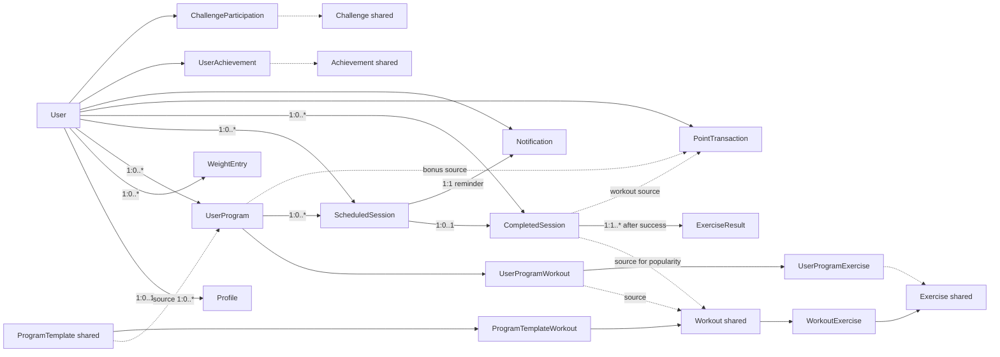
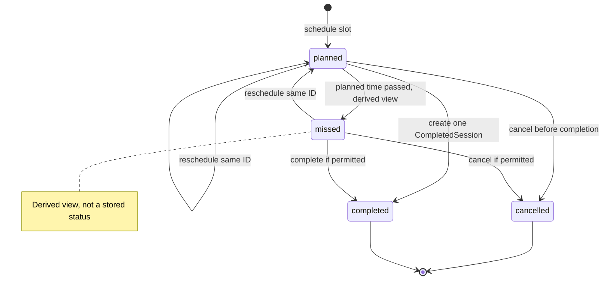

# Доменна модель фітнес-додатка, варіант 4

## 1. Призначення та межі

Це проєктна, орієнтована на реалізацію модель предметної області **до написання коду**. Вона описує відповідальності, власність, стани та інваріанти, потрібні для наступних UML Class Diagram й ERD; наведені назви не фіксують таблиці, поля Django ORM чи REST-контракт. Функціональні межі взято з [вимог](../analysis/requirements.md), конкретні правила і статуси рішень — з [бізнес-правил](../analysis/business-rules.md), обов'язкові функції варіанта 4 — з [методички](../kursova_DPZSP.pdf), §2 «Проєкт 4».

**Пріоритет джерел:** підтверджені вимоги/правила → методичка → [план](../PLAN_VARIANT_4.md) → запропоновані технічні деталі. Позначка `PROPOSED` нижче означає проєктне припущення, а не нове погоджене бізнес-правило; `OPEN` — питання для наступного етапу.

## 2. Архітектурний контекст і припущення

Погоджений стек: Django + Django REST Framework, PostgreSQL, React + TypeScript; модульний моноліт із Service Layer. `Administrator` підтримує спільні шаблони через Django Admin; початкове наповнення — management command. Час зберігається в UTC, а дати й періоди показуються в `Europe/Kyiv` (NFR-002/005). FastAPI у старому плані §5.1 — історична альтернатива, не чинний вибір; це розходження джерел уже розв'язане OQ-02.

Модель відділяє **факти** (`WeightEntry`, `CompletedSession`, `ExerciseResult`, `PointTransaction`) від **намірів** (`UserProgram`, `ScheduledSession`) і **похідних проєкцій** (прогрес, статистика, рейтинг, популярність). Для MVP не потрібні розподілений брокер подій, Celery/Redis, cron, AI/ML або версії кожного редагування програми. Три погоджені GoF-патерни — `Strategy`, `Observer`, `Template Method`; додаткові можливі лише за конкретної потреби. Рішення AR-01–AR-04, явно погоджені D-2026-10-31, уточнюють наявні переходи й сервіси без нових сутностей.

## 3. Доменні терміни

| Термін | Точне значення |
|---|---|
| Спільний каталог | Визначення, якими користуються багато User; окремий User не володіє ними. |
| `Exercise` | Визначення вправи та можливе зіставлення з довідковим MET; не факт виконання. |
| `Workout` | Спільний шаблон тренування з упорядкованими вправами й рекомендованими параметрами; початкове джерело персональної копії та одиниця звіту популярності за походженням завершень. |
| `ProgramTemplate` | Спільний шаблон програми з метою, рівнем, частотою та складом тренувань; джерело для копіювання. |
| `UserProgram` | Персональна, незалежно редагована копія обраного шаблону одного User. Посилання на оригінал означає походження, а не спільне зберігання складу. |
| `ScheduledSession` | Плановий слот у календарі; сам по собі не доводить виконання. |
| `CompletedSession` | Один зафіксований, незмінний факт виконання з історичними значеннями; може бути плановим або позаплановим. |
| `ExerciseResult` | Фактичний результат вправи всередині завершення; відрізняється від планових sets/reps/load/duration. |
| `WeightEntry` | Датований запис маси; джерело графіка та історичної ваги для kcal. |
| Activity Points | Сума незмінних `PointTransaction`; публічне місце — похідне, за згодою User. |

## 4. Піддомени та модулі

| Модуль | Відповідальність | Головні доменні об'єкти |
|---|---|---|
| Identity & Profile | Ідентичність, приватні налаштування, виміри, доступ | `User`, `Profile`, `WeightEntry` |
| Catalog | Спільні вправи, тренування, програми, архівація | `Exercise`, `Workout`, `ProgramTemplate` та їхні впорядковані входження |
| Planning | Власна копія програми, планові слоти, прогрес | `UserProgram`, персональний склад, `ScheduledSession` |
| Execution | Перевірка фактичних результатів і незмінна історія | `CompletedSession`, `ExerciseResult` |
| Engagement | Бали, досягнення, челенджі, публічний рейтинг | `PointTransaction`, `Achievement`, `UserAchievement`, `Challenge`, `ChallengeParticipation` |
| Notifications | Внутрішні нагадування про слот | `Notification` |
| Reporting | Особисті та системні SQL-підсумки | Похідні значення з фактів без окремої сутності `Statistics` |

## 5. Каталог сутностей і класифікація кандидатів

Позначення: **E** — сутність зі сталою ідентичністю; **A** — асоціативна сутність із власними атрибутами; **VO** — об'єкт-значення; **D** — похідне значення; **S** — сервіс. Зв'язки у цьому розділі конкретизовано кратностями в §7. Життєві цикли розкрито в §9. Наведені атрибути концептуальні, не вичерпний список майбутніх полів.

### Ідентичність і профіль

| Кандидат; клас | Призначення, значущі атрибути | Ідентичність, власник, зв'язки й цикл | Інваріанти; простежуваність |
|---|---|---|---|
| `User`; **E** | Обліковий запис, `registered_at`, `is_active`, публічний псевдонім і opt-in рейтингу (початково `false`). | Власний ID; корінь власності персональних даних; active → deactivated → можливе остаточне видалення. Псевдонім/згода можуть бути вкладеним VO налаштувань без окремої таблиці. | Деактивація не стирає дані; інший User не читає приватні записи; FR-001/002/005/028/036/041, BR-017/028/032. |
| `Profile`; **E** | `first_name?`, `last_name?` (приватні необов’язкові рядки), сім незмінених фітнес-полів: `date_of_birth`, `weight_kg`, `height_cm`, `gender`, `fitness_goal`, `experience_level`, `workouts_per_week`; `created_at`. | Рівно один власник User; щонайбільше один профіль на User; створюється і оновлюється власником після реєстрації; для входу Profile не потрібен. | Імена не впливають на рекомендацію, виконання, kcal, бали чи соціальні правила й не стають публічними; рейтинг і далі використовує лише `public_alias` + opt-in (BR-034). Початковий вік 19–59 за локальною датою Kyiv; після 60 років доступ зберігається. Вага 20.0–500.0 kg, зріст 100.0–250.0 cm (1 знак), частота 1–7; `age` не зберігають; FR-003/004, BR-001/013. |
| `WeightEntry`; **E** | `measured_at`, `weight_kg`, `created_at`; датована точка історії. | Власний ID, рівно один User; User має 0..* записів; запис при першому встановленні та кожній зміні профільної ваги. | Не замінювати історію поточним полем профілю; для kcal вибрати останній запис із `measured_at ≤ completed_at`; FR-004/031, BR-001/012/019. |

### Спільний каталог і персональна структура

| Кандидат; клас | Призначення, значущі атрибути | Ідентичність, власник, зв'язки й цикл | Інваріанти; простежуваність |
|---|---|---|---|
| `ExerciseCategory`; **VO, PROPOSED** | Контрольоване значення категорії (`cardio`, `strength`, `yoga`, з можливістю розширення). | Входить до `Exercise`/каталогу; не має окремої власності чи циклу в MVP. Окрема E потрібна лише для адміністрованої таксономії. | Категорія не є виконанням; FR-006, BR-002. |
| `Exercise`; **E** | Назва, опис, категорія, допустимі типи результату, опційні MET value, 5-значний activity code, версія джерела, стан каталогу. | Спільна ідентичність; входить у багато `Workout` та персональних копій; адміністративне редагування/архівація через `is_archived` як прийнятий технічний вибір MVP; архівну Exercise не пропонують для нового вибору, використану зберігають через `PROTECT`. | Відсутній MET залишається невідомим; зіставлення за конкретною активністю та інтенсивністю C2024, не за широкою категорією; FR-007/009/037, BR-003/004/013. |
| `Workout`; **E** | Назва, опис, тип/категорія, можливий MET для цілого тренування, стан каталогу. | Спільна ідентичність; має 1..* впорядкованих входжень вправ; є початковим джерелом для `UserProgramWorkout` і `CompletedSession`. | Кожне завершення, що походить від цього Workout, додає 1 до його популярності незалежно від персональних правок; архівний Workout не пропонують для нового вибору, але він лишається в історичних звітах і зберігає використану ідентичність через `PROTECT`; FR-008/033/037, BR-002/003/020/029. |
| `WorkoutExercise`; **A, PROPOSED** | Входження вправи у Workout: порядок, рекомендовані sets/reps/load/duration/distance. | Власник — `Workout`; посилання на одну спільну `Exercise`; живе разом зі складом Workout. Повторна вправа може мати різні позиції. | Планові параметри не є `ExerciseResult`; FR-008/009, BR-002/004. |
| `ProgramTemplate`; **E** | Назва, мета, рівень, занять/тиждень, стан `published/archived`. | Спільна ідентичність; 1..* входжень Workout; Administrator керує; копіювання створює окремий `UserProgram`. | Використаний шаблон архівують, не видаляють; `published` шаблон із валідним складом створюють/оновлюють атомарно через Admin inlines або management command, а невдалий склад відкочують; редагування не поширюється на копії; FR-011/013/038, BR-003/005/009. |
| `ProgramTemplateWorkout`; **A, PROPOSED** | Упорядковане входження Workout до ProgramTemplate, можлива позиція/день тижня. | Власник — `ProgramTemplate`; посилання на один спільний Workout; редагується разом із шаблоном. | Потрібне для повторного входження одного Workout і детермінованого складу; FR-011/038, BR-005. |
| `UserProgram`; **E** | Назва копії, посилання на джерело `ProgramTemplate`, життєвий `status` (`draft/active/completed`), окремий `is_archived`, `bonus_target_sessions`, підсумковий snapshot завершення. | Власний ID; рівно один User; 0..* персональних входжень і 0..* слотів; `draft → active → completed`; архівація не замінює життєвий стан (§9). | Копія незалежна; активна неархівована програма редагується, завершена закрита незалежно від архівації; проміжний прогрес не зберігається; FR-011–016, BR-005–009. |
| `UserProgramWorkout`; **A, PROPOSED щодо форми асоціації** | Персональна копія входження Workout: порядок/назва на час копіювання, обов'язкове посилання на початковий `Workout`, редаговані майбутні вправи й параметри. | Власник — `UserProgram`; рівно один початковий Workout; 0..* `ScheduledSession` можуть посилатися на це входження. | Походження не змінюється при персональному редагуванні; правки не змінюють уже завершені факти; FR-011/012/014/033, BR-005/009/020. |
| `UserProgramExercise`; **A, PROPOSED** | Персональне входження Exercise з порядком і плановими sets/reps/load/duration/distance. | Власник — `UserProgramWorkout`; посилання на `Exercise` є походженням; живе з персональним планом. | Відокремлює рекомендацію від факту `ExerciseResult`; FR-012/019, BR-005/029. |

Дві персональні асоціації запропоновано, бо редагування вправ і параметрів не можна реалізувати лише посиланням `UserProgram → ProgramTemplate`; вони не є `ProgramVersion`. Копіювання початкового складу є одноразовою операцією. Майбутні заміни впливають на персональний план, а виконане читається зі snapshots.

### План, виконання та залучення

| Кандидат; клас | Призначення, значущі атрибути | Ідентичність, власник, зв'язки й цикл | Інваріанти; простежуваність |
|---|---|---|---|
| `ScheduledSession`; **E** | `scheduled_at`, стан `planned/completed/cancelled`, історія перенесення часу (для MVP прийнято легкий `reschedule_history JSONB`). | Власний ID і рівно один User; опційно `UserProgram` і персональне входження Workout; 0..1 `CompletedSession`, рівно один reminder. | `missed` обчислюється за часом, не завершує заняття; перенесення зберігає ID; скасований слот не завершується; FR-014/017, BR-006/008/010/023–026. |
| `CompletedSession`; **E** | `completed_at`, фактична тривалість, `scheduled_session_id?`, обов'язкове посилання на початковий `Workout`, незалежний snapshot фактично виконаного тренування/ProgramTemplate/Weight/MET/kcal, причина відсутньої оцінки, `idempotency_key` для позапланового. | Власний ID і рівно один User; опційно один слот, рівно один початковий Workout; 1..* валідних фактично виконаних результатів після успішного створення; стан після створення незмінний. БД допускає 0 дочірніх рядків, а мінімум одного забезпечує сервіс. | Кожен факт додає 1 до популярності початкового Workout незалежно від персональних змін; не більше одного факту на слот; позаплановий факт має окрему ідемпотентність; FR-018/020–022/033, BR-010–013/016/020/029/030. |
| `ExerciseResult`; **E або A** | Фактична назва/ID вправи у snapshot, sets/reps/load/duration/distance, застосовні одиниці, порядковий номер. | Належить рівно одній `CompletedSession` і тому ж User через неї; створюється один раз разом із фактом. | Типова валідація перед записом; ніякого звичайного редагування; FR-019/022, BR-004/016/029/033. |
| `PointTransaction`; **E** | `points`, `point_kind`, абстрактне посилання `source`, `awarded_at`. | Власний ID, рівно один User; `source` вказує рівно на один його `CompletedSession` або `UserProgram`; після створення незмінна. | Унікальна пара `source` + `point_kind`; бонус програми максимум раз; сума транзакцій — єдиний авторитетний баланс; FR-016/028/030, BR-014/015/030. |
| `Achievement`; **E** | Код, назва, опис, умова, стан публікації. | Спільне визначення; Administrator налаштовує; 0..* `UserAchievement`. | Зміна визначення не переписує вже отримані нагороди; FR-027/039, BR-021. |
| `UserAchievement`; **A** | `unlocked_at`, опційний snapshot назви/правила **PROPOSED**. | Рівно один User і одне Achievement; виникає один раз за пару. | Унікальність `(user, achievement)`; факт нагороди зберігається; FR-027, BR-021/030. |
| `Challenge`; **E** | Назва, межі UTC, тип цілі, цільове значення, стан публікації. | Спільне визначення; Administrator налаштовує; 0..* участей. | Дані інших учасників не розкривають приватну історію; FR-029/039, BR-022. |
| `ChallengeParticipation`; **A** | `joined_at`, `completed_at?`, стан участі (`joined/completed/expired`) **PROPOSED щодо зберігання**. | Рівно один User і один Challenge; унікальна пара. | Зараховуються лише факти після вступу і в межах челенджу; завершення не подвоюється; FR-029, BR-022/030. |
| `Notification`; **E** | Тип reminder, `visible_at = scheduled_at − 1 година`, стан `pending/read/cancelled`, `read_at?`. | Власний ID і рівно один User; один reminder на `ScheduledSession`; створюється атомарно зі слотом і живе зі слотом/акаунтом. | `pending` означає непрочитане, навіть до часу видимості; `visible` та `is_current` похідні; перенесення оновлює той самий запис; факт виконання не створюється з reminder; FR-023–026, BR-023–026. |

`source` у `PointTransaction` — концептуальне посилання, а не окреме фізичне поле. В [ERD](erd.md) його реалізовано двома nullable FK: `completed_session_id` і `user_program_id`; рівно один із них заповнений. Часткові унікальні обмеження для кожного джерела й `point_kind` реалізують концептуальну однократність, а збіг власника транзакції з власником джерела перевіряє Service Layer.

`LeaderboardRow`, `Statistics`, `ProgressHistory`, `ProgramVersion`, окрема сутність `Age`, `BonusEarned` і збережений прапорець `Notification.visible` для MVP **не потрібні**. `WorkoutCompleted` — доменна подія як короткоживучий VO, а не таблиця. Токен відновлення пароля є механізмом Django auth; `PasswordResetToken`/`PasswordResetRequest` не є доменними сутностями чи таблицями. `WorkoutCompletionService` та сервіси §13 — **S**, не сутності. Персональні «друзі»/соціальні ребра не вводяться без функціонального сценарію; якщо вони з'являться, BR-032 вимагатиме видалити ребро при видаленні будь-якого учасника.

## 6. Об'єкти-значення та похідні величини

| Назва; клас | Правило й джерело |
|---|---|
| `WeightKg`, `HeightCm`, `DurationMin`, `DistanceKm`, `CaloriesKcal`; **VO** | Десяткові величини з явними одиницями й валідацією BR-001/031; `null` для невідомої оцінки не дорівнює 0. |
| `FitnessGoal`, `ExperienceLevel`, `ExerciseCategory`, `SessionStatus`, `NotificationStatus`; **VO** | Контрольовані коди. `missed` — **D**, не окремий збережений стан слота. |
| `MetReference`; **VO** | Activity code, MET value, версія C2024 і зіставлена активність/інтенсивність. Історично використані компоненти копіюються у snapshot. |
| `ProgramCompletionSnapshot`; **VO** | `completed_at`, `total_planned_at_completion`, `completed_planned_at_completion`, `progress_percent_at_completion`; частина закритого `UserProgram`, не окрема сутність. |
| `WorkoutCompleted`; **VO події** | ID факту/User/час і дані для синхронних реакцій; не джерело історії та не брокерна подія. |
| `age`, `current_progress_percent`, `bonus_earned`; **D** | Вік з DOB на локальну дату; прогрес з поточних нескасованих слотів; бонус за наявністю транзакції відповідного виду. |
| `notification.visible`, `notification.is_current`; **D** | Видимість із `visible_at ≤ now` та статусу; актуальність зі стану слота, незалежно від прочитання. |
| Особисті графіки, частота, сума kcal, популярність, середня активність, рейтинг; **D** | SQL-проєкції `CompletedSession`/`ExerciseResult`/`WeightEntry`/`PointTransaction`; популярність групує завершення за початковим `Workout` і рахує кожен факт один раз, включно з архівними шаблонами. Часові межі локального періоду переводяться в UTC `[start,end)`. |

Якщо є факт без оцінки kcal, агрегат показує неповноту або кількість таких фактів; невідома величина не перетворюється на виміряний нуль. Порожня множина завершень може мати суму 0 (BR-012/019).

## 7. Зв'язки та кратності

Кратності описують доменне володіння й посилання. `0..1` означає необов'язковий зв'язок, а не дозвіл лишити історичний snapshot порожнім.

| Зв'язок | Кратність | Зміст |
|---|---|---|
| User — Profile; User — WeightEntry | `1 ↔ 0..1`; `1 ↔ 0..*` | Профіль і виміри належать одному User. |
| Workout — WorkoutExercise — Exercise | `1 ↔ 1..* ↔ 1` | Упорядкована структура спільного тренування; одна Exercise входить у багато Workout. |
| ProgramTemplate — ProgramTemplateWorkout — Workout | `1 ↔ 1..* ↔ 1` | Упорядкована структура спільної програми. |
| User — UserProgram — ProgramTemplate | `1 ↔ 0..* → 1` | Кожна персональна програма має одного власника й походить від одного опублікованого шаблону; джерело-шаблон не володіє копією. Використаний шаблон архівують, тому зв'язок зберігається. |
| UserProgram — UserProgramWorkout — UserProgramExercise | `1 ↔ 0..* ↔ 0..*` | Редагований персональний склад; входження вправи також посилається на одну спільну Exercise. |
| Workout — UserProgramWorkout; Workout — CompletedSession | `1 ↔ 0..*`; `1 ↔ 0..*` | Кожна персональна копія і кожен завершений факт посилаються рівно на один початковий спільний Workout; ці посилання фіксують походження, не власність. |
| User — ScheduledSession — UserProgram | `1 ↔ 0..* → 0..1` | Слот може бути поза програмою; якщо в програмі, User обох збігається. Слот програми посилається на одне персональне входження Workout. |
| ScheduledSession — CompletedSession | `1 ↔ 0..1` | Факт може не мати слота; один слот не має двох фактів. |
| User — CompletedSession — ExerciseResult | `1 ↔ 0..* ↔ 1..*` після успішного завершення | Факт і щонайменше один валідний фактично виконаний результат належать тому самому User; БД сама допускає 0 дочірніх рядків. |
| User — PointTransaction; User — Notification | `1 ↔ 0..*`; `1 ↔ 0..*` | Персональні нагороди й повідомлення. Кожен створений слот має рівно одне reminder типу workout. |
| PointTransaction — `source` (`CompletedSession` або `UserProgram`) | `1 → 1`; кожне джерело → `0..1` транзакцію відповідного виду | Транзакція посилається рівно на одне джерело свого User; завершення заняття атомарно створює свою транзакцію, бонус програми є умовним. |
| User — UserAchievement — Achievement | `1 ↔ 0..* ↔ 1` | Унікальна пара власника і спільного визначення. |
| User — ChallengeParticipation — Challenge | `1 ↔ 0..* ↔ 1` | Унікальна пара власника і спільного челенджу. |



Стрілки до спільного каталогу показують використання, **не каскад власності**. Діаграма навмисно не задає фізичних FK та політик `on_delete`.

## 8. Межі власності

`User` — власник приватного графа. Прямий власник обов'язково однозначний для `Profile`, `WeightEntry`, `UserProgram`, `ScheduledSession`, `CompletedSession`, `Notification`, `PointTransaction`, `UserAchievement`, `ChallengeParticipation`; `ExerciseResult` належить User через `CompletedSession`. Персональні входження належать через `UserProgram`. Якщо слот пов'язаний з програмою, факт зі слотом або reminder зі слотом, усі відповідні `user_id` повинні збігатися. Це інваріант, який не гарантується одним FK.

`Exercise`, `Workout`, `ProgramTemplate`, `Achievement`, `Challenge` є спільними. Посилання персональної сутності на них не означає доступу Administrator до персонального запису й не означає, що видалення User може видалити каталог. Історичні посилання на каталоги потрібні для ідентичності й популярності, а значення назв/розрахунків зберігаються окремо як snapshots. Бізнес-роль Administrator бачить лише дозволені каталоги й агрегати, а деактивацію — через обмежену дію; технічний superuser не є цією роллю (BR-028).

## 9. Життєві цикли та переходи станів

### `UserProgram`

```mermaid
stateDiagram-v2
  [*] --> draft: copied from published ProgramTemplate
  draft --> active: activate with at least one planned slot; freeze bonus_target_sessions
  active --> active: edit future plan; reschedule or cancel slot
  active --> completed: E01 or S05 makes all current noncancelled slots completed; snapshot
  completed --> [*]: closed; read only
```



У `draft` користувач налаштовує копію й слоти; для активації потрібен щонайменше один слот (BR-006). Під час активації фіксують лише `bonus_target_sessions = max(3, initial_planned_sessions)` **CONFIRMED**; окремий `progress_scope` не фіксують. У `active` за `is_archived=false` дозволені правки майбутнього плану, а поточний прогрес = `100 × completed_planned / total_planned` для поточних нескасованих слотів, з `0%` при нульовому знаменнику, показ до одного знака. Скасування незавершеного слота зменшує знаменник і може виконати предикат закриття; додавання збільшує, перенесення того самого слота не змінює. Проміжні відсотки не зберігаються.

Перехід у `completed` відбувається, якщо знаменник додатний і всі поточні нескасовані слоти завершено, після E01 **або S05** (BR-007, AR-01, D-2026-10-31; критерій **CONFIRMED**). Підсумковий snapshot пишеться завжди; +50 — лише коли кількість завершених планових слотів досягла незмінного порогу, **CONFIRMED**. `100%` не створює права на бонус. Наприклад, після скасування одного з п’яти слотів і виконання решти чотирьох програма закривається з `100%`, але без +50; коротка програма з одним виконаним слотом також закривається без +50. `bonus_earned` виводиться з `PointTransaction`. Повторна програма з того самого шаблону є новим екземпляром і може отримати власний бонус; це не повний антифрод. Після закриття не можна додати слот заради бонусу.

**Узгоджене рішення для `UserProgram`:** `status ∈ {draft, active, completed}` і незалежний `is_archived` (початково `false`). Це синхронізує модель із [ERD](erd.md), §3–4: архівована завершена програма лишається `completed`, а її `completed_at`, лічильники й відсоток не переписуються. Архівація draft дозволена лише за відсутності persisted `ScheduledSession.status=planned`, включно з overdue `is_missed=true`; інакше G09 повертає `409 planned_sessions_exist` без змін (AR-04, D-2026-10-31). Скасовані слоти не блокують; їхній reminder змінює S05 за BR-025, не G09. Після успішної перевірки архівація змінює тільки `is_archived`; не видаляє `CompletedSession`/`ExerciseResult`, не змінює `PointTransaction`, не перераховує snapshot і не створює повторний бонус. `completed` закритий для будь-якого планування чи зміни результатів незалежно від прапорця.

| `status` | `is_archived=false` | `is_archived=true` |
|---|---|---|
| `draft` | Налаштовується; після ≥1 нескасованого слота може перейти в `active`. | Архівний незавершений draft без persisted `planned` слотів; лише читання. |
| `active` | Можна змінювати майбутній план; за BR-007 може перейти в `completed`. | Архівний незавершений екземпляр, лише читання; у MVP перехід до цього стану не відкритий до визначення політики майбутніх слотів і reminder. |
| `completed` | Закритий екземпляр із незмінним snapshot. | Такий самий закритий екземпляр, прихований як архівний; snapshot і бали незмінні. |

Для MVP допустимі `draft,false → active,false`, `active,false → completed,false` через E01 або S05, `draft,false → draft,true` лише без persisted `planned` слотів і `completed,false → completed,true`; повторна архівація ідемпотентна. `active,false → active,true` і повернення з архіву **не підтримуються в MVP**. Правила щодо майбутніх слотів/нагадувань і можливого відновлення — **OUT OF SCOPE / FUTURE DECISION**, не блокер MVP. `active,true` репрезентується моделлю, але не приймає нових змін або завершення без окремого погодженого правила. Поточний прогрес і критерій бонусу BR-006/007 залишаються без змін та не залежать від самого прапорця. Для спільного `ProgramTemplate` окремо підтверджені `published/archived`; використаний шаблон не видаляють фізично.

### `ScheduledSession` та виконання



`missed` — похідне від часу й відсутності факту, а не фоновий запис чи автоматичне завершення. Перенесення зберігає ID та історію зміни часу за BR-008; для MVP прийнято `reschedule_history JSONB` зі списком попередніх UTC-часів. Це легка прикладна історія, не захищений від підробки аудит. `completed` і `cancelled` не переносять; для нового наміру після скасування створюють новий слот. Позапланове завершення створює `CompletedSession` без `ScheduledSession`, але з посиланням на обраний початковий `Workout` і окремим ключем ідемпотентності; бонусу за плановий день немає (BR-010/014/020). Планове заняття без факту не збільшує статистику.

`Notification`: запис `pending` створюється в одній транзакції зі слотом із `visible_at=scheduled_at−1h`; його `visible` обчислюється з часу й статусу під час читання. Видиме `pending → read` за дією User. При перенесенні того самого слота оновлюють `visible_at` того самого запису й повертають `status=pending`, навіть якщо він був прочитаний. Якщо слот завершено/скасовано до `visible_at`, запис переходить у `cancelled`; після або в момент видимості лишається `pending/read`, але має `is_current=false`. Cron і відкладене створення запису не потрібні (BR-023–026). `ChallengeParticipation`: вступ → виконано один раз або прострочено за BR-022 **PROPOSED**. `UserAchievement` і `PointTransaction` після створення не мають звичайних переходів редагування.

## 10. Бізнес-інваріанти

1. Кожна персональна програма, слот, завершення, транзакція балів, нагорода, участь і reminder належать рівно одному User; власники пов'язаних персональних об'єктів збігаються (BR-028/032).
2. Спільні шаблони й визначення не належать User; редагувати `ProgramTemplate` може лише Administrator, а створення `UserProgram` копіює зміст, не ділить редаговані записи (BR-005/009).
3. `Workout` має хоча б одну Exercise; у програмному E01 дозволений склад походить з останнього committed `UserProgramWorkout` після lock `UserProgram`, у позапрограмному — зі shared `Workout` (AR-02, D-2026-10-31). Кожен успішний `CompletedSession` має щонайменше один валідний, реально виконаний `ExerciseResult`. Пропущені вправи не рахуються, усі планові вправи виконувати не обов’язково; нуль результатів відхиляє `WorkoutCompletionService` до запису факту й балів (BR-002/004/010/029/033).
4. Один `ScheduledSession` має не більш ніж один `CompletedSession`; для позапланового завершення ключ унікальний у межах User. Повтор із тим самим payload повертає той самий факт, з іншим — конфлікт (BR-010/030).
5. Завершений `CompletedSession`, його `ExerciseResult`, snapshots, `PointTransaction` і отримане `UserAchievement` не змінюються звичайними діями. Майбутня контрольована корекція має бути окремою операцією з аудитом, не прихованим переписуванням (BR-016/029).
6. За BR-007 активна програма закривається і після S05, якщо лишилися тільки завершені нескасовані слоти; S05 не публікує `WorkoutCompleted`. +50 за закриття конкретного `UserProgram` нараховується щонайбільше раз; прогрес 100% і право на бонус — різні поняття (BR-006/007/015).
7. MET, вага чи kcal за відсутності даних лишаються невідомими (`null` з причиною); пріоритет причин: `unsupported_age_for_reference` → `missing_weight` → `missing_met`. Оцінка за C2024 не виконується, якщо на локальну дату завершення User уже 60+ (BR-012/013).
8. Слот, missed-стан і reminder не є доказом виконання. Фактичні звіти ґрунтуються на завершеннях, історія ваги — на `WeightEntry`, рейтинг — на транзакціях балів (BR-018–020/023/029).
9. Публічний рейтинг початково вимкнений; показує лише згоду, псевдонім, бали/місце без приватних вимірів та історії. Вимкнення згоди прибирає User зі списку, не стирає бали (BR-017/028).
10. Деактивація зберігає всі дані; остаточне видалення видаляє лише персональний граф цього User і соціальні зв'язки з ним, але не спільні каталоги та приватні записи інших User (BR-032).
11. Нове завершення програмного слота дозволене лише за `UserProgram.status=active,is_archived=false`; draft/completed/archived → `409 invalid_state` без записів. Draft-слоти планувати можна, позапрограмне завершення лишається дозволеним; ідентичний повтор раніше committed факту перевіряють до нового state check (AR-03, D-2026-10-31). Початковий `Workout` у `UserProgramWorkout` не змінюється через персональні правки; кожен `CompletedSession` зберігає його посилання та окремий snapshot фактичного складу. Популярність рахує факти за початковим шаблоном, включно з архівним, а не кількість планів чи збігів вправ із початковим складом (BR-020).

**Межа DB / Service Layer.** Звичайні FK перевіряють існування батьків, `CHECK` — значення одного рядка, UQ — щонайбільше один відповідний запис. Вони не доводять міжрядкову належність або існування обов'язкового дочірнього запису, зокрема мінімум одного `ExerciseResult` у завершеного факту. Тому сервіс у локальній `transaction.atomic()` перевіряє: (1) `Notification.user = ScheduledSession.user`; (2) `PointTransaction.user = CompletedSession.user` або `UserProgram.user` відповідно до джерела; (3) `ScheduledSession.user_program_workout.user_program = ScheduledSession.user_program`; (4) для `UserProgram.status=completed` заборонено змінювати склад, слоти, поріг і completion snapshot незалежно від `is_archived` — архівація може змінити лише прапорець; (5) успішне завершення створює один обов'язковий workout `PointTransaction` разом із фактом і результатами. Відповідні UQ/`CHECK` у ERD стримують дублі та хибну форму рядка, а сервіс забезпечує ці п'ять наскрізних інваріантів (BR-028–030).

## 11. Історичні snapshots і незмінність

| Що фіксують при завершенні | Чому одного посилання недостатньо |
|---|---|
| Посилання на початковий `Workout` для популярності, його ID/назву у snapshot, незалежний snapshot фактично виконаного складу, ID/назву вихідного `ProgramTemplate` за наявності, контекст персональної програми | Початковий шаблон визначає походження, але може бути персонально змінений або архівований; історія показує виконаний склад і тогочасні назви, не поточний каталог. |
| Для кожного фактично виконаного Exercise: ID/назву, тип та фактичні sets/reps/load/duration/distance й одиниці | План і каталог змінюються; історичний результат не має перечитувати поточні рекомендації. |
| Фактичний час/тривалість, вага з останнього придатного `WeightEntry`, MET value/activity code/версія джерела, використані сегменти часу | Поточна профільна вага, MET чи алгоритм можуть змінитися; розрахунок має пояснюватися власними історичними входами. |
| Розраховані `estimated_calories` або `null` і причина (`missing_weight`, `missing_met`, `unsupported_age_for_reference`), бали через окрему `PointTransaction` | Переобчислення заднім числом порушило б історію та рейтинг. |

Підсумок закриття `UserProgram` зберігає лише фінальні лічильники/відсоток, не кожну проміжну версію. Посилання `CompletedSession → Workout` є джерелом атрибуції популярності; відображення фактичного тренування бере незалежний snapshot. Якщо Exercise/Workout архівують, їхні ID зберігаються; фізичне видалення використаного каталогу має блокуватися або замінюватися архівацією (BR-003/020/029/032). Завершена історія діє, поки існує акаунт; остаточне видалення User є підтвердженим винятком.

## 12. Межі агрегатів

Це межі узгодженого редагування, а не вимога окремих репозиторіїв чи DDD-фреймворку.

| Агрегат / корінь | Що контролює | Компроміс |
|---|---|---|
| `User` / `Profile` | Профіль, обов'язкове створення `WeightEntry` при зміні ваги. | Виміри мають власну ідентичність і історію; сервіс зберігає їх атомарно з поточною вагою. |
| `ProgramTemplate`, `Workout`, `Exercise` | Кожен спільний об'єкт і його входження; публікація/архівація. | Каталог посилається між агрегатами; копіювання в персональну програму не передає право власності. |
| `UserProgram` | Редагований персональний склад, слотів програми, `bonus_target_sessions`, закриття й snapshot. | Один lock на корені серіалізує мутації слотів і конкурентне завершення; позапланові слоти можуть існувати окремо. |
| `CompletedSession` | Незмінний факт і всі його `ExerciseResult`/snapshots. | Створюється під координацією сервісу разом із балами та зміною слота; після commit окремо читається. |
| `ChallengeParticipation`, `UserAchievement`, `PointTransaction`, `Notification` | Кожен має свою однократність або стан прочитання. | Міжагрегатна узгодженість забезпечується однією локальною транзакцією, не прихованими side effects. |

`ScheduledSession` у програмі контролює `UserProgram`; позаплановий слот є власним агрегатом плану. Це **PROPOSED** компроміс, бо всі слоти як дочірні записи одного агрегату можуть спричинити зайве блокування, проте BR-030 вимагає lock програми для будь-якої зміни її слотів. `Notification` не входить у історичний агрегат і не створює фактів виконання.

## 13. Прикладні та доменні сервіси

| Сервіс | Роль і межа |
|---|---|
| `ProfileService` | Створює Profile із необов’язковими іменами, дозволяє окремо змінювати їх, зберігає валідацію семи фітнес-полів; синхронно оновлює `weight_kg` і створює `WeightEntry` лише при фактичній зміні ваги; визначає вік на локальну дату. |
| `PasswordResetService` у `accounts` (тонкий прикладний координатор, **PROPOSED**) | A07/A08: нормалізує email, надсилає лист придатному User, перевіряє стандартний Django reset token і змінює пароль через Django validators/hasher без автоматичного входу; власної криптографії, доменної сутності чи таблиці немає (BR-035). |
| `ProgramSelectionService` | Застосовує `SelectionStrategy`, знаходить опублікований шаблон і створює незалежну копію з плановим складом; якщо кандидата немає, повертає явне повідомлення. |
| `ProgramPlanningService` | Активація, G06-редагування персонального складу, створення/перенесення/скасування слотів, G09-архівація; бере lock програми перед змінами, перевіряє відсутність `planned` слотів для draft G09 та після S05 викликає спільну оцінку завершення BR-007. |
| `WorkoutCompletionService` | Для нового програмного E01 після lock вимагає `active,false`, читає останній committed персональний склад; для позапрограмного — shared склад. До збереження відхиляє нуль валідних фактично виконаних результатів і координує перевірку власності/ідемпотентності, lock, `ExerciseResultProcessor`, перенесення посилання на початковий `Workout` у факт, незалежні історичні snapshots, `CaloriesEstimator`, запис факту/балів, синхронних Observer, стан слота й програми. |
| `CaloriesEstimator` | Доменний розрахунок з історичної ваги, зіставленого MET і фактичного часу; за неможливості оцінки повертає `null` і першу застосовну причину в порядку `unsupported_age_for_reference` → `missing_weight` → `missing_met`, без вигаданого нуля. |
| `PointsPolicy` | Обчислює транзакції за BR-014/015, не підтримує окремий баланс. Формула звичайних балів — **PROPOSED**. |
| `AchievementEvaluator`, `ChallengeProgressEvaluator` | Визначають нові нагороди й поріг челенджу з committed/поточних фактів; синхронні обов'язкові реакції Observer у транзакції завершення. |
| `ReminderService` | У тій самій транзакції зі слотом створює один reminder з `visible_at=scheduled_at−1h`, оновлює його при перенесенні, застосовує BR-025 при завершенні/скасуванні та обчислює `visible`/`is_current` для читання; інформаційні повідомлення після завершення — окрема необов’язкова реакція. |
| `StatisticsQueryService`, `LeaderboardQueryService`, `ReportQueryService` | SQL-проєкції з фактів/балів із локальними періодами, без транзакційного оновлення агрегатів. |
| `AccountDeactivationService`; `AccountDeletionService` **future** | Обмежена авторизована деактивація; майбутнє атомарне повне видалення персонального графа. |

## 14. GoF-патерни та учасники

| Патерн і шар | Проблема, учасники та взаємодія | Перевірювана користь / SOLID |
|---|---|---|
| `Strategy`; доменний алгоритм, виклик із application layer | `ProgramSelectionService` — context, `SelectionStrategy` — інтерфейс, `WeightLossSelectionStrategy`, `MuscleGainSelectionStrategy`, `MaintenanceSelectionStrategy` — конкретні алгоритми. Спільний фільтр вимагає точного goal+level, потім мінімізує різницю workouts/week, потім бере меншу частоту; лише після цього стратегія порівнює склад, далі ID. Weight loss максимізує cardio, muscle gain — strength, maintenance мінімізує розмах часток cardio/strength/yoga. | Три конкретні критерії реально відрізняються; попарні шаблони з однаковими goal/level/frequency і різним складом демонструють це. Нову ціль/правило додають окремим класом, без умовних гілок у сервісі. FR-011, BR-005/§10. |
| `Observer`; application layer | `WorkoutCompletionService` публікує локальну `WorkoutCompleted` через явний dispatcher. Обов'язкові `AchievementHandler` і, якщо зберігається стан, `ChallengeHandler` працюють **синхронно всередині транзакції**. Інформаційний `NotificationHandler` запускається після commit. Основний факт, результати, бали й програмний бонус записує сервіс без прихованого обробника. | Реакції мають окремі відповідальності; обов'язковий збій відкочує весь сценарій, необов'язковий ні. Dispatcher не є брокером/таблицею; Django Signals самі по собі не становлять демонстрацію патерна. FR-018/027/029, BR-030. |
| `Template Method`; domain layer | `ExerciseResultProcessor.process()` задає спільний алгоритм; деталізація кроків **PROPOSED** за BR-033: належність вправи до заняття → спільна валідація → типова перевірка → нормалізація до kg/km/min і цілих sets/reps → валідований результат. `StrengthResultProcessor`, `CardioResultProcessor`, `YogaResultProcessor` перевизначають лише типоспецифічний крок; фактичний запис робить completion service. | Один спільний алгоритм не дублюється; новий тип вправ розширює підклас, не змінюючи процес чи історичну сутність. FR-019, BR-004/033. |

S05-закриття програми не є завершенням заняття й **не** публікує `WorkoutCompleted`; ця подія виникає лише після фактичного E01. `ProgramPlanningService` і `WorkoutCompletionService` використовують одну вузьку оцінку предиката BR-007 та бонусу без дублювання правил; її точна назва в Python не визначена і вона не є новою сутністю.

Три погоджені патерни мають бути видимі на майбутній UML Class Diagram та в коді: `Strategy`, `Observer`, `Template Method` (NFR-007). Додатковий патерн доречний лише тоді, коли він розв'язує конкретну задачу й буде показаний у UML та коді. Для поточної моделі `Factory Method` не потрібен лише заради вибору одного з трьох процесорів, а `Builder` не має вимагати повної програми до збереження, бо `UserProgram` підтримує `draft`. `Strategy` для MET не потрібна: різні значення MET не утворюють різних алгоритмів. Ефект `Observer` на статистику/рейтинг — наступне читання committed фактів, а не окремий запис.

## 15. Транзакції та конкурентність

| Операція | Атомарні записи й захист | Після commit / похідне |
|---|---|---|
| Зміна профільної ваги | `Profile.weight_kg` та новий `WeightEntry` в одній транзакції (BR-001). | Графік читає записи ваги. |
| Створення/перенесення/скасування слота | Слот і його один reminder в одній транзакції; для програмного S05 після lock `UserProgram` → `ScheduledSession` оцінити BR-007 та атомарно записати completion snapshot і, за порогом, один +50 `PointTransaction` (AR-01). | Видимість reminder обчислюють під час читання. |
| Архівація draft | Після lock `UserProgram` відхилити G09 за наявності persisted `planned` слотів, включно з missed; 409 не змінює програму, слоти чи reminders. За відсутності таких слотів атомарно змінити лише `is_archived` (AR-04). | Видимість раніше скасованих reminders визначає BR-025. |
| Завершення заняття | `transaction.atomic()` охоплює `CompletedSession`, усі `ExerciseResult`/snapshots, основні `PointTransaction`, стан слота, `UserAchievement`, збережений стан Challenge (якщо є), закриття `UserProgram`/snapshot і бонусну транзакцію (BR-030). | Статистика, рейтинг, графіки й популярність — SQL із committed фактів; необов'язкова інформація — після commit. |
| Остаточне видалення **future** | Окрема авторизована атомарна операція повного персонального каскаду (BR-032). | Звіти/рейтинг перераховуються з наявних записів. |

Перед створенням будь-якого факту сервіс вимагає щонайменше один валідний фактично виконаний результат; інакше не записує факт, результати або бали. Для планового завершення унікальний `scheduled_session_id` гарантує щонайбільше один факт. Для позапланового — унікальний `(user, idempotency_key)`; однаковий ключ з іншим payload — конфлікт. Для програмного слота сервіс **до створення факту і читання прогресу** блокує `UserProgram` через `select_for_update()`, після lock перечитує `status`, `is_archived`, лічильники й останній committed персональний склад, а новий E01 допускає лише для `active,false`. Ідентичний retry раніше committed факту обробляє за ключем/відбитком до повторної бізнес-перевірки стану. G06 та всі мутації слотів/порогу/архівації беруть той самий lock; порядок для програмних операцій `UserProgram` → `ScheduledSession` → залежні записи. Закритий або архівний екземпляр не приймає нового E01 чи змін плану. Це серіалізує конкурентні завершення двох різних слотів однієї програми; унікальна транзакція бонусу є другим захистом. Помилка будь-якого обов'язкового кроку, зокрема створення workout `PointTransaction`, відкочує все. Завершення без kcal допускається за BR-012 **PROPOSED**, якщо фактичні дані валідні. Необов'язковий callback після commit не може змінити результат транзакції.

```mermaid
sequenceDiagram
  actor User
  participant W as WorkoutCompletionService
  participant P as UserProgram / ScheduledSession
  participant V as ExerciseResultProcessor
  participant H as Persistence: facts, points, awards
  participant O as Required Observers
  participant Q as SQL reports
  User->>W: Complete slot or unscheduled workout
  W->>W: Begin atomic; check owner and committed idempotency retry
  W->>P: For new fact lock UserProgram, then slot; reread state
  W->>P: Read latest personal composition after lock if linked
  W->>V: Validate membership and normalize actual results
  V-->>W: Validated results
  W->>H: Persist fact, results, snapshots, core points
  W->>P: Mark slot; shared completion evaluation and conditional bonus
  W->>O: Publish WorkoutCompleted synchronously
  O->>H: Persist achievement / required challenge state
  W-->>User: Commit and return one result
  W-->>O: Optional information after commit
  Q->>H: Read committed facts and points when queried
```

Для позапрограмного виконання крок із lock програми пропускається, а склад вправ береться зі shared `Workout`; повтор уже створеного факту повертається без повторного dispatch. Порядок внутрішніх записів у межах атомарної операції може змінитися під час реалізації, якщо інваріанти BR-030 збережено.

**D-2026-10-31 / AR-01–AR-04:** S05 та E01 викликають ту саму оцінку закриття в межах транзакції свого use case; при S05 немає фальшивого `WorkoutCompleted`. G06/E01 серіалізуються program lock і перевіряють персональний склад після lock. G09/S02/S04/S05 серіалізуються тим самим lock, тому архівний draft не одержує нового `planned` слота. Сервісні правила, а не `CHECK` одного рядка, гарантують ці міжрядкові інваріанти.

## 16. Деактивація та каскадне видалення

| Операція | Ефект | Часова межа |
|---|---|---|
| Деактивація | `User.is_active=False`; припинити вхід/подальший доступ; профіль, виміри, програми, факти, бали й участі залишаються. Деактивований User враховується у `TotalUsers` за BR-018. | **MVP**, FR-036, BR-032. |
| Остаточне видалення | Авторизовано й атомарно видалити User та весь його персональний граф, зокрема результати вправ і соціальні ребра; спільні каталоги, визначення, записи інших User не змінюються. Рейтинг і історичні SQL-звіти можуть змінитися після перерахунку. | **Після MVP**, FR-041, BR-032. |

Концептуальна власність означає каскад **від User до персональних записів**, а `ExerciseResult` — від `CompletedSession`. Посилання персональних записів на `ProgramTemplate`, `Workout`, `Exercise`, `Achievement`, `Challenge` — лише використання; видалення власника не має поширитися до цих спільних сутностей. [ERD](erd.md), §5 визначає відповідні `CASCADE` Django ORM для власності та `PROTECT` для використаного спільного каталогу. Між персональними сутностями `PROTECT` або `SET_NULL` допустимі лише з перевіреним шляхом повного очищення: `PROTECT` може блокувати `User.delete()`, а `SET_NULL` не видаляє залежний запис сам. Точні FK/`on_delete` визначено в ERD, а їхню фактичну поведінку треба перевірити на PostgreSQL під час реалізації. Незмінність одиничного завершення у звичайних операціях не суперечить винятку повного видалення акаунта.

## 17. Простежуваність FR / BR / UC

| Сценарій | Елементи моделі | Правила |
|---|---|---|
| Реєстрація, профіль, вага; UC-001/002 | `User`, `Profile`, `WeightEntry`, `ProfileService` | FR-001–005/031/042; BR-001/012/019/028/034/035 |
| Каталог і адміністрування; UC-003/014/017 | `Exercise`, `Workout`, `ProgramTemplate` та входження | FR-006–010/037/038; BR-002–005/009 |
| Добір, персоналізація, план; UC-004/005/009 | `ProgramSelectionService`, `UserProgram`, персональний склад, `ScheduledSession` | FR-011–017/031/032; BR-005–009/015/030 |
| Завершення й історія; UC-006/007/008 | `WorkoutCompletionService`, `CompletedSession`, `ExerciseResult`, `WeightEntry`, `CaloriesEstimator` | FR-018–022/030/032; BR-010–016/019/029/030/033 |
| Нагадування; UC-010 | `ScheduledSession`, `Notification`, `ReminderService` | FR-023–026; BR-023–026 |
| Досягнення, рейтинг, челенджі; UC-011–013 | `PointTransaction`, `Achievement`, `UserAchievement`, `Challenge`, `ChallengeParticipation` | FR-027–030/035/039; BR-014/015/017/021/022/030 |
| Графік і три звіти; UC-009/015 | `WeightEntry`, `CompletedSession`, SQL query services | FR-031–035/040; BR-018–020/027/029 |
| Деактивація й видалення; UC-018/019 | `User` як корінь власності, приватний граф, shared references | FR-036/041; BR-018/028/032 |
| Архітектурні патерни | Три учасницькі групи §14 | NFR-007; BR-005/030/033 |

ID сценаріїв наведені за `requirements.md`, §6; вони служать для звірки майбутніх UML/тестів, не означають наявності реалізації.

## 18. Підтверджені рішення, технічні ризики та майбутні питання

| Статус | Питання для реалізації | Чому важливо |
|---|---|---|
| **CONFIRMED** | BR-006/007: `bonus_target_sessions=max(3, initial_planned_sessions)`, завершення лише при ненульовому виконаному плані, +50 за досягнення замороженого порогу. | Приклади 1/1 без бонусу, 3/3 і 5/5 з бонусом, 4/4 після скасування одного з п’яти без бонусу; нульовий план не закривається. |
| **OUT OF SCOPE / FUTURE DECISION** | Архівація `active` програми та відновлення архівної програми. | Обидві дії не підтримуються в MVP; майбутня політика слотів і нагадувань не блокує поточну реалізацію. |
| **ACCEPTED TECHNICAL CHOICE** | Фізичну форму впорядкованих входжень `WorkoutExercise`, `ProgramTemplateWorkout`, `UserProgramWorkout`, `UserProgramExercise` визначено в ERD; `reschedule_history JSONB` прийнято для MVP. | Входження забезпечують незалежне редагування, порядок і повторення Workout/Exercise без `ProgramVersion`; реалізація має відповідати визначеним у ERD зв'язкам. |
| **OUT OF SCOPE / FUTURE DECISION** | Чи потрібен окремий адміністрований `ExerciseCategory`. | Для MVP категорія є розширюваним кодом без окремої таблиці; CRUD категорій не визначено. Атрибуцію зміненого персонального тренування до початкового Workout вирішено BR-020. |
| **PROPOSED** | Зберігати `ChallengeParticipation.completed_at/status` чи повністю виводити з фактів; snapshot назви/умови `Achievement` при розблокуванні. | BR-022 говорить про одноразову фіксацію, BR-021 — про незмінність уже отриманого; потрібна одна авторитетна форма, особливо після правок спільного визначення. |
| **OUT OF SCOPE / FUTURE DECISION** | Точні правила адміністративної корекції історії, політика фізичного видалення невикористаних `Workout`/`Exercise`, резервні копії й журнали при видаленні User. | Поза MVP; не можна допустити непомітне переписування фактів або неповне очищення персональних даних. |
| **PROPOSED / перевірити** | Політики FK та унікальні обмеження для ідемпотентності, бонусу, reminder, UserAchievement/ChallengeParticipation; блокування програми і повний каскад у PostgreSQL. | Концептуальна модель не доводить фактичної поведінки конкурентних транзакцій чи `User.delete()`; потрібні інтеграційні перевірки на наступному етапі. |

**Конфлікт джерел, уже вирішений:** старий план §5.1 називає FastAPI й §4.3 описує лише два обрані патерни; підтверджені NFR-002/007 та BR-030/033 задають Django/DRF і мінімум три патерни. Редагувати старий план у межах цього документа не потрібно. Інших несумісних **підтверджених** вимог, які блокують цю концептуальну модель, не виявлено.
