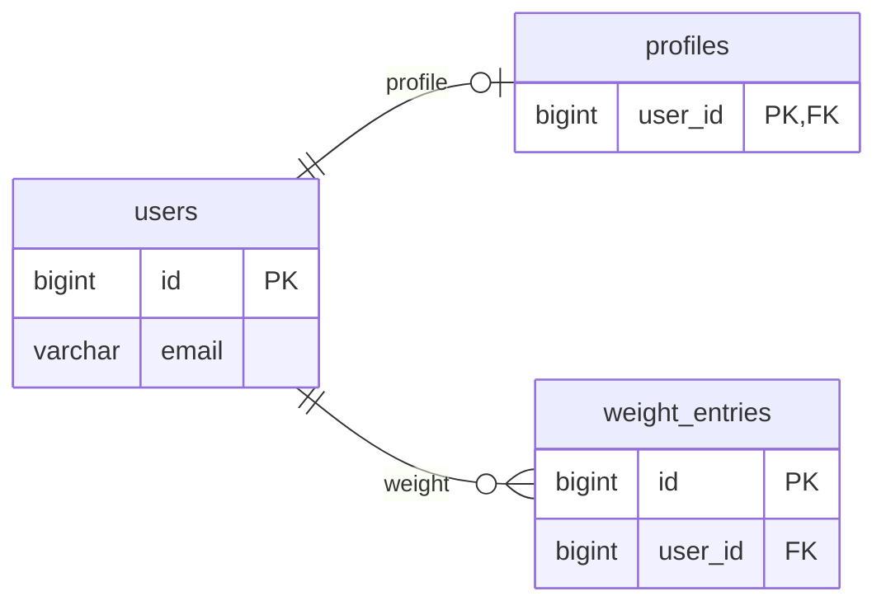
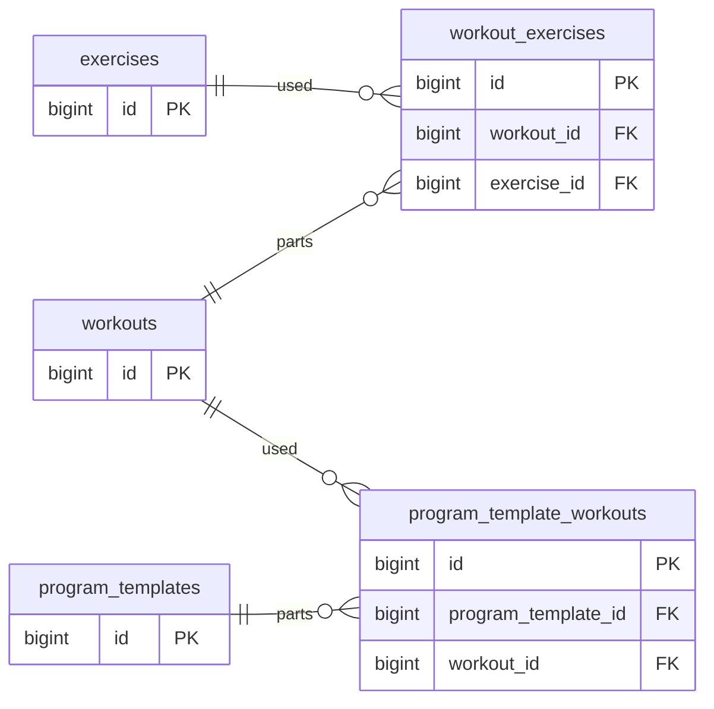
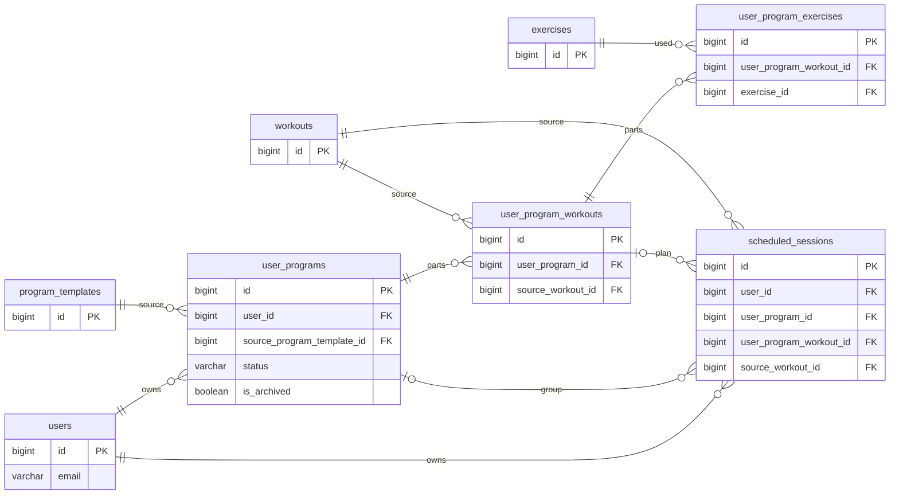
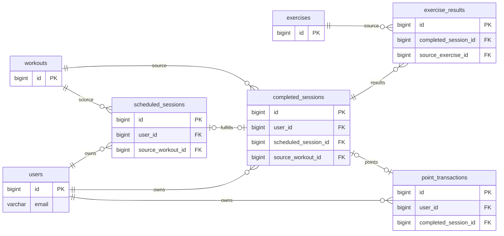
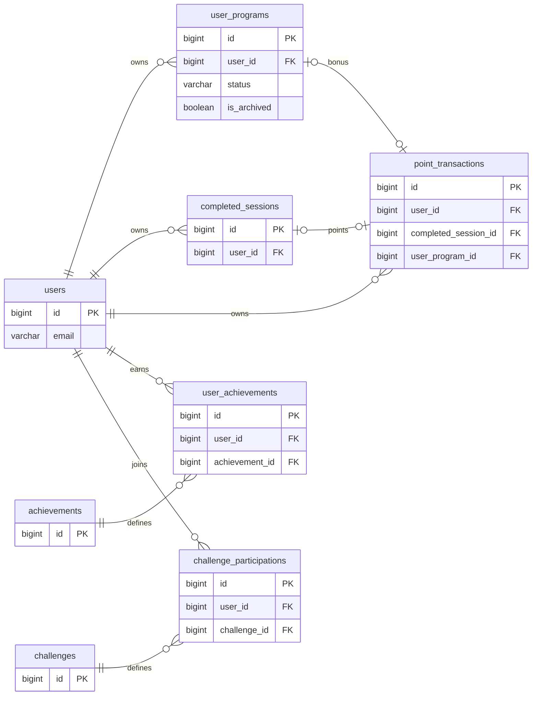
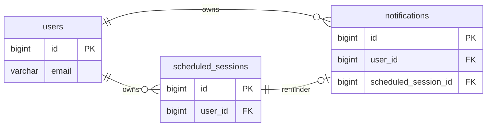
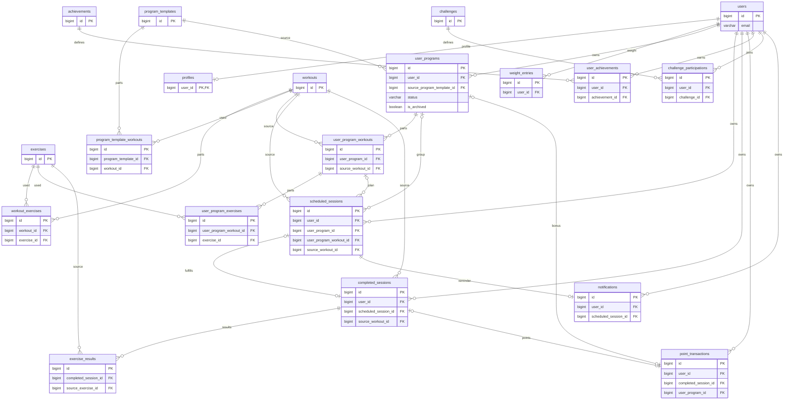

# PostgreSQL ERD — фітнес-додаток, варіант 4

## 1. Статус, джерела й принципи

Це **PROPOSED** фізична схема для Django ORM + PostgreSQL, а не реалізовані моделі чи міграції. Прочитано повністю `docs/analysis/requirements.md`, `docs/analysis/business-rules.md`, `docs/architecture/domain-model.md`, `docs/PLAN_VARIANT_4.md` і `docs/kursova_DPZSP.pdf` (§1, §2 «Проєкт 4», §3 та додатки). Пріоритет: підтверджені рішення вимог/BR → методичка → план → технічний вибір цього ERD. Позначки **CONFIRMED**, **PROPOSED**, **OPEN**, **CONFLICT** мають те саме значення, що в джерелах. Історичний FastAPI у плані вже розв'язано OQ-02 на користь Django + DRF; це не новий конфлікт.

**CONFIRMED:** спільний каталог не належить User; `UserProgram` — незалежна персональна копія; кожне завершення має початковий спільний `Workout`; історія незмінна до остаточного видалення акаунта; поточний прогрес рахується з поточних нескасованих слотів; reminder створюється разом зі слотом без фонових задач. **PROPOSED:** точні фізичні поля, індекси й більшість `CHECK` нижче. BR-006/007, заморожений поріг бонусу, критерій закриття, мінімум одного фактичного `ExerciseResult` та пріоритет причин відсутніх kcal підтверджені рішенням D-2026-10-28; схема зберігає різницю між бізнес-інваріантами й обмеженнями БД. D-2026-10-31 підтверджує AR-01–AR-04; для них не потрібні нові таблиці, FK, індекси чи зміна складу 20 сутностей.

20 прикладних таблиць. Усі PK, якщо не сказано інакше, `bigint GENERATED BY DEFAULT AS IDENTITY` / Django `BigAutoField`, `NOT NULL`; FK теж `bigint` / `ForeignKey` або `OneToOneField`. Час подій — `timestamptz` / `DateTimeField` у UTC; межі звітних періодів будують з `Europe/Kyiv` як `[start,end)` і переводять у UTC. Інші відповідники: `date` / `DateField`; `numeric(p,s)` / `DecimalField(max_digits=p, decimal_places=s)`; `smallint` / `PositiveSmallIntegerField`; `integer` / `PositiveIntegerField` для невід'ємних лічильників/балів або `IntegerField` для загального цілого; `varchar(n)` і `char(n)` / `CharField(max_length=n)`; `text` / `TextField`; `boolean` / `BooleanField`; `jsonb` / `JSONField`. Для додатних типів PostgreSQL `CHECK` обов'язковий: ORM-клас не замінює DB constraint. У таблицях нижче `NN` = `NOT NULL`, `N` = nullable; `—` = немає DB default. Не зазначений default означає явне значення від сервісу без DB default. Кожен `choices` дублюється DB `CHECK`, бо Django `TextChoices` сам по собі не обмежує SQL-запис. Звичайні PK/FK-індекси не перелічено як окремі індекси повторно.

`ExerciseCategory` — `TextChoices`/код у `Exercise` і `Workout`, а не таблиця: немає підтвердженого CRUD таксономії. `MetReference`, `ProgramCompletionSnapshot` — value objects у колонках; `WorkoutCompleted` — короткоживуча подія; прогрес, рейтинг, популярність і статистика — SQL-проєкції, без таблиць/другого балансу. Django `auth_group`, permissions, sessions та M2M авторизації — інфраструктурні таблиці Django, поза 20 доменними таблицями; `User` нижче — кастомний `AUTH_USER_MODEL`, а модельні права/групи залишаються стандартними Django.

## 2. Entity-to-table mapping

| Модуль | Entity → таблиця | Чому таблиця |
|---|---|---|
| Identity | User → `users`; Profile → `profiles`; WeightEntry → `weight_entries` | Ідентичність, приватний стан, датована історія ваги. |
| Shared catalog | Exercise → `exercises`; Workout → `workouts`; WorkoutExercise → `workout_exercises`; ProgramTemplate → `program_templates`; ProgramTemplateWorkout → `program_template_workouts` | Незалежні спільні визначення та впорядковані входження з параметрами. |
| Personal planning | UserProgram → `user_programs`; UserProgramWorkout → `user_program_workouts`; UserProgramExercise → `user_program_exercises`; ScheduledSession → `scheduled_sessions` | Копія, редагований склад та окремі календарні слоти. |
| Execution | CompletedSession → `completed_sessions`; ExerciseResult → `exercise_results` | Факт і його фактично виконані вправи. |
| Engagement | PointTransaction → `point_transactions`; Achievement → `achievements`; UserAchievement → `user_achievements`; Challenge → `challenges`; ChallengeParticipation → `challenge_participations` | Нарахування та одноразові зв'язки зі спільними визначеннями. |
| Reminder | Notification → `notifications` | Один збережений внутрішній reminder на слот. |

## 3. Детальна реляційна схема

Формат: `колонка: SQL / Django; null; default`. `created_at` / `DateTimeField(default=timezone.now)` задається застосунком, а не `DEFAULT now()` у БД, якщо прямо не зазначено. У кожної таблиці PK `id`, окрім `profiles`, де `user_id` є одночасно PK і FK. Позначка `FK` у переліку колонок посилається на матрицю §5 з `on_delete`.

### 3.1 Identity

**`users`** — обліковий запис і налаштування публічного рейтингу. `id` PK; `email varchar(254)` / `EmailField`, NN, —; `password varchar(128)` / Django password hash, NN, —; `last_login timestamptz` / `DateTimeField`, N (успадковане `AbstractBaseUser`); `registered_at timestamptz` / `DateTimeField`, NN, `timezone.now`; `is_active boolean` / `BooleanField`, NN, `true`; `is_staff boolean`, NN, `false`; `is_superuser boolean`, NN, `false`; `public_alias varchar(80)` / `CharField`, N, —; `leaderboard_opt_in boolean` / `BooleanField`, NN, `false`. UQ: `UniqueConstraint(Lower('email'))` для case-insensitive login; сервіс нормалізує адресу перед записом, окремий UQ `email` не потрібен. `CHECK`: opt-in вимагає непорожній alias (`leaderboard_opt_in=false OR nullif(btrim(public_alias),'') IS NOT NULL`). Індекс рейтингового opt-in — частковий `(id) WHERE leaderboard_opt_in=true` лише якщо план запиту показує користь; PK зазвичай достатній. FR-001/002/028/035/036/041; BR-017/028/032. Django auth-групи/права — стандартні M2M, без `role` дубліката.

**`profiles`** — рівно один поточний профіль на User. `user_id bigint` / `OneToOneField(primary_key=True)`, NN, FK; `date_of_birth date` / `DateField`, NN; `weight_kg numeric(4,1)` / `DecimalField(4,1)`, NN; `height_cm numeric(4,1)` / `DecimalField(4,1)`, NN; `gender varchar(20)`, NN; `fitness_goal varchar(20)`, NN; `experience_level varchar(20)`, NN; `workouts_per_week smallint`, NN; `created_at timestamptz`, NN, `timezone.now`. UQ: PK `user_id`. `CHECK`: weight `20.0..500.0`, height `100.0..250.0`, frequency `1..7`, enum sets BR-001. Вік 19–59 на **локальну дату першого `created_at`** та виправлення DOB — Service Layer, бо DB `CHECK` не може коректно обчислити часовий пояс і змінний вік. Поточна вага синхронізується із новим `WeightEntry` в одній транзакції. FR-003/004; BR-001/012/013.

**`weight_entries`** — історичний вимір. `id` PK; `user_id bigint` / `ForeignKey`, NN, FK; `measured_at timestamptz` / `DateTimeField`, NN; `weight_kg numeric(4,1)`, NN; `created_at timestamptz`, NN, `timezone.now`. `CHECK`: weight `20.0..500.0`. UQ немає: кілька вимірів навіть за одну секунду можливі, стабільний порядок `(measured_at,id)`. Індекс `(user_id,measured_at DESC,id DESC)` для графіка й вибору останньої ваги `<= completed_at`. FR-004/021/031; BR-001/012/019.

### 3.2 Shared catalog

**`exercises`** — спільне визначення. `id` PK; `name varchar(160)` NN; `description text` NN, `''`; `category varchar(24)` NN (`cardio|strength|yoga` у MVP); `met_value numeric(5,2)` N; `met_activity_code varchar(5)` N; `met_reference_version varchar(40)` N; `met_activity_description text` N; `is_archived boolean` NN, `false`. `CHECK`: категорія в підтримуваному наборі; MET `>0` або NULL; код рівно п'ять цифр (`~ '^[0-9]{5}$'`) або NULL; `met_value`, code, version, description або всі NULL, або всі NN (конкретний C2024 mapping). UQ немає для назви: різні інтенсивності можуть мати однакову назву. Індекс `(is_archived,category,name)` для каталогу. Фізичне видалення використаної Exercise блокує `PROTECT`; архівну Exercise не пропонують для нового вибору, але архівація не змінює копій/фактів. FR-006/007/009/037; BR-002–004/013.

**`workouts`** — спільний початковий Workout для кожного завершення. `id` PK; `name varchar(160)` NN; `description text` NN, `''`; `category varchar(24)` NN; `met_value numeric(5,2)` N; `met_activity_code varchar(5)` N; `met_reference_version varchar(40)` N; `met_activity_description text` N; `is_archived boolean` NN, `false`. `CHECK` категорії та MET-пакета як для `exercises`. Індекс `(is_archived,category,name)` для бібліотеки. Використаний Workout архівують, не пропонують для нового вибору й зберігають через `PROTECT`; `source_workout_id` у персональному входженні й факті незмінний. FR-008/033/037; BR-002/003/011/013/020/029.

**`workout_exercises`** — упорядковане входження; та сама Exercise може повторюватися. `id` PK; `workout_id bigint` NN FK; `exercise_id bigint` NN FK; `position smallint` NN; `recommended_sets smallint` N; `recommended_reps smallint` N; `recommended_load_kg numeric(6,1)` N; `recommended_duration_min numeric(7,2)` N; `recommended_distance_km numeric(8,3)` N. UQ `(workout_id,position)`. `CHECK`: position >0; ненульові sets/reps/duration/distance >0, load ≥0. Типова комбінація BR-004 перевіряється сервісом із `Exercise.category`, бо SQL `CHECK` не читає іншу таблицю. UQ `(workout_id,exercise_id)` **немає** через повторні входження. FR-008/009; BR-002/004.

**`program_templates`** — спільне визначення програми. `id` PK; `name varchar(160)` NN; `description text` NN, `''`; `fitness_goal varchar(20)` NN; `experience_level varchar(20)` NN; `workouts_per_week smallint` NN; `status varchar(12)` NN, `'published'` або `'archived'`. `CHECK` enum goal/level/status, frequency 1..7. Індекс `(fitness_goal,experience_level,workouts_per_week,id) WHERE status='published'` для BR-005; не вимагати UQ для трійки, бо парні шаблони з однаковими параметрами потрібні для Strategy. **Обрано варіант B:** початкове створення разом з Django Admin inlines/management command відбувається в одній транзакції; перед commit валідовувати збережений склад (≥1 Workout, ≥1 Exercise), а за помилки відкотити батька й inlines. Та сама перевірка застосовується до кожного оновлення `published` шаблону, щоб видалення останнього входження не лишило порожній опублікований рядок. Рекомендації читають лише committed `status='published'`, тому проміжний стан батьківського INSERT не видимий іншим транзакціям. Валідація між таблицями належить Service Layer/Admin, не SQL `CHECK`. Це зберігає підтверджений `published|archived` життєвий цикл BR-003 без нового `draft`; прямий запис, що обходить сервіс, не входить до підтриманого контракту. Атомарність parent+inlines, rollback при помилці та невидимість невалідного опублікованого шаблону перевірити інтеграційно на PostgreSQL. FR-011/013/038; BR-003/005/009.

**`program_template_workouts`** — упорядкований склад шаблону. `id` PK; `program_template_id bigint` NN FK; `workout_id bigint` NN FK; `position smallint` NN; `suggested_weekday smallint` N (`1..7`). UQ `(program_template_id,position)`; `CHECK` position >0, weekday NULL або 1..7. Повторний Workout дозволений на іншій позиції. FK `program_template_id` і UQ вже підтримують впорядковане читання, окремий індекс не потрібен. FR-011/038; BR-005.

### 3.3 Personal copy and schedule

**`user_programs`** — персональний незалежний екземпляр. `id` PK; `user_id bigint` NN FK; `source_program_template_id bigint` NN FK; `source_program_template_name_snapshot varchar(160)` NN (назва при копіюванні); `name varchar(160)` NN; `description text` NN, `''`; `fitness_goal varchar(20)` NN; `status varchar(12)` NN, `'draft'` (`draft|active|completed`); `is_archived boolean` NN, `false`; `bonus_target_sessions integer` N; `activated_at timestamptz` N; `completed_at timestamptz` N; `total_planned_at_completion integer` N; `completed_planned_at_completion integer` N; `progress_percent_at_completion numeric(5,1)` N. **Узгоджено з Domain Model §9:** `is_archived` відділяє видимість/припинення використання від життєвого стану. `CHECK`: status у трьох значеннях; `(status='draft') = (activated_at IS NULL)`; `(activated_at IS NULL AND bonus_target_sessions IS NULL) OR (activated_at IS NOT NULL AND bonus_target_sessions>=3)`; усі чотири поля completion snapshot або NULL разом, або NN разом; `(status='completed') = (completed_at IS NOT NULL)`; при `completed` total >0, completed = total, percent = 100.0. Ці `CHECK` порівнюють тільки колонки одного рядка і сумісні з PostgreSQL/Django `CheckConstraint`; незмінність snapshot/порогу після запису контролює сервіс. При архівації `completed` змінюється тільки `is_archived`, `status` і snapshot лишаються незмінними. `bonus_target_sessions` записати один раз при активації як `max(3, count(non-cancelled slots))`. Індекс `(user_id,is_archived,status,id)` для списку; поточний прогрес — запит до `scheduled_sessions`, не поле тут. Попередню суперечність з `archived` як статусом усунуто синхронізацією Domain Model §9; архівація активного екземпляра й відновлення архівного не підтримуються в MVP (§4/§10). FR-011–016/038; BR-005–009/015/030.

`source_program_template_name_snapshot` копіюється при створенні `UserProgram` і після цього не редагується; завершення читає саме цю збережену назву, а не поточний `ProgramTemplate.name`.

**`user_program_workouts`** — персональне входження Workout із незмінним походженням. `id` PK; `user_program_id bigint` NN FK; `source_workout_id bigint` NN FK; `position smallint` NN; `name varchar(160)` NN (копія назви, редагована локально); `category varchar(24)` NN (копія типу). UQ `(user_program_id,position)`; `CHECK` position >0, category supported. `source_workout_id` задають під час копіювання й далі не змінюють; редагування складу не змінює атрибуцію. Окремий індекс source FK — лише для FK lookup/адмін-перевірки, якщо потрібний планом, не для популярності (вона читає `completed_sessions`). FR-011/012/033; BR-005/009/020.

**`user_program_exercises`** — незалежні рекомендовані параметри. `id` PK; `user_program_workout_id bigint` NN FK; `exercise_id bigint` NN FK; `position smallint` NN; `recommended_sets smallint` N; `recommended_reps smallint` N; `recommended_load_kg numeric(6,1)` N; `recommended_duration_min numeric(7,2)` N; `recommended_distance_km numeric(8,3)` N. UQ `(user_program_workout_id,position)`; `CHECK` position >0 та positivity/nullability як `workout_exercises`. Типову комбінацію перевіряє сервіс. Редагування цих рядків ніколи не переписує `exercise_results`. FR-011/012/019; BR-004/005/009/033.

**`scheduled_sessions`** — один календарний намір, у програмі або поза нею. `id` PK; `user_id bigint` NN FK; `user_program_id bigint` N FK; `user_program_workout_id bigint` N FK; `source_workout_id bigint` NN FK; `scheduled_at timestamptz` NN; `status varchar(12)` NN, `'planned'` (`planned|completed|cancelled`); `reschedule_history jsonb` NN, `'[]'` / `JSONField(default=list)` — **прийнятий технічний вибір MVP**: легка історія попередніх UTC `scheduled_at` для BR-008. При перенесенні сервіс у тій самій транзакції додає попередній час до масиву й оновлює `scheduled_at`/Notification; окрема таблиця для MVP не потрібна. JSONB може бути змінений привілейованим записом і не є захищеним від підробки audit log. `CHECK`: status enum; `user_program_workout_id IS NULL OR user_program_id IS NOT NULL`; `jsonb_typeof(reschedule_history)='array'` можна задати SQL `CheckConstraint`, але форму елементів валідовує сервіс. Належність входження тій самій програмі, власник програми = user, source Workout = незмінне походження входження — сервіс; прості FK цього не доводять. Для позапрограмного слота обов'язково явно обраний спільний Workout. Індекс `(user_id,scheduled_at,id)` для календаря; `(user_program_id,status,id)` для прогресу, лише при ненульовій програмі. Один reminder на слот гарантує UQ у `notifications`, але його **існування** забезпечує атомарний сервіс. `missed` виводиться з `planned` та минулого часу; запису `missed` немає. FR-014/017/018/023–026; BR-006/008/010/020/023–026/030.

### 3.4 Immutable execution

**`completed_sessions`** — історичний факт, одна одиниця популярності. `id` PK; `user_id bigint` NN FK; `scheduled_session_id bigint` N FK; `source_workout_id bigint` NN FK; `source_workout_id_snapshot bigint` NN; `source_workout_name_snapshot varchar(160)` NN; `performed_workout_name_snapshot varchar(160)` NN; `performed_workout_category_snapshot varchar(24)` NN; `source_program_template_id_snapshot bigint` N; `source_program_template_name_snapshot varchar(160)` N; `user_program_id_snapshot bigint` N; `user_program_name_snapshot varchar(160)` N (чотири скалярні значення контексту програми, без FK; всі NULL для позапрограмного факту); `completed_at timestamptz` NN; `duration_min numeric(7,2)` NN; `weight_kg_snapshot numeric(4,1)` N; `weight_entry_id_snapshot bigint` N (скалярний ID, **без FK**, щоб snapshot не залежав від редагованої історії); `workout_met_value_snapshot numeric(5,2)` N; `workout_met_activity_code_snapshot varchar(5)` N; `workout_met_reference_version_snapshot varchar(40)` N; `workout_met_description_snapshot text` N; `estimated_calories numeric(10,2)` N; `missing_calorie_reason varchar(40)` N (`missing_weight|missing_met|unsupported_age_for_reference`); `idempotency_key varchar(100)` NN; `request_payload_sha256 char(64)` NN. UQ `(user_id,idempotency_key)` для кожного завершення, UQ `(scheduled_session_id)` з nullable FK (PostgreSQL допускає багато NULL). `CHECK`: duration >0; calorie ≥0; чотири поля програмного контексту або всі NULL, або всі NN; `(estimated_calories IS NULL) = (missing_calorie_reason IS NOT NULL)`; source snapshot ID = FK ID; непорожній key і 64 hex для hash. Індекси `(user_id,completed_at DESC,id DESC)` для історії/активності, `(source_workout_id,completed_at)` для популярності, `scheduled_session_id` UQ уже індексує слот. Історичні workout points читаються з незмінного `point_transactions` за `completed_session_id` і `point_kind='workout_completion'`, без дубльованого поля тут. `performed_*` разом із щонайменше одним валідним, фактично виконаним `exercise_results` утворюють незалежний snapshot тренування. Мінімум одного результату перевіряє `WorkoutCompletionService` до збереження факту й нарахування балів для планового та позапланового завершення; FK/звичайний `CHECK` не доводять існування дочірнього рядка. FR-018/020–022/030/032–034; BR-010–020/029/030.

**`exercise_results`** — фактично виконана впорядкована вправа, не план. `id` PK; `completed_session_id bigint` NN FK; `source_exercise_id bigint` NN FK; `source_exercise_id_snapshot bigint` NN; `exercise_name_snapshot varchar(160)` NN; `exercise_category_snapshot varchar(24)` NN; `position smallint` NN; `actual_sets smallint` N; `actual_reps smallint` N; `actual_load_kg numeric(6,1)` N; `actual_duration_min numeric(7,2)` N; `actual_distance_km numeric(8,3)` N; `met_value_snapshot numeric(5,2)` N; `met_activity_code_snapshot varchar(5)` N; `met_reference_version_snapshot varchar(40)` N; `met_activity_description_snapshot text` N. UQ `(completed_session_id,position)`; `CHECK`: position >0; source snapshot ID = FK ID; позитивність застосовних actual-значень, load ≥0; MET >0 або NULL. Відсутня/пропущена вправа не має рядка; виконувати всі планові вправи не потрібно, але після успішного завершення має бути щонайменше один валідний фактичний рядок. Повторне входження тієї самої вправи можливе на іншій позиції. Типова комбінація й сума тривалостей `≤ completed_sessions.duration_min` — сервіс. Точні значення MET/C2024 копіюються при створенні й не читаються пізніше з `exercises`. FR-019/021/022/032; BR-004/011–013/016/029/033.

### 3.5 Engagement

**`point_transactions`** — незмінний авторитетний ledger, одна звичайна сума за факт або один бонус за програму. `id` PK; `user_id bigint` NN FK; `completed_session_id bigint` N FK; `user_program_id bigint` N FK; `point_kind varchar(24)` NN (`workout_completion|program_completion`); `points integer` NN; `awarded_at timestamptz` NN, `timezone.now`. `CHECK`: рівно одне джерело NN (`(completed_session_id IS NOT NULL) <> (user_program_id IS NOT NULL)`); `workout_completion` iff completed_session NN; `program_completion` iff user_program NN; points >0; для `program_completion` points = 50. UQ `(completed_session_id,point_kind) WHERE completed_session_id IS NOT NULL`; UQ `(user_program_id,point_kind) WHERE user_program_id IS NOT NULL`. Таким чином не більше однієї звичайної суми за завершення і не більше одного +50 за екземпляр; джерело й ledger мають того самого User **через сервіс**, бо стандартний FK/CHECK не порівнює два рядки. Кожне успішне завершення створює рівно один `workout_completion` PointTransaction у тій самій транзакції; UQ гарантує «не більше одного», а існування забезпечує сервіс/атомарність. Індекс `(user_id,awarded_at,id)` для балів за період/рейтингу; групування публічного рейтингу читає цей індекс і фільтрує `users.leaderboard_opt_in=true`, без кешу балансу. FR-016/028/030/035; BR-014/015/017/030.

**`achievements`** — спільне визначення нагороди. `id` PK; `code varchar(64)` NN; `name varchar(160)` NN; `description text` NN, `''`; `rule_code varchar(64)` NN (наприклад, три коди BR-021); `is_archived boolean` NN, `false`. UQ `code`. Зміна визначення не перераховує `user_achievements`; використане визначення архівують. Індекс `(is_archived,code)` для каталогу за потреби; UQ `code` уже покриває lookup code. FR-027/039; BR-021.

**`user_achievements`** — факт одноразового розблокування. `id` PK; `user_id bigint` NN FK; `achievement_id bigint` NN FK; `unlocked_at timestamptz` NN; `name_snapshot varchar(160)` NN; `rule_code_snapshot varchar(64)` NN. UQ `(user_id,achievement_id)` (покриває список нагород User); додатковий індекс не потрібен. Snapshot дає незмінне відображення нагороди після редагування визначення. FR-027; BR-021/029/030.

**`challenges`** — спільне визначення. `id` PK; `name varchar(160)` NN; `start_at timestamptz` NN; `end_at timestamptz` NN; `goal_kind varchar(16)` NN (`workouts|minutes`); `goal_value integer` NN; `is_archived boolean` NN, `false`. `CHECK` `start_at<end_at`, `goal_value>0`, enum kind. Індекс `(is_archived,start_at,end_at)` для активних челенджів; фізичне видалення використаного блокується. FR-029/039; BR-022.

**`challenge_participations`** — одна участь User у Challenge. `id` PK; `user_id bigint` NN FK; `challenge_id bigint` NN FK; `joined_at timestamptz` NN; `status varchar(12)` NN, `'joined'` (`joined|completed|expired`); `completed_at timestamptz` N. UQ `(user_id,challenge_id)`; `CHECK`: `status='completed'` iff `completed_at IS NOT NULL`. Вступ до кінця челенджу, факти після `joined_at` у `[start,end)`, поріг і одноразова зміна стану — сервіс, не `CHECK`. Прогрес до порогу обчислюється з `completed_sessions`, не збережений другим джерелом. Індекс `(challenge_id,status)` лише для агрегатів участі, якщо потрібні; UQ покриває User+Challenge. FR-029; BR-022/029/030.

### 3.6 Reminder

**`notifications`** — внутрішнє нагадування, створене разом зі слотом. `id` PK; `user_id bigint` NN FK; `scheduled_session_id bigint` NN FK; `type varchar(24)` NN, `'workout_reminder'`; `visible_at timestamptz` NN; `status varchar(12)` NN, `'pending'` (`pending|read|cancelled`); `read_at timestamptz` N. UQ `(scheduled_session_id,type)`; для MVP сервіс створює рівно один тип `workout_reminder`, отже рівно один reminder на слот. `CHECK`: type/status enum; `status='read'` iff `read_at IS NOT NULL` **крім** перенесення, яке скидає `read_at=NULL`; `pending/cancelled` мають NULL. Індекс `(user_id,status,visible_at,id)` для фільтра видимих. `visible_at = scheduled_at - interval '1 hour'` задає сервіс при створенні/перенесенні; SQL `CHECK` між таблицями неможливий. Видимий рядок: `visible_at<=now_utc AND status IN ('pending','read')`; `is_current` виводиться зі стану слота. При перенесенні оновлюються той самий рядок і `pending`; при завершенні/скасуванні до часу видимості — `cancelled`, після/в момент видимості — лишити `pending/read`. FR-023–026; BR-023–026/030.

## 4. Кратності й історичні snapshots

Кожен FK NN означає рівно одного батька; nullable FK — 0..1 батька. Один User має 0..1 Profile і 0..* інших прямих персональних рядків. Workout має 1..* WorkoutExercise у валідному каталозі; таблиця сама дозволяє тимчасовий порожній набір під час атомарного адміністрування. ProgramTemplate аналогічно 1..* входжень після публікації. Exercise/Workout можуть входити у багато складів; повторення в різних `position` дозволено. UserProgram має 0..* UserProgramWorkout та ScheduledSession; ScheduledSession має 0..1 CompletedSession і, після успішного створення, рівно 1 Notification. CompletedSession має 0..* ExerciseResult за можливостями самої БД, але 1..* після успішної сервісної операції; рівно один source Workout і 0..1 ScheduledSession. Achievement/Challenge мають 0..* персональних зв'язків. PointTransaction має рівно одне джерело з двох типів.

### UserProgram lifecycle й архівація — узгоджена технічна модель

Узгоджене рішення: `status=draft|active|completed` плюс незалежний `is_archived`. Domain Model §9 синхронізовано; архівована завершена програма лишається `completed` зі збереженим snapshot. Значення полів:

| `status` | `is_archived` | Значення / дозволені дії |
|---|---:|---|
| `draft` | `false` | Налаштування копії й плану; перехід до `active` після ≥1 нескасованого слота. |
| `active` | `false` | Редагування майбутнього плану; перехід до `completed` лише за BR-007. |
| `completed` | `false` | Закритий екземпляр, snapshot і бонус (якщо належить) вже зафіксовані; лише читання. |
| `draft` | `true` | Архівний незавершений draft без persisted `planned` слотів; лише читання. |
| `active` | `true` | Архівний незавершений екземпляр; лише читання як безпечний режим, без нових слотів, перенесення або завершення, доки не погоджено політику майбутніх слотів/нагадувань. Звичайний перехід `active,false → active,true` **не відкритий у MVP**. |
| `completed` | `true` | Архівний завершений екземпляр; snapshot і транзакції незмінні. |

Дозволені переходи MVP: `draft,false → active,false`; `active,false → completed,false` за BR-007 після E01 або S05; `draft,false → draft,true` лише без persisted `planned` слотів (включно з overdue); `completed,false → completed,true`. Архівація `completed` змінює лише прапорець, не факти, ExerciseResult, PointTransaction, completion snapshot або bonus eligibility. Повторна архівація ідемпотентна. Повернення з архіву й архівація активної програми **не підтримуються в MVP**. Їхня майбутня політика щодо слотів і BR-023–026 reminder є **OUT OF SCOPE / FUTURE DECISION**, не невирішеним блокером MVP. `active,true` репрезентується для потенційної міграції/майбутньої політики, але без дозволу на продовження чи автоматичне завершення. DB `CHECK` перевіряє форму стану/snapshot, а не допустимість переходу між двома версіями рядка чи відсутність дочірніх `planned` слотів; це завдання сервісу під lock (AR-01/04, D-2026-10-31).

**Копіюється при створенні персональної програми:** назва/мета/опис шаблону, включно з `source_program_template_name_snapshot`, позиції Workout, персональні назва/категорія, вправи та рекомендовані параметри. `source_program_template_id` і кожен `user_program_workouts.source_workout_id` залишаються FK походження; зміни спільних рядків не перебудовують копію. **Копіюється при завершенні:** початкові ID/назва Workout, ID/назва джерельного ProgramTemplate та ID/назва персональної програми за її наявності (із копії, а не з mutable шаблону), локальна назва/тип фактично виконаного Workout, фактично виконані назва/тип/параметри кожної Exercise, timestamp, тривалість, вибраний історичний `WeightEntry` ID і weight, застосовані MET/code/version/опис для кожного оціненого сегмента або workout fallback, kcal чи причина її відсутності. Історичні бали — незмінний `PointTransaction.points` із FK на той самий CompletedSession; це узгоджується з Domain Model §11 і усуває дубльований числовий стовпець. FK на оригінальний Workout та Exercise залишаються для походження/адміністрування, але **ніколи** не є джерелом реконструкції історичних назв або чисел. `CompletedSession.source_workout_id` — єдиний ключ популярності; кожен факт дає рівно 1, незалежно від персональних правок. Для програмного E01 членство фактичної вправи перевіряють за останнім committed `user_program_exercises` відповідного `UserProgramWorkout` після lock програми; shared `workout_exercises` не є джерелом дозволеного складу зміненої персональної копії. Для позапрограмного E01 використовують shared склад. Старі snapshots не перераховують (AR-02, D-2026-10-31). Позаплановий факт також вимагає явно вибраного спільного Workout.

Калорії BR-011–013: сервіс знаходить останній `WeightEntry` `measured_at<=completed_at` (tie `id DESC`), вік на локальну дату Kyiv, метадані C2024 конкретної активності/інтенсивності; зберігає сегментні MET у `exercise_results` і workout fallback у `completed_sessions`. `Σ(MET_i × weight × duration_i/60)`; сума сегментів ≤ загальної тривалості, залишок лише за валідного workout MET, результат `numeric(10,2)` half-up. За неможливості оцінки `estimated_calories=NULL`, не 0. Пріоритет причин BR-012/013: спершу вік 60+ на локальну дату → `unsupported_age_for_reference`; інакше відсутній придатний історичний WeightEntry → `missing_weight`; інакше недостатньо застосовного MET для повної оцінки → `missing_met`. Редагування WeightEntry у майбутньому не змінює snapshot.

## 5. Referential integrity і видалення

Матриця задає **Django ORM `on_delete`**. Це поведінка Django collector, не автоматичний PostgreSQL `ON DELETE CASCADE`; SQL FK в міграції Django зазвичай має власну DB-поведінку. Остаточне видалення виконується тільки через ORM у `transaction.atomic()`; прямий SQL `DELETE users` не є підтриманим контрактом. `PROTECT` блокує видалення **цільового каталогу**, коли він використаний, але не блокує видалення персонального рядка, який на нього посилається.

| FK у дочірній таблиці → батько | Null | Django `on_delete` | Наслідок |
|---|---:|---|---|
| `profiles.user`, `weight_entries.user`, `user_programs.user`, `scheduled_sessions.user`, `completed_sessions.user`, `point_transactions.user`, `user_achievements.user`, `challenge_participations.user`, `notifications.user` → `users` | Ні | `CASCADE` | Прямі шляхи повного очищення User A. |
| `workout_exercises.workout` → `workouts`; `program_template_workouts.program_template` → `program_templates`; `user_program_workouts.user_program` → `user_programs`; `user_program_exercises.user_program_workout` → `user_program_workouts`; `exercise_results.completed_session` → `completed_sessions` | Ні | `CASCADE` | Склад живе з власником; історичні ExerciseResult зникають лише при винятковому видаленні цілого User/факту. |
| `workout_exercises.exercise`, `program_template_workouts.workout`, `user_programs.source_program_template`, `user_program_workouts.source_workout`, `user_program_exercises.exercise`, `scheduled_sessions.source_workout`, `completed_sessions.source_workout`, `exercise_results.source_exercise`, `user_achievements.achievement`, `challenge_participations.challenge` → відповідний shared catalog | Ні | `PROTECT` | Використані спільні визначення архівують. Видалення User не зачіпає каталог. |
| `scheduled_sessions.user_program` → `user_programs` | Так | `CASCADE` | Видалення персональної програми прибирає її слоти; звичайний сервіс архівує програму, а не фізично видаляє. |
| `scheduled_sessions.user_program_workout` → `user_program_workouts` | Так | `SET_NULL` | Можна змінити майбутній склад без каскаду слота; `source_workout_id` у слоті зберігає початковий Workout. Сервіс не відв'язує завершений слот звичайною дією. |
| `completed_sessions.scheduled_session` → `scheduled_sessions` | Так | `SET_NULL` | Факт переживає випадкове видалення слота, зберігає snapshot і власний User; звичайний сервіс забороняє таке видалення. При видаленні User прямий `completed_sessions.user CASCADE` все одно очищує факт. |
| `point_transactions.completed_session` → `completed_sessions`; `point_transactions.user_program` → `user_programs` | Так | `CASCADE` | Звичайне окреме видалення джерел заборонене сервісом; при остаточному видаленні ledger очищується. Прямий `user CASCADE` дублює безпечний шлях. |
| `notifications.scheduled_session` → `scheduled_sessions` | Ні | `CASCADE` | Видалення слота прибирає reminder; прямий `user CASCADE` також. |

**Сценарій A:** авторизований `User A.delete()` у `atomic()` обходить прямі CASCADE та вкладені персональні склади; `SET_NULL` зв'язку факту зі слотом не залишає факту, бо він має власний `user_id` CASCADE. `PROTECT` каталогу не спрямований на User і не зупиняє операцію. User B, який посилається на ті самі `Workout`, `Challenge`, `Achievement`, та всі його дані лишаються. Рейтинг більше не містить A; звіти перераховуються з решти фактів і користувачів. Збій collector/SQL відкочує весь delete.

**Сценарій B:** `Workout.is_archived=true` приховує його від нових виборів, але FK у `user_program_workouts`, `scheduled_sessions`, `completed_sessions` і snapshots лишаються. Історична популярність групує `completed_sessions.source_workout_id`, включно з архівним Workout. Спроба фізично видалити використаний Workout отримає `ProtectedError`.

Деактивація MVP: `users.is_active=false`; жоден персональний рядок не видаляється; користувач залишається у знаменнику BR-018. Окреме остаточне видалення — після MVP, із правом поза звичайним CRUD/адмініструванням. Фізична немодифікованість CompletedSession забезпечується авторизацією, сервісом і відсутністю CRUD update/delete; самі `CHECK` не забороняють SQL `UPDATE`, тому DB-superuser лишається довіреною операційною роллю.

## 6. Транзакції, конкурентність, ідемпотентність

1. **Публікація й копія:** Django Admin з inlines або management command створює повний валідний `ProgramTemplate` в одній транзакції перед публічним commit; за невдалого складу відкочує parent та inlines. Копіювання в іншій транзакції переносить ProgramTemplateWorkout → UserProgramWorkout та WorkoutExercise → UserProgramExercise. Зберігати FK походження; не використовувати shared рядки як персональний склад.
2. **Активація/слоти/архівація:** `transaction.atomic()` + `select_for_update()` на `UserProgram` **до** перевірки/зміни її слотів, складу, `bonus_target_sessions` або `is_archived`. При активації потрібен ≥1 нескасований слот, один раз зберегти `max(3, initial_planned_sessions)`. Завершений екземпляр лишається закритим незалежно від `is_archived`; архівація `completed` змінює тільки прапорець. Активну програму та відновлення архівного екземпляра не підтримують у MVP; майбутня політика слотів/reminder винесена за межі MVP (§4/§10). Створення ScheduledSession + Notification — одна транзакція; UQ не доводить існування Notification, тому помилка його вставки відкочує слот. Перенесення/скасування бере той самий lock і застосовує BR-025 до існуючого reminder; попередній час додається до `reschedule_history` в цьому ж commit. Після S05 у тій самій транзакції оцінити BR-007, за потреби зберегти completion snapshot і умовний +50 ledger без `WorkoutCompleted`; повтор S05 не створює дубль. G09 для draft перевіряє відсутність будь-якого persisted `planned` слота, включно з `is_missed=true`; за наявності повертає 409 без зміни програми/слотів/reminders (AR-01/04).
3. **Завершення:** в `atomic()` спочатку перевірити власність і committed повтор за key+hash; для нового програмного запиту блокувати UserProgram, потім перечитати `status`, `is_archived` та слоти й заблокувати слот для локальної гонки. Нове програмне завершення допускається лише для `status=active,is_archived=false`; `draft`, `completed` і archived відхиляються без записів. Після lock перечитати останній committed персональний склад і передати його processor для членства/типової перевірки; позапрограмний E01 бере shared склад. Ідентичний ідемпотентний повтор раніше committed факту читає результат до повторного state check (AR-02/03, D-2026-10-31). Перед будь-яким записом сервіс перевіряє ≥1 валідний фактично виконаний ExerciseResult; нуль результатів відхиляє без факту й балів. Валідовані CompletedSession, ExerciseResult, snapshots, **обов'язковий workout PointTransaction**, стан слота/Notification, обов'язкові UserAchievement/ChallengeParticipation, завершення програми/snapshot і, за умовою, окремий +50 PointTransaction фіксуються або відкочуються разом. Історичні бали читаються через зв'язаний ledger, не дублюються в CompletedSession. Необов'язкові інформаційні реакції — після commit. `transaction.atomic()` без locks/UQ не запобігає гонці.
4. **Повтор:** UQ `(user_id,idempotency_key)` діє і для планового, і для позапланового запиту. Той самий ключ і канонічний `request_payload_sha256` повертає існуючий факт, інший hash — контрольований conflict. UQ `scheduled_session_id` не допускає двох фактів на слот навіть з різними ключами; другий запит або повертає існуючий результат за політикою API, або conflict, без повторного нарахування. `IntegrityError` після concurrent insert обробити після rollback savepoint/транзакції й перечитати переможний рядок. Канонічний payload/hash і його версія мають бути стабільні для повторів (**PROPOSED** технічний контракт).
5. **Одночасні різні слоти однієї програми:** обидві операції блокують той самий UserProgram в однаковому порядку. Друга після першого commit перечитує прогрес і стан; той самий порядок `UserProgram → ScheduledSession → залежні записи` діє для S05/E01, G06/E01 та G09/S02/S04/S05. Завершення при `total_planned>0` та `completed_planned=total_planned` зберігає snapshot один раз. Бонус лише якщо завершених слотів ≥ зафіксованого порогу, а UQ на `point_transactions.user_program_id,point_kind` дає додатковий захист. Нульовий план не закривається. `status=completed` і `bonus_earned` (наявність транзакції) — окремі результати.
6. **Порушення власності:** FKs не доводять, що `PointTransaction.user_id` дорівнює власнику джерела або `Notification.user_id` власнику слота; те саме для слота/програми/факту. Усі створення — через сервіси з перевіркою власника і єдиною транзакцією; прямий SQL запис цими правами не надається. Додаткові composite FK чи тригери не вводяться без доведеної потреби.

| Наскрізний інваріант | Що гарантує PostgreSQL | Що гарантує Service Layer |
|---|---|---|
| `Notification.user_id = ScheduledSession.user_id` | Обидва FK існують; UQ не допускає дубля reminder для `(scheduled_session_id,type)`. | Порівнює власників і створює/оновлює слот та reminder в одній транзакції. |
| `PointTransaction.user_id` дорівнює власнику його `CompletedSession` або `UserProgram` | FK, XOR `CHECK` джерел і UQ за джерелом/видом; ці обмеження не порівнюють власників. | Перевіряє тип і власника джерела перед записом у `atomic()`. |
| `ScheduledSession.user_program_workout` належить саме `ScheduledSession.user_program` | FK і локальний `CHECK` не допускають workout без program, але не доводять рівність двох program ID. | Порівнює `user_program_workout.user_program_id` зі слотом та їхнього User; для програмного слота тримає lock UserProgram. |
| `UserProgram.status='completed'` не допускає змін програми | `CHECK` вимагає повний completion snapshot і коректну форму стану, але не може порівняти стару й нову версії рядка або заборонити зміну дочірніх слотів. | Відхиляє зміну складу, слотів, порогу й snapshot незалежно від `is_archived`; дозволяє тільки архівацію як зміну прапорця. |
| Кожне успішне завершення має workout `PointTransaction` | UQ на `completed_session_id,point_kind` гарантує **не більше одного**, не його існування. | До запису вимагає ≥1 валідний фактичний ExerciseResult; створює факт, результати й обов'язковий workout PointTransaction у тій самій `atomic()`; збій будь-якого кроку відкочує все. |

**Розподіл AR-01–AR-04 між БД і сервісами (D-2026-10-31).** Наявні FK/UQ/CHECK достатні як локальний захист форми й однократності: UQ `completed_sessions.scheduled_session_id`, `(user_id,idempotency_key)` і `(point_transactions.user_program_id,point_kind)` не допускають дубльованого факту/бонусу. Вони **не** можуть через звичайний `CHECK` порахувати нескасовані слоти, перевірити відсутність `planned` перед G09, порівняти членство вправи з поточним персональним складом або забезпечити `status=active` на іншому рядку. `ProgramPlanningService` та `WorkoutCompletionService` роблять ці перевірки під `select_for_update()` на `UserProgram`, потім блокують потрібний `ScheduledSession`, перечитують стан/склад і фіксують атомарно. Наявні FK від слота до персонального входження й від факту до початкового Workout зберігають ідентичність; після G06 фактичне членство встановлює сервіс, не FK на shared Workout. Додатковий індекс для AR-01–AR-04 не потрібен наперед: наявні FK/index по `user_program_id`, статусу та позиції підтримують lookup, план запиту слід перевірити на реальних даних. Міграції й фізичну схему не змінено.

## 7. Індексування та запити

| Query | Індекс / причина |
|---|---|
| Історія User за часом, частота, звіти за період | `completed_sessions(user_id,completed_at DESC,id DESC)`; глобальна середня активність за період може користуватися окремим `completed_sessions(completed_at)` **лише після EXPLAIN** на реальному обсязі, бо локальний індекс за User не підходить до глобального range scan. |
| Графік ваги і вага на момент завершення | `weight_entries(user_id,measured_at DESC,id DESC)`. |
| Календар User | `scheduled_sessions(user_id,scheduled_at,id)`. |
| Прогрес програми | `scheduled_sessions(user_program_id,status,id) WHERE user_program_id IS NOT NULL`; CompletedSession `scheduled_session_id` UQ підтримує join. |
| Видимі reminder | `notifications(user_id,status,visible_at,id)`; фільтр status `pending/read` і `visible_at<=now` без persistent visible. |
| Ledger User/рейтинг | `point_transactions(user_id,awarded_at,id)`; агрегат `SUM(points)` для opt-in User. Для великих загальних рейтингів перевірити `EXPLAIN` перед окремим індексом `awarded_at`. |
| ChallengeParticipation | UQ `(user_id,challenge_id)` покриває пошук участі; `(challenge_id,status)` лише для статистики челенджу. |
| Добір шаблону | Partial `(fitness_goal,experience_level,workouts_per_week,id) WHERE status='published'`; Strategy рахує частки складу через joins, не materialized counters. |
| Популярність Workout | `completed_sessions(source_workout_id,completed_at)` для групування за початковим Workout і періодом; для суто часової вибірки оптимізатор може віддати перевагу глобальному completed_at індексу після вимірювання. |

Унікальні обмеження створюють індекси: не дублювати їх окремими `Index`. Індекси catalog `is_archived,category,name` підтримують фільтр/пошук за типом, але пошук підрядка потребує окремої виміряної trigram-стратегії, не додається наперед. Схема не задає непрогнозованих обсягів або SLA (NFR-010 OPEN).

## 8. ERD-діаграми: читабельні модулі й повний огляд

Шість вузьких ERD нижче — **основна читабельна форма** схеми; повторні таблиці в них є зовнішніми посиланнями, не новими сутностями. Логічний порядок читання: **спільний каталог → персональне планування → виконання → гейміфікація**; Identity стоїть поруч із персональними даними, Notification — поруч зі слотом. Кожна діаграма містить локальні PK/FK і фактичні FK-зв'язки свого зрізу; поля без зв'язків перелічені у §3. Зв'язок із батьком `o|` означає nullable FK, `||` — NN FK; права кратність `o|` або `o{` показує максимум один чи багато дочірніх рядків. Кардинальність — можливість БД; сервіс додатково гарантує одну Notification на створений слот і один workout PointTransaction на успішне завершення.

Mermaid ERD не має гарантованих координат або маршрутизації ребер; підтримувані `direction LR/TB` лише задають орієнтацію, а subgraphs залежать від версії рендерера, тому тут не використовуються ([офіційний синтаксис Mermaid ERD](https://mermaid.js.org/syntax/entityRelationshipDiagram.html)). Повна all-FK діаграма §8.7 є **допоміжним оглядом**: усі 20 таблиць і 30 FK-зв'язків присутні, проте автоматичний layout може перетинати ребра. Деталі читайте в шести коротких діаграмах і §3/§5; декларативний порядок таблиць сам собою не гарантує їхніх позицій. Новий Graphviz/PlantUML asset не додаємо: в репозиторії немає відповідного шаблону/генератора, а `dot` і Mermaid CLI не встановлені; окремої залежності лише заради оформлення не потрібно.

`users.email` має **функціональну** унікальність `UNIQUE(LOWER(email))` (§3), а не звичайну `UNIQUE(email)`. Тому в ERD `email` не має `UK`; навіть якщо рендерер позначив би `UK`, це було б лише візуальним скороченням. Складені/часткові UQ (слот, ключ ідемпотентності, бонус, нагорода, reminder) задаються точно у §3, а не маркерами окремого поля. Кожна лінія нижче — реальний FK; похідні зв'язки (наприклад, Challenge progress із CompletedSession) описані текстом, без вигаданого FK.

### 8.1 Identity і Profile

User має не більше одного Profile; кожен WeightEntry має одного User.

### 8.2 Shared Workout Catalog

Асоціативні `workout_exercises` і `program_template_workouts` стоять між спільними визначеннями; повторні входження дозволені різними `position`.

### 8.3 Personal Programs і Planning

`source_program_template_id` і `source_workout_id` задають походження; персональні вправи посилаються на спільну Exercise, але рекомендовані параметри належать копії. Слот може не належати програмі.

### 8.4 Workout Execution

CompletedSession може не мати ScheduledSession; кожен має обов’язковий початковий Workout. БД допускає 0..* ExerciseResult, але сервіс підтверджує щонайменше один валідний фактичний результат до успішного завершення. Workout PointTransaction має nullable source FK, але за `point_kind` і UQ він щонайбільше один на факт.

### 8.5 Gamification

У `PointTransaction` рівно одне джерело з двох за `CHECK`; лінії до них показують nullable FK і максимум один запис на джерело. Achievement і Challenge — спільні визначення.

### 8.6 Notifications

`notifications.scheduled_session_id` є NN FK; UQ `(scheduled_session_id,type)` дає не більше одного reminder цього типу на слот. Атомарний сервіс забезпечує його створення.

### 8.7 Complete all-FK ERD — supplementary overview

Лише PK та FK (і `UserProgram.status/is_archived`) залишені в блоках, щоб зменшити ширину й перетини. Скорочені labels означають роль FK, не бізнес-власність каталогів; усі 30 зв'язків §5 збережені. Для перегляду конкретного модуля використовуйте §8.1–8.6.

`scheduled_sessions o|--o| completed_sessions`: nullable FK у факті плюс UQ на `scheduled_session_id`; один слот має 0..1 факт. `completed_sessions o|--o| point_transactions` і `user_programs o|--o| point_transactions`: nullable FK у ledger плюс унікальність відповідного джерела/`point_kind`; один PointTransaction має рівно одне джерело за `CHECK`. `users ||--o| profiles` і `scheduled_sessions ||--o| notifications` допускають 0 до атомарного створення повного набору. Mermaid сама не гарантує усунення перетинів у цьому all-FK огляді; читабельність забезпечують вузькі зрізи.

## 9. FR/BR traceability і consistency audit

| Таблиці / Domain entities | FR | BR | Статус бізнес-основи |
|---|---|---|---|
| `users`, `profiles`, `weight_entries` / User, Profile, WeightEntry | 001–005, 028, 031, 036, 041 | 001, 012, 017–019, 028, 032 | Профіль, opt-in, деактивація/видалення CONFIRMED; форму індексів PROPOSED. |
| `exercises`, `workouts`, `workout_exercises` / Exercise, Workout, WorkoutExercise | 006–010, 019, 021, 033, 037 | 002–004, 011–013, 020, 029, 033 | Походження Workout CONFIRMED; архівація Exercise/Workout і параметри BR-004 PROPOSED. |
| `program_templates`, `program_template_workouts` / ProgramTemplate, ProgramTemplateWorkout | 011, 013, 038 | 003, 005, 009 | Спільний каталог/незалежне копіювання CONFIRMED; форма входжень PROPOSED. |
| `user_programs`, `user_program_workouts`, `user_program_exercises` / UserProgram і персональний склад | 011–016, 033 | 005–009, 015, 020, 030 | Модель без версій, поріг/закриття BR-006/007 і `is_archived` як окрема вісь CONFIRMED; архівація активної та відновлення архівної програми поза MVP. |
| `scheduled_sessions`, `notifications` / ScheduledSession, Notification | 014, 017, 023–026 | 006, 008, 023–026, 030 | Reminder lifecycle CONFIRMED; `reschedule_history JSONB` — прийнятий технічний вибір MVP, короткий lead BR-026 лишається PROPOSED. |
| `completed_sessions`, `exercise_results` / CompletedSession, ExerciseResult | 018–022, 030–034 | 004, 010–013, 016, 018–020, 029, 030, 033 | Незмінність/походження/snapshot і мінімум одного фактичного ExerciseResult CONFIRMED; MET-розрахунок/типова валідація частково PROPOSED. |
| `point_transactions` / PointTransaction | 016, 018, 028, 030, 035 | 014, 015, 017, 029, 030 | Одноразовий бонус CONFIRMED; склад ledger і формула workout points PROPOSED; історичні бали факту беруться тільки з ledger. |
| `achievements`, `user_achievements`, `challenges`, `challenge_participations` / відповідні Domain entities | 027, 029, 039 | 021, 022, 029, 030 | Функції M4 CONFIRMED; конкретні пороги/стани PROPOSED. |

**Контроль перед реалізацією:** BR-006/007 — прогрес 2/4=50%, 0/0=0%, завершення лише при додатному знаменнику й 100%, snapshot лише при закритті, +50 окремо; архівація completed не змінює snapshot; BR-020 — source Workout незмінний і один факт = один count; BR-023–026 — та сама Notification при reschedule, видимість із часу/статусу; BR-029/030 — UQ slot/key, hash conflict, атомарні факт/результати/єдина транзакція workout points, lock UserProgram; BR-032 — прямі каскади User, `SET_NULL` не залишає сиріт, shared PROTECT. Наявні GoF рішення Strategy/Observer/Template Method не змінено. Користувач дозволив додатковий GoF-патерн, якщо він розв'язує конкретну проблему; цей ERD такої потреби не виявив, тому не додає патерн заради схеми. Вимоги, бізнес-правила, Domain Model і ERD синхронізовано щодо BR-006/007, мінімуму фактичних вправ, пріоритету причин kcal, архівації MVP та межі Service Layer. Нових таблиць або GoF-патернів не введено; технічні ризики й майбутні рішення відокремлено від підтверджених бізнес-правил.

## 10. Підтверджені рішення, майбутній обсяг і технічні ризики

| Статус | Питання / вплив |
|---|---|
| **OUT OF SCOPE / FUTURE DECISION** | `status` ∈ {`draft`, `active`, `completed`} разом із `is_archived` підтверджено. У MVP архівують лише draft/completed; `active,true` репрезентується, але архівацію active та відновлення не підтримують. Майбутня політика слотів/reminder не блокує MVP. |
| **CONFIRMED; D-2026-10-31** | AR-01–AR-04: завершення програми оцінюється після E01 і S05; поріг бонусу заморожений та +50 максимум раз; програмний E01 лише для `active,false` і поточного персонального складу після lock; G09 draft із `planned` слотами → 409 без змін. Усі ці міжрядкові умови забезпечує Service Layer під lock; фізична схема незмінна. |
| **IMPLEMENTATION RISK** | Пріоритет причин `unsupported_age_for_reference` → `missing_weight` → `missing_met` підтверджено; конкретне зіставлення Exercise/Workout з Activity Code й інтенсивністю C2024 лишається завданням наповнення та перевірки каталогу. |
| **ACCEPTED TECHNICAL CHOICE** | Для MVP `scheduled_sessions.reschedule_history jsonb` зберігає список попередніх UTC-часів без окремої таблиці. Це легка прикладна історія, не tamper-resistant audit log; юридичний аудит і складний SQL-пошук поза MVP. |
| **IMPLEMENTATION RISK** | Варіант B першої публікації ProgramTemplate покладається на атомарне збереження Admin parent+inlines і перевірку складу до commit; SQL `CHECK` не може гарантувати існування дочірніх рядків. Це треба інтеграційно перевірити на PostgreSQL, включно з помилкою inline та одночасним читанням рекомендацій. Новий `draft` lifecycle не вводиться. |
| **ACCEPTED TECHNICAL CHOICE / FUTURE DECISION** | `is_archived` і `PROTECT` зберігають використані Workout/Exercise; архівні визначення не пропонуються для нових виборів, а історія й популярність зберігаються. Фізичне видалення невикористаних об’єктів — майбутнє адміністративне рішення поза MVP. |
| **IMPLEMENTATION RISK** | FK не можуть самі гарантувати збіг User на всіх персональних зв'язках і те, що `Notification.visible_at` точно відповідає слоту. Сервіси й транзакції є обов'язковою межею запису; це потрібно довести інтеграційними перевірками PostgreSQL, разом із каскадом User.delete(). |
| **CONFIRMED / SERVICE LAYER** | Кожен успішний CompletedSession має ≥1 валідний фактично виконаний ExerciseResult; skipped не рахується, усі планові вправи виконувати не потрібно. Звичайний FK/`CHECK` допускає 0 дочірніх рядків, тому сервіс відхиляє такий запит до запису й балів. |

**Перевірка діаграм:** статично перевірено 7 Mermaid ERD: 6 фокусних мають відповідно 3/5/8/7/8/3 таблиці та 2/4/10/9/9/3 FK-лінії; повна має 20 таблиць і 30 FK-ліній. У кожному блоці кількість атрибутів `FK` дорівнює кількості показаних ребер, усі кінці ребер існують, повторних оголошень таблиць немає. Синтаксис ключа `PK, FK` і `direction LR/TB` звірено з [офіційним описом Mermaid ERD](https://mermaid.js.org/syntax/entityRelationshipDiagram.html). Локального Mermaid CLI/Graphviz `dot` немає, тому **рендеринг та візуальну геометрію не перевірено**; повна діаграма лишається допоміжною, а короткі зрізи — основною формою для читача. PostgreSQL міграцій/тестової БД на цьому етапі немає, отже поведінка каскадів і гонок вказана як майбутня інтеграційна перевірка.

Критичний review: усі 20 кандидатів §4 завдання мають таблицю; нових таблиць немає, як і ProgramVersion, агрегатного points balance чи persisted notification visible. Єдине авторитетне джерело балів — `point_transactions.points`; дубль у CompletedSession вилучено. Nullable `scheduled_session_id` підтримує позапланове завершення, але `source_workout_id` обов'язковий. UQ/partial UQ закривають дублі фактів, бонусів, нагород, участей і reminder. `PROTECT` спрямований на shared каталог; прямі CASCADE від User обходять nullable персональні зв'язки й не чіпають User B. Історія не реконструюється з mutable каталогу; архівація completed програми не змінює завершення чи snapshots. Основні залишкові ризики — сервісні cross-row інваріанти, реальні PostgreSQL concurrency/delete і Admin inline перевірки на наступному етапі та інші явно позначені PROPOSED технічні правила.
