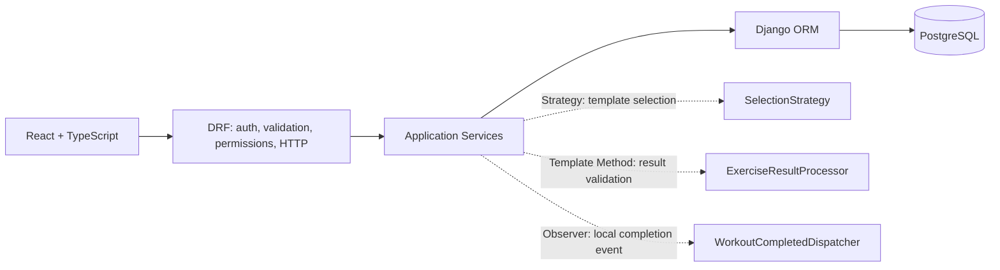

# REST API — фітнес-додаток, варіант 4

## 1. Призначення і статус

Контракт для React/TypeScript ↔ Django REST Framework у модульному моноліті. Джерела: [вимоги](../analysis/requirements.md), [бізнес-правила](../analysis/business-rules.md), [Domain Model](./domain-model.md), [ERD](./erd.md), [додаткові GoF-пропозиції](./additional-gof-proposals.md), [план](../PLAN_VARIANT_4.md) та чотири сторінки [UML Class Diagram](../diagrams/class-diagram.drawio). У разі розбіжності пріоритет мають CONFIRMED вимоги та бізнес-рішення. **Це дизайн, не реалізований API. AR-01–AR-04 підтверджені власником як D-2026-10-31; їхні правила нижче мають статус `CONFIRMED`, а формат маршрутів та інші окремо позначені технічні деталі зберігають власні статуси.** Нижче `CONFIRMED` означає успадковане правило; маршрути, форми JSON і HTTP-політика є `PROPOSED`, якщо їх раніше не погоджено.

Актори: Guest, автентифікований User, Administrator через Django Group/Permissions, System як внутрішній процес. View/serializer розбирає JSON, перевіряє форму й права, форматує HTTP. Application Service виконує бізнес-операцію, блокування та `transaction.atomic()`; Django ORM і PostgreSQL додають FK/UQ/CHECK захист. Адміністрування спільного каталогу та деактивація акаунта — обмежений Django Admin, а не публічні CRUD-маршрути.



## 2. Інвентар маршрутів

Усі шляхи мають префікс `/api/v1/`. `G` = Guest; `U` = власний ресурс автентифікованого User; `A` = Administrator з окремим правом. Методи й шляхи в таблиці точно відповідають §4.

| ID | Модуль | Метод | Шлях після префікса | Призначення | Доступ | FR/BR |
|---|---|---|---|---|---|---|
| A01 | Auth | GET | `auth/csrf/` | CSRF cookie | G | FR-002 |
| A02 | Auth | POST | `auth/register/` | Реєстрація | G | FR-001 |
| A03 | Auth | POST | `auth/login/` | Сесія | G | FR-002 |
| A04 | Auth | POST | `auth/logout/` | Завершення сесії | U | FR-002 |
| A05 | Auth | GET | `me/` | Власний акаунт | U | FR-003/028 |
| A06 | Auth | PATCH | `me/` | Псевдонім, opt-in | U | FR-028/035, BR-017 |
| P01 | Profile/Weight | GET | `profile/` | Власний профіль | U | FR-003, BR-001 |
| P02 | Profile/Weight | POST | `profile/` | Перший профіль і вимір | U | FR-003/004, BR-001 |
| P03 | Profile/Weight | PATCH | `profile/` | Оновлення профілю | U | FR-003/004, BR-001 |
| P04 | Profile/Weight | GET | `weight-entries/` | Історія ваги | U | FR-004, BR-019 |
| P05 | Profile/Weight | GET | `statistics/weight-chart/` | Звіт 1: графік ваги | U | FR-031, BR-019 |
| C01 | Catalog | GET | `categories/` | Коди категорій | G | FR-006 |
| C02 | Catalog | GET | `exercises/` | Визначення вправ | G | FR-007/009 |
| C03 | Catalog | GET | `workouts/` | Пошук бібліотеки | G | FR-008/010 |
| C04 | Catalog | GET | `workouts/{id}/` | Склад Workout | G | FR-008/009 |
| G01 | Programs | GET | `program-recommendation/` | Рекомендація Strategy | U | FR-011, BR-005 |
| G02 | Programs | GET | `user-programs/` | Власні програми | U | FR-011–016 |
| G03 | Programs | POST | `user-programs/` | Копія шаблону | U | FR-011/013, BR-005 |
| G04 | Programs | GET | `user-programs/{id}/` | Склад і стан | U | FR-012/015 |
| G05 | Programs | PATCH | `user-programs/{id}/` | Назва/опис копії | U | FR-012, BR-009 |
| G06 | Programs | PUT | `user-programs/{id}/workouts/{entry_id}/` | Особистий склад Workout | U | FR-012/019, BR-004 |
| G07 | Programs | POST | `user-programs/{id}/activate/` | Активація | U | FR-014–016, BR-006 |
| G08 | Programs | GET | `user-programs/{id}/progress/` | Поточний прогрес | U | FR-015/016, BR-006/007 |
| G09 | Programs | POST | `user-programs/{id}/archive/` | Архівація | U | FR-012, BR-006/009 |
| S01 | Scheduling | GET | `scheduled-sessions/` | Список і календар | U | FR-014/017 |
| S02 | Scheduling | POST | `scheduled-sessions/` | Новий слот і reminder | U | FR-017/023, BR-023 |
| S03 | Scheduling | GET | `scheduled-sessions/{id}/` | Деталі слота | U | FR-017 |
| S04 | Scheduling | PATCH | `scheduled-sessions/{id}/` | Перенесення | U | FR-017/026, BR-008/025 |
| S05 | Scheduling | POST | `scheduled-sessions/{id}/cancel/` | Скасування | U | FR-017/026, BR-025 |
| E01 | Execution | POST | `completed-sessions/` | Фактичне завершення | U | FR-018–021/030, BR-010/030 |
| E02 | Execution | GET | `completed-sessions/` | Історія | U | FR-022 |
| E03 | Execution | GET | `completed-sessions/{id}/` | Незмінний факт | U | FR-022, BR-029 |
| M01 | Points/Achievements | GET | `points/summary/` | Сума ledger | U | FR-030/035, BR-015 |
| M02 | Points/Achievements | GET | `point-transactions/` | Історія балів | U | FR-030, BR-015 |
| M03 | Points/Achievements | GET | `achievements/` | Доступні визначення | U | FR-027, BR-021 |
| M04 | Points/Achievements | GET | `user-achievements/` | Власні нагороди | U | FR-027, BR-021 |
| H01 | Challenges | GET | `challenges/` | Доступні челенджі | U | FR-029, BR-022 |
| H02 | Challenges | GET | `challenges/{id}/` | Деталі цілі | U | FR-029, BR-022 |
| H03 | Challenges | POST | `challenges/{id}/join/` | Вступ | U | FR-029, BR-022 |
| H04 | Challenges | GET | `challenge-participations/` | Власний прогрес | U | FR-029, BR-022 |
| L01 | Leaderboard | GET | `leaderboard/` | Opt-in рейтинг і власна позиція | U | FR-028/035, BR-017 |
| N01 | Notifications | GET | `notifications/` | Видимі власні | U | FR-024, BR-023/024 |
| N02 | Notifications | GET | `notifications/{id}/` | Видимий reminder | U | FR-024, BR-024 |
| N03 | Notifications | POST | `notifications/{id}/read/` | Позначити прочитаним | U | FR-025, BR-024 |
| R01 | Statistics/Reports | GET | `statistics/overview/` | Власні підсумки | U | FR-032, BR-019 |
| R02 | Statistics/Reports | GET | `reports/workout-popularity/` | Звіт 2: популярність | A | FR-033/040, BR-020 |
| R03 | Statistics/Reports | GET | `reports/average-activity/` | Звіт 3: середня активність | A | FR-034/040, BR-018 |

## 3. Загальні домовленості

| Тема | Контракт |
|---|---|
| Версія/шляхи | **PROPOSED:** `/api/v1/`, множина й `kebab-case`, кінцевий `/`; ідентифікатори — додатні цілі. |
| Методи | GET не змінює стан; POST створює або виконує доменну дію; PATCH частково змінює; PUT замінює весь редагований склад конкретного персонального Workout. DELETE не відкритий для незмінних фактів чи спільного каталогу. |
| Формат | `Content-Type: application/json`, `Accept: application/json`; невідомі writable поля → 400 `unknown_field`, server-owned поля відхиляються, не ігноруються. Nullable значення — JSON `null`. Decimal — **рядок** з крапкою та зафіксованою точністю, не IEEE-754 number. |
| Час | Timestamp ISO 8601 з явним offset, відповіді нормалізовано до `Z`; БД UTC. Дати календаря й періодів — `YYYY-MM-DD` у `Europe/Kyiv`; `start_date` включно, `end_date` виключно, інтервал `[start,end)` конвертують у UTC за timezone rules, без фіксованого UTC+2/+3. |
| Списки | **PROPOSED:** page-number pagination `?page=1&page_size=20`, `1..100`; порожній envelope `{"count":0,"next":null,"previous":null,"results":[]}`. Усі списки рядків БД мають стабільний вторинний ID; C01 — статичний перелік choices без пагінації. Хибна сторінка/фільтр → 400. |
| Фільтри | Лише зазначені біля маршруту; невідомий filter/sort → 400. `ordering` тільки з whitelist; `start_date<end_date`; для `all` період необмежений. |
| Коди | 200 читання/повтор або оновлення; 201 створення; 204 logout без body; 400 синтаксис/форма/валідація; 401 немає сесії; 403 роль заборонена; 404 чужий або відсутній приватний ID/невидимий каталог; 409 стан/дублі/ключ; 429 rate limit. |
| Ідемпотентність | GET, PUT заміни, POST архівації/скасування/читання notification мають повторюваний ефект. Завершення E01 — окремий `Idempotency-Key`; інші POST не обіцяють deduplication без DB правила. |
| Сортування | Історія й календар — timestamp DESC/ASC та ID; popularity — count DESC, назва, ID; leaderboard — BR-017 **PROPOSED** tie policy. |
| Статуси | Збережені: `UserProgram` — draft, active, completed плюс `is_archived`; `ScheduledSession` — planned, completed, cancelled; `Notification` — pending, read, cancelled. `missed`, `visible`, `is_current`, `bonus_earned`, прогрес і сума балів — read-only похідні. |

**Типи параметрів, спільні для маршрутів нижче:**

| Параметр | Де застосовується | Тип / перевірка |
|---|---|---|
| `{id}`, `{entry_id}` | Деталі й вкладене особисте входження | Додатне ціле; власність перевіряється перед використанням. |
| `page`, `page_size` | Пагіновані GET списки | Додатні цілі; default 1/20, max page_size 100. |
| `start_date`, `end_date` | Історія, календар, статистика, звіти | ISO date `YYYY-MM-DD`, обидва разом, `start_date<end_date`, локальні межі Kyiv `[start,end)`. Для P04/E02/M02/S01 optional пара, для P05/R01/R02/R03 обов'язкова. |
| `scheduled_at` | S02/S04 | ISO 8601 timestamp з offset; UTC у відповіді; майбутній час за BR-026 **PROPOSED**. |
| `duration_min`, `actual_duration_min` | E01 | Decimal-рядок з двома знаками, >0; фактична загальна тривалість обов'язкова. |
| `weight_kg`, `height_cm`, `actual_load_kg` | P02/P03/E01 | Decimal-рядок з одним знаком; profile межі BR-001, load ≥0. |
| `actual_distance_km` | E01 | Nullable Decimal-рядок з трьома знаками; якщо задано, >0. |
| `position`, `actual_sets`, `actual_reps` | G06/E01 | Позиція — додатне ціле; sets/reps, якщо застосовні, цілі >0. |
| `Idempotency-Key` | E01 header | UUID v4, 36 символів; унікальність `(user_id,key)`, payload fingerprint за §4.6. |

### 3.1. Автентифікація й доступ

**PROPOSED:** Django session authentication з HTTP-only `sessionid` cookie, `Secure` у HTTPS, `SameSite=Lax`; React і DRF розгорнуті на одному origin. SPA перед unsafe методами бере CSRF cookie через A01 і посилає `X-CSRFToken`; login і register також захищені CSRF. Session зберігається на сервері, frontend не кладе credential у localStorage. Django стандартно перевіряє `is_active` при кожному запиті, тож деактивація блокує й чинну сесію; logout інвалідовує сесію. **PROPOSED:** мінімум 12 символів пароля та строк сесії 7 днів без автоматичного подовження; це технічні налаштування, не бізнес-правила. Cross-origin deployment потребуватиме окремого CORS/CSRF рішення, воно не входить у цей контракт. HTTPS обов'язковий у production.

| Підхід | Оцінка для React web |
|---|---|
| Django session + DRF `SessionAuthentication` | Обрано: server-side logout/revocation та cookie без доступу JavaScript; вимагає CSRF на unsafe запитах і same-origin конфігурації. |
| DRF `TokenAuthentication` | Потребує зберігання bearer token на клієнті, окремої ротації/терміну дії; базовий механізм DRF простий і не дає expiration автоматично. |
| JWT через сторонній пакет | Може бути доречним для незалежних клієнтів, але refresh/revocation і зберігання токенів ускладнюють цей веб-MVP. |

[Документація DRF](https://www.django-rest-framework.org/api-guide/authentication/) підтверджує поведінку session/CSRF, відмінність 401/403 та можливість власного `authenticate_header()`. Звичайна DRF `SessionAuthentication` повертає 403 для анонімного запиту; цей **PROPOSED** контракт використовує мінімальну session-auth subclass із `WWW-Authenticate: Session realm="api"`, щоб `NotAuthenticated` і невірні credentials мали 401. **Кожна 401-відповідь включає цей header.** Login/register потребують стандартної Django CSRF-перевірки окремо: DRF session CSRF за замовчуванням застосовується лише до вже автентифікованих запитів. Не покладатися на один лише DRF permission для захисту login від CSRF.

Guest бачить тільки A01–A03 і неархівний каталог C01–C04 (**публічність каталогу PROPOSED**). User бачить тільки власні приватні ресурси. Administrator має ті самі права на власні дані, а R02/R03 — лише за Group/Permission для агрегованих звітів; `is_staff` сам по собі недостатній. Адміністратор не отримує чужий Profile, WeightEntry чи CompletedSession через API. Приватний ID іншого користувача та неіснуючий ID однаково дають 404 після фільтра `user=request.user`; 403 використовується для відомої за роллю забороненої дії, наприклад R02. Всі id з URL перевіряються на власність; вкладений `entry_id` має належати програмі з URL.

### 3.2. Стандартна помилка

Єдина форма `{"error":{"code":"validation_error","message":"Некоректні дані.","fields":{},"request_id":"req-7d0"}}`; `request_id` **PROPOSED** кореляційний ID, не персональні дані. `fields` — ключі JSON/загальний `non_field_errors`, значення — масиви коротких рядків. Сервісні помилки маплять у HTTP без SQL/stack trace.

| Ситуація | HTTP / приклад |
|---|---|
| Невалідне поле | 400 `{"error":{"code":"validation_error","message":"Некоректні дані.","fields":{"weight_kg":["Має бути від 20.0 до 500.0 kg."]},"request_id":"req-7d1"}}` |
| Немає входу | 401 `{"error":{"code":"authentication_required","message":"Потрібен вхід.","fields":{},"request_id":"req-7d2"}}` |
| Немає ролі | 403 `{"error":{"code":"permission_denied","message":"Недостатньо прав.","fields":{},"request_id":"req-7d3"}}` |
| Не знайдено / чужий ID | 404 `{"error":{"code":"not_found","message":"Ресурс не знайдено.","fields":{},"request_id":"req-7d4"}}` |
| Перехід заборонено | 409 `{"error":{"code":"invalid_state","message":"Операція недоступна в поточному стані.","fields":{},"request_id":"req-7d5"}}`; для нового програмного E01 у `draft`/`completed`/архівному стані повідомлення: `Неможливо завершити заняття для програми в поточному стані.` |
| У draft лишилися persisted `planned` слоти | 409 `{"error":{"code":"planned_sessions_exist","message":"Перед архівацією програми необхідно скасувати заплановані заняття.","fields":{},"request_id":"req-7d9"}}` |
| Ключ з іншим payload | 409 `{"error":{"code":"idempotency_conflict","message":"Ключ уже використано з іншими даними.","fields":{},"request_id":"req-7d6"}}` |
| Слот уже завершено іншим ключем | 409 `{"error":{"code":"duplicate_completion","message":"Заняття вже завершено.","fields":{},"request_id":"req-7d7"}}` |
| Конкурентна зміна стану | 409 `{"error":{"code":"concurrent_modification","message":"Стан змінився; оновіть дані.","fields":{},"request_id":"req-7d8"}}` |

Синтаксично зламаний JSON → 400 `invalid_json`; відсутній/хибний CSRF → 403 `csrf_failed`; невалідний login → 401 `invalid_credentials`; дубль email → 409 `email_taken`. Для відсутнього неархівного каталожного ресурсу — 404. Після помилки E01 часткових записів немає.

## 4. Детальні контракти

У всіх прикладах ID і дати ілюстративні. `Вхід —` означає відсутність query/body; GET не має request body. Для кожного списку діють page/page_size із §3; конкретні фільтри вказано нижче. Усі не перелічені клієнтські поля — read-only. Доступ `U` завжди включає object-level перевірку. Скорочені JSON приклади є **повними валідними об'єктами показаного response shape**; списки містять один демонстраційний елемент, а не символічні пропуски.

### 4.1. Auth і акаунт

#### A01. Отримати CSRF cookie
**Метод/URL:** `GET /api/v1/auth/csrf/`. **Доступ:** Guest/User. **FR:** FR-002. **Вхід:** —. **Успіх:** 200 `{"csrf_token":"a0f7e9c4d2b61805"}` і cookie `csrftoken`; token — ілюстративний. **Помилки:** 429. **Виконання:** Django CSRF middleware, без доменного сервісу; клієнт посилає token у `X-CSRFToken` на unsafe методах.

#### A02. Реєстрація
**Метод/URL:** `POST /api/v1/auth/register/`. **Доступ:** Guest. **FR:** FR-001/005. **Вхід:** body `email: string`, `password: string`; query —. **Приклад запиту:** `{"email":"olena@example.test","password":"CorrectHorse2026!"}`. **Успіх:** 201 `{"id":41,"email":"olena@example.test","public_alias":null,"leaderboard_opt_in":false}`. **Помилки:** 400 email/password, 409 `email_taken`, 403 CSRF, 429. **Виконання:** Django auth manager нормалізує email, хешує пароль; case-insensitive унікальність `LOWER(email)`; профіль створюють окремо P02. Реєстрація не автентифікує автоматично (**PROPOSED**).

#### A03. Вхід
**Метод/URL:** `POST /api/v1/auth/login/`. **Доступ:** Guest. **FR:** FR-002/036; BR-032. **Вхід:** `email`, `password` у body. **Запит:** `{"email":"olena@example.test","password":"CorrectHorse2026!"}`. **Успіх:** 200 `{"id":41,"email":"olena@example.test","public_alias":null,"leaderboard_opt_in":false}` + `sessionid` cookie. **Помилки:** 400, 401 `invalid_credentials` також для деактивованого акаунта без розкриття його стану, 403 CSRF, 429. **Виконання:** Django authenticate/login; не повертати token у JSON.

#### A04. Вихід
**Метод/URL:** `POST /api/v1/auth/logout/`. **Доступ:** U. **FR:** FR-002. **Вхід:** —. **Успіх:** 204 без body; інвалідувати session cookie. **Помилки:** 401, 403 CSRF. **Виконання:** Django logout; повтор після інвалідації без сесії поверне 401.

#### A05. Власний акаунт
**Метод/URL:** `GET /api/v1/me/`. **Доступ:** U. **FR:** FR-003/028. **Вхід:** —. **Успіх:** 200 `{"id":41,"email":"olena@example.test","public_alias":"OlenaFit","leaderboard_opt_in":true}`. **Помилки:** 401. **Виконання:** серіалізувати лише `request.user`; не повертати password hash, Groups або приватний профіль у публічних відповідях.

#### A06. Змінити участь у рейтингу
**Метод/URL:** `PATCH /api/v1/me/`. **Доступ:** U. **FR/BR:** FR-028/035, BR-017/028. **Вхід:** writable `public_alias: string|null` (до 80 символів), `leaderboard_opt_in: boolean`; інші поля заборонені. **Запит:** `{"public_alias":"OlenaFit","leaderboard_opt_in":true}`. **Успіх:** 200 `{"id":41,"email":"olena@example.test","public_alias":"OlenaFit","leaderboard_opt_in":true}`. **Помилки:** 400 порожній alias при opt-in, 401, 403 CSRF. **Виконання:** атомарна перевірка alias + opt-in; вимкнення одразу прибирає User з публічного списку, ledger не змінює. `id,email,is_staff,is_active` read-only.

### 4.2. Профіль і вага

У цьому MVP **PROPOSED** прямий POST/PATCH для `WeightEntry` не відкривати: первинне створення P02 та кожна зміна `weight_kg` через P03 викликають `ProfileService`, який атомарно створює новий датований запис. Концептуальні права C/U own у матриці доступу не зобов'язують публікувати незалежне редагування історії; якщо така операція стане потрібною, слід окремо визначити корекцію поточного значення та історичних snapshots. Існуючі `CompletedSession` від цього не переписуються.

#### P01. Прочитати профіль
**Метод/URL:** `GET /api/v1/profile/`. **Доступ:** U. **FR/BR:** FR-003, BR-001. **Вхід:** —. **Успіх:** 200 `{"date_of_birth":"1998-05-12","age":28,"weight_kg":"68.4","height_cm":"170.0","gender":"female","fitness_goal":"maintenance","experience_level":"beginner","workouts_per_week":3}`. **Помилки:** 401, 404 `profile_missing` до P02. **Виконання:** `ProfileService` обчислює `age` на поточну локальну дату Kyiv; `age` read-only.

#### P02. Створити перший профіль
**Метод/URL:** `POST /api/v1/profile/`. **Доступ:** U без профілю. **FR/BR:** FR-003/004, BR-001. **Вхід:** усі сім полів профілю. **Запит:** `{"date_of_birth":"1998-05-12","weight_kg":"68.4","height_cm":"170.0","gender":"female","fitness_goal":"maintenance","experience_level":"beginner","workouts_per_week":3}`. **Успіх:** 201 `{"date_of_birth":"1998-05-12","age":28,"weight_kg":"68.4","height_cm":"170.0","gender":"female","fitness_goal":"maintenance","experience_level":"beginner","workouts_per_week":3}`. **Помилки:** 400 межі віку 19–59, ваги 20.0–500.0, зросту 100.0–250.0, перелічувані значення, точність або частота 1–7; 401; 409 `profile_exists`. **Виконання:** `ProfileService` в одній `atomic()` створює Profile та перший `WeightEntry` з server time; вік оцінює на дату створення Kyiv. `created_at` server-owned.

#### P03. Оновити профіль
**Метод/URL:** `PATCH /api/v1/profile/`. **Доступ:** U. **FR/BR:** FR-003/004, BR-001/009. **Вхід:** будь-яка підмножина семи полів; `age` заборонене. **Запит:** `{"weight_kg":"67.9","workouts_per_week":4}`. **Успіх:** 200 `{"date_of_birth":"1998-05-12","age":28,"weight_kg":"67.9","height_cm":"170.0","gender":"female","fitness_goal":"maintenance","experience_level":"beginner","workouts_per_week":4}`. **Помилки:** 400 валідація, 401, 404 відсутній профіль, 403 CSRF. **Виконання:** `ProfileService` у `atomic()` створює новий `WeightEntry` тільки якщо `weight_kg` реально змінено; дата народження при виправленні перевіряється відносно локальної дати першого `Profile.created_at`, не поточної дати. Минулі результати/kcal незмінні.

#### P04. Історія вимірів
**Метод/URL:** `GET /api/v1/weight-entries/`. **Доступ:** U. **FR/BR:** FR-004/031, BR-001/019. **Query:** `start_date,end_date,page,page_size`; період Kyiv `[start,end)`; порядок `measured_at DESC,id DESC`. **Успіх:** 200 `{"count":2,"next":null,"previous":null,"results":[{"id":302,"measured_at":"2026-10-29T09:00:00Z","weight_kg":"67.9"},{"id":301,"measured_at":"2026-10-01T09:00:00Z","weight_kg":"68.4"}]}`. **Помилки:** 400 фільтр/період, 401. **Виконання:** read-only owner queryset; порожній список має `count:0,results:[]`.

#### P05. Звіт 1 — графік ваги
**Метод/URL:** `GET /api/v1/statistics/weight-chart/`. **Доступ:** U. **FR/BR:** FR-031, BR-019. **Query:** обов'язкові `start_date,end_date` (локальні дати Kyiv). **Успіх:** 200 `{"period":{"start_date":"2026-10-01","end_date":"2026-11-01","timezone":"Europe/Kyiv"},"points":[{"measured_at":"2026-10-01T09:00:00Z","weight_kg":"68.4"},{"measured_at":"2026-10-29T09:00:00Z","weight_kg":"67.9"}]}`. **Помилки:** 400 період, 401. **Виконання:** `StatisticsQueryService` читає лише `WeightEntry` власника у хронологічному порядку; однаковий timestamp упорядковує ID. Немає точок → `points:[]`; не вигадувати початковий вимір. Це перший із трьох обов'язкових звітів.

### 4.3. Спільний каталог

Категорії — коди, не таблиця; `WorkoutExercise` — рекомендовані параметри, `ExerciseResult` — фактичні результати. C01–C04 повертають тільки неархівні визначення для нового вибору. Архівний `Workout` лишається доступним через snapshots E02/E03 та власну програму G04, без повторного відкриття для нового вибору. Guest-доступ — **PROPOSED**.

#### C01. Категорії
**Метод/URL:** `GET /api/v1/categories/`. **Доступ:** G/U. **FR/BR:** FR-006, BR-002. **Вхід:** —. **Успіх:** 200 `{"results":[{"code":"cardio","label":"Кардіо"},{"code":"strength","label":"Силові"},{"code":"yoga","label":"Йога"}]}`. **Помилки:** 429. **Виконання:** статичні choices, без окремої таблиці; не змінюються через REST.

#### C02. Вправи каталогу
**Метод/URL:** `GET /api/v1/exercises/`. **Доступ:** G/U. **FR/BR:** FR-007/009, BR-002/003/013. **Query:** `category` з C01, `search` за назвою, `page,page_size`; сортування `name,id`. **Успіх:** 200 `{"count":1,"next":null,"previous":null,"results":[{"id":17,"name":"Присідання","description":"Базова силова вправа","category":"strength","met_value":"5.00","met_activity_code":"02052","met_reference_version":"C2024","met_activity_description":"Resistance training, squats and deadlifts"}]}`. **Помилки:** 400 фільтри, 429. **Виконання:** read-only catalog query; MET — довідкове значення, не обіцянка kcal для кожного виконання.

#### C03. Бібліотека тренувань
**Метод/URL:** `GET /api/v1/workouts/`. **Доступ:** G/U. **FR/BR:** FR-008/010, BR-002/003. **Query:** `category,search,page,page_size`, сортування `name,id`. **Успіх:** 200 `{"count":1,"next":null,"previous":null,"results":[{"id":8,"name":"Силове тренування А","description":"Тренування всього тіла","category":"strength","exercise_count":2}]}`. **Помилки:** 400, 429. **Виконання:** список лише неархівних Workout; `exercise_count` read-only.

#### C04. Склад Workout
**Метод/URL:** `GET /api/v1/workouts/{id}/`. **Доступ:** G/U. **FR/BR:** FR-008/009, BR-002/004. **Path:** `id` Workout. **Успіх:** 200 `{"id":8,"name":"Силове тренування А","description":"Тренування всього тіла","category":"strength","exercises":[{"entry_id":51,"position":1,"exercise":{"id":17,"name":"Присідання","category":"strength"},"recommended_sets":3,"recommended_reps":10,"recommended_load_kg":"20.0","recommended_duration_min":null,"recommended_distance_km":null},{"entry_id":52,"position":2,"exercise":{"id":18,"name":"Планка","category":"strength"},"recommended_sets":3,"recommended_reps":1,"recommended_load_kg":"0.0","recommended_duration_min":null,"recommended_distance_km":null}]}`. **Помилки:** 404 невидимий/відсутній, 429. **Виконання:** упорядковані `WorkoutExercise`; звичайний User не змінює каталог.

### 4.4. Персональні програми

`ProgramTemplate` — спільний `published|archived`; `UserProgram` — власна незалежна копія `draft|active|completed` плюс `is_archived`. API не має ручного закриття: E01 автоматично закриває програму за BR-007. Заархівувати можна лише `draft` або `completed`, повторний G09 ідемпотентний; відновлення, архівація `active` і зміни `completed` недоступні у MVP. У `draft` і неархівному `active` можна редагувати особистий склад, але збережені історичні факти незмінні.

#### G01. Рекомендація шаблону
**Метод/URL:** `GET /api/v1/program-recommendation/`. **Доступ:** U з Profile. **FR/BR:** FR-011/013, BR-005. **Вхід:** —; goal/level/frequency беруться тільки з власного Profile. **Успіх:** 200 `{"program_template":{"id":12,"name":"Баланс 3","description":"Рівномірний склад","fitness_goal":"maintenance","experience_level":"beginner","workouts_per_week":3,"workouts":[{"position":1,"workout_id":8,"name":"Силове тренування А"}]},"reason":{"exact_goal":true,"exact_level":true,"frequency_difference":0,"strategy":"MaintenanceSelectionStrategy","composition_criterion":"Найменший розмах часток cardio/strength/yoga"}}`. **Помилки:** 401, 404 profile missing, 404 `recommendation_unavailable` за відсутності кандидатів (без створення UserProgram). **Виконання:** `ProgramSelectionService` фільтрує `published` з точними goal+level, далі мінімізує різницю частоти, при нічиїй бере меншу частоту, потім Strategy за складом, далі менший ID; `reason` read-only.

#### G02. Список програм
**Метод/URL:** `GET /api/v1/user-programs/`. **Доступ:** U. **FR/BR:** FR-011–016, BR-006/007. **Query:** `status=draft|active|completed`, `archived=true|false` (default false), `page,page_size`; порядок `id DESC`. **Успіх:** 200 `{"count":1,"next":null,"previous":null,"results":[{"id":77,"name":"Мій баланс","status":"active","is_archived":false,"source_program_template_id":12,"progress_percent":"50.0","bonus_earned":false}]}`. **Помилки:** 400 фільтр, 401. **Виконання:** owner queryset, progress SQL із поточних нескасованих слотів; `bonus_earned` з bonus PointTransaction.

#### G03. Створити незалежну копію
**Метод/URL:** `POST /api/v1/user-programs/`. **Доступ:** U. **FR/BR:** FR-011/013, BR-005/009. **Вхід:** `program_template_id` опублікованого шаблону; це явне прийняття поточної рекомендації G01 (**PROPOSED** API-крок). Сервіс повторно визначає переможця за BR-005; застарілий або інший ID відхиляє 409 без копії. **Запит:** `{"program_template_id":12}`. **Успіх:** 201 `{"id":77,"name":"Баланс 3","description":"Рівномірний склад","fitness_goal":"maintenance","status":"draft","is_archived":false,"source_program_template_id":12,"source_program_template_name_snapshot":"Баланс 3","bonus_target_sessions":null,"workouts":[{"entry_id":201,"position":1,"source_workout_id":8,"name":"Силове тренування А","category":"strength","exercises":[{"position":1,"exercise_id":17,"recommended_sets":3,"recommended_reps":10,"recommended_load_kg":"20.0","recommended_duration_min":null,"recommended_distance_km":null}]}]}`. **Помилки:** 400, 401, 404 шаблон недоступний, 409 ID не відповідає поточній рекомендації. **Виконання:** `ProgramSelectionService` у `atomic()` копіює всі входження та рекомендовані параметри; відповідь містить увесь скопійований склад шаблону. `source_workout_id` після копіювання незмінний. Повторний POST створює новий екземпляр, що допускається BR-007.

#### G04. Деталі власної програми
**Метод/URL:** `GET /api/v1/user-programs/{id}/`. **Доступ:** U. **FR/BR:** FR-012/015/016, BR-006/007. **Path:** `id` own UserProgram. **Успіх:** 200 `{"id":77,"name":"Мій баланс","description":"Рівномірний склад","fitness_goal":"maintenance","status":"active","is_archived":false,"source_program_template_id":12,"source_program_template_name_snapshot":"Баланс 3","bonus_target_sessions":3,"progress":{"total_planned":2,"completed_planned":1,"percent":"50.0"},"completion_snapshot":null,"bonus_earned":false,"workouts":[{"entry_id":201,"position":1,"source_workout_id":8,"name":"Силове тренування А","category":"strength","exercises":[{"position":1,"exercise_id":17,"recommended_sets":3,"recommended_reps":10,"recommended_load_kg":"20.0","recommended_duration_min":null,"recommended_distance_km":null}]}]}`. **Помилки:** 401, 404. **Виконання:** `ProgramPlanningService`/query читає поточний склад та прогрес; для `completed` повертає незмінний `completion_snapshot`, для активної — null. Архівний шаблон не змінює цей payload.

#### G05. Назва й опис особистої копії
**Метод/URL:** `PATCH /api/v1/user-programs/{id}/`. **Доступ:** U. **FR/BR:** FR-012, BR-009. **Вхід:** тільки `name` і `description`; `status,is_archived,source_*,bonus_target_sessions` read-only. **Запит:** `{"name":"Мій баланс","description":"Зручний темп"}`. **Успіх:** 200 `{"id":77,"name":"Мій баланс","description":"Зручний темп","status":"draft","is_archived":false}`. **Помилки:** 400, 401, 404, 409 `invalid_state` для completed/archived. **Виконання:** `ProgramPlanningService`; зміна не торкається шаблону чи минулих фактів.

#### G06. Замінити особистий склад одного Workout
**Метод/URL:** `PUT /api/v1/user-programs/{id}/workouts/{entry_id}/`. **Доступ:** U. **FR/BR:** FR-012/019, BR-004/009/020. **Вхід:** `name` і повний непорожній масив `exercises`; кожен елемент: `position,exercise_id,recommended_sets,recommended_reps,recommended_load_kg,recommended_duration_min,recommended_distance_km`; nullable параметри явно `null`. **Запит:** `{"name":"Силовий блок","exercises":[{"position":1,"exercise_id":17,"recommended_sets":4,"recommended_reps":8,"recommended_load_kg":"22.5","recommended_duration_min":null,"recommended_distance_km":null}]}`. **Успіх:** 200 `{"entry_id":201,"position":1,"source_workout_id":8,"name":"Силовий блок","category":"strength","exercises":[{"position":1,"exercise_id":17,"recommended_sets":4,"recommended_reps":8,"recommended_load_kg":"22.5","recommended_duration_min":null,"recommended_distance_km":null}]}`. **Помилки:** 400 порожній/невалідний/непослідовний склад, 401, 404 чужа програма або entry, 409 completed/archived. **Виконання:** `ProgramPlanningService` атомарно валідує BR-004 і замінює персональні `UserProgramExercise`; `source_workout_id` і `category` незмінні. Позиції 1..N без дублів — **PROPOSED** API правило. Старі `ExerciseResult` не змінюються. Зміни G06 впливають на ще незавершені програмні заняття, навіть якщо S02 уже створив слот: E01 бере останній committed `UserProgramExercise` відповідного входження **після** lock `UserProgram`. G06 бере той самий lock; одночасні G06/E01 виконуються в одному серіалізованому порядку (AR-02, D-2026-10-31). `source_workout_id` лишається ключем походження, не переліком дозволених вправ персональної копії.

#### G07. Активувати програму
**Метод/URL:** `POST /api/v1/user-programs/{id}/activate/`. **Доступ:** U. **FR/BR:** FR-014–016, BR-006. **Вхід:** порожній body `{}`. **Успіх:** 200 `{"id":77,"status":"active","is_archived":false,"activated_at":"2026-10-29T10:00:00Z","bonus_target_sessions":3,"progress":{"total_planned":2,"completed_planned":0,"percent":"0.0"}}`. **Помилки:** 400 немає ≥1 нескасованого слота, 401, 404, 409 стан не draft або archived. **Виконання:** `ProgramPlanningService` блокує програму, рахує початкові нескасовані слоти, фіксує `max(3,count)` один раз у `atomic()`. Уже активну програму не активувати повторно. Draft-слоти S02 дозволені, але нове програмне E01 стає доступним лише після успішної активації та фіксації порогу (AR-03, D-2026-10-31).

#### G08. Поточний прогрес
**Метод/URL:** `GET /api/v1/user-programs/{id}/progress/`. **Доступ:** U. **FR/BR:** FR-015/016, BR-006/007. **Вхід:** path `id`. **Успіх:** 200 `{"user_program_id":77,"status":"active","is_archived":false,"total_planned":2,"completed_planned":1,"percent":"50.0","bonus_target_sessions":3,"bonus_earned":false,"completion_snapshot":null}`. **Помилки:** 401, 404. **Виконання:** SQL count по поточних нескасованих `ScheduledSession`, включно з простроченими; завершення визначає пов'язаний факт. Нульовий знаменник → `"0.0"`. Для `completed` `completion_snapshot` має `completed_at,total_planned_at_completion,completed_planned_at_completion,progress_percent_at_completion` і не перераховується; `bonus_earned` походить тільки з ledger.

**Приклад після закриття без бонусу:** 200 `{"user_program_id":77,"status":"completed","is_archived":false,"total_planned":2,"completed_planned":2,"percent":"100.0","bonus_target_sessions":3,"bonus_earned":false,"completion_snapshot":{"completed_at":"2026-10-29T17:00:00Z","total_planned_at_completion":2,"completed_planned_at_completion":2,"progress_percent_at_completion":"100.0"}}`. Архівація змінить лише `is_archived`, не ці значення.

#### G09. Архівувати програму
**Метод/URL:** `POST /api/v1/user-programs/{id}/archive/`. **Доступ:** U. **FR/BR:** FR-012/016, BR-006/007/009. **Вхід:** `{}`. **Успіх:** 200 `{"id":77,"status":"completed","is_archived":true,"bonus_earned":false}`; для порожнього draft або draft лише зі скасованими слотами той самий shape з `"status":"draft"`. **Помилки:** 401, 404; `409 invalid_state` для `active`; `409 planned_sessions_exist` для draft з хоча б одним persisted `ScheduledSession.status=planned`, включно з простроченим `is_missed=true`. **Виконання:** `ProgramPlanningService` під lock програми перевіряє незавершені слоти, потім змінює тільки `is_archived` у порожнього draft, draft лише зі скасованими слотами або `completed`; повтор успішної архівації повертає 200 той самий результат. При 409 програма, слоти й reminders незмінні. User отримує незавершені слоти через S01, скасовує їх S05 та повторює G09. G09 не скасовує reminders і не видаляє історію; їхню долю визначає S05/BR-025. G09/S02/S04/S05 серіалізуються lock `UserProgram` (AR-04, D-2026-10-31).

### 4.5. Планування

S01 з `start_date,end_date` є також контрактом календаря: окремий дубльований endpoint не потрібен. Для програмного слота клієнт подає `user_program_workout_id`, а сервер виводить `user_program_id` та `source_workout_id` і перевіряє власника. Для позапрограмного клієнт подає `source_workout_id` із неархівного каталогу. Обидва поля одночасно заборонені. Слот не є фактом виконання й не додає бали/статистику.

#### S01. Список і календар
**Метод/URL:** `GET /api/v1/scheduled-sessions/`. **Доступ:** U. **FR/BR:** FR-014/017, BR-006/008. **Query:** `start_date,end_date` разом для календаря, optional `status=planned|completed|cancelled`, `user_program_id`, `page,page_size`; `missed` як status-filter не приймається, клієнт може фільтрувати похідне `is_missed` локально. **Успіх:** 200 `{"count":1,"next":null,"previous":null,"results":[{"id":92,"scheduled_at":"2026-10-29T16:00:00Z","status":"planned","is_missed":false,"user_program_id":77,"user_program_workout_id":201,"source_workout_id":8}]}`. **Помилки:** 400 фільтр/період, 401, 404 чужий `user_program_id`. **Виконання:** `ProgramPlanningService`/owner query; календар сортує `scheduled_at ASC,id ASC`, без збереженого missed-status.

#### S02. Створити слот і reminder
**Метод/URL:** `POST /api/v1/scheduled-sessions/`. **Доступ:** U. **FR/BR:** FR-014/017/023, BR-008/023/026/030. **Вхід:** `scheduled_at` timezone-aware; рівно одне з `user_program_workout_id` або `source_workout_id`. **Запит:** `{"user_program_workout_id":201,"source_workout_id":null,"scheduled_at":"2026-10-29T16:00:00Z"}`. **Успіх:** 201 `{"id":92,"user_program_id":77,"user_program_workout_id":201,"source_workout_id":8,"scheduled_at":"2026-10-29T16:00:00Z","status":"planned","is_missed":false,"reschedule_history":[],"reminder":{"id":501,"visible_at":"2026-10-29T15:00:00Z","status":"pending","is_current":true}}`. **Помилки:** 400 минулий/неоднозначний час або пара FK, 401, 404 чужий/невидимий workout, 409 завершена/архівна програма. **Виконання:** `ProgramPlanningService` і `ReminderService` в одній `atomic()`; програму блокують до зміни слотів. Успіх означає рівно один Notification; якщо до початку <1 години, reminder вже видимий. Немає cron чи окремого POST для reminder.

#### S03. Деталі слота
**Метод/URL:** `GET /api/v1/scheduled-sessions/{id}/`. **Доступ:** U. **FR/BR:** FR-017/026, BR-008/023. **Path:** own slot ID. **Успіх:** 200 `{"id":92,"user_program_id":77,"user_program_workout_id":201,"source_workout_id":8,"scheduled_at":"2026-10-29T16:00:00Z","status":"planned","is_missed":false,"reschedule_history":[],"completed_session_id":null,"reminder":{"id":501,"visible_at":"2026-10-29T15:00:00Z","status":"pending","is_current":true}}`. **Помилки:** 401, 404. **Виконання:** owner query; `reschedule_history` — прикладна історія, не tamper-resistant audit; `completed_session_id` read-only.

#### S04. Перенести слот
**Метод/URL:** `PATCH /api/v1/scheduled-sessions/{id}/`. **Доступ:** U. **FR/BR:** FR-017/026, BR-008/025/030. **Вхід:** тільки `scheduled_at`; незмінні `id,user_program_id,user_program_workout_id,source_workout_id`. **Запит:** `{"scheduled_at":"2026-10-30T16:00:00Z"}`. **Успіх:** 200 `{"id":92,"scheduled_at":"2026-10-30T16:00:00Z","status":"planned","is_missed":false,"reschedule_history":["2026-10-29T16:00:00Z"],"reminder":{"id":501,"visible_at":"2026-10-30T15:00:00Z","status":"pending","is_current":true}}`. **Помилки:** 400 час, 401, 404, 409 completed/cancelled або закрита/архівна програма. **Виконання:** `ProgramPlanningService` з lock програми/слота і `ReminderService` в `atomic()`; переносити можна також прострочений слот, бо він лишається persisted `planned` з похідним `is_missed=true`. Той самий ID слота й reminder, попередній UTC час додається до JSONB; прочитаний reminder повертається в pending з `read_at=null`. Повтор із тим самим `scheduled_at` **PROPOSED** no-op 200 без другого запису в історії.

#### S05. Скасувати слот
**Метод/URL:** `POST /api/v1/scheduled-sessions/{id}/cancel/`. **Доступ:** U. **FR/BR:** FR-015–017/026, BR-006–008/015/025/030. **Вхід:** `{}`. **Успіх:** 200 `{"id":92,"status":"cancelled","reminder":{"id":501,"status":"pending","is_current":false}}` якщо reminder вже став видимим; до `visible_at` повертається `"status":"cancelled"` у reminder. **Помилки:** 401, 404; 409 лише для **нового** скасування completed слота або слота закритої/архівної програми. Якщо persisted статус слота вже `cancelled`, відповідь 200 має пріоритет над перевіркою поточного стану програми. **Виконання:** після автентифікації та перевірки власності `ProgramPlanningService` відкриває `atomic()`; для програмного слота блокує `UserProgram → ScheduledSession`, для позапрограмного — `ScheduledSession`, потім перечитує persisted статус. Якщо він уже `cancelled`, сервіс повертає наявний стан слота/reminder 200 без нового переходу або записів. Інакше перевіряє, чи дозволене нове скасування, скасовує слот і застосовує BR-025 через `ReminderService`. Після нового скасування програмного слота сервіс під тим самим lock повторно рахує `total_planned` і `completed_planned`; якщо активна програма тепер задовольняє BR-007, у тій самій `atomic()` фіксує `status=completed`, snapshot та окремо оцінює заморожений поріг для одноразових +50. S05 не публікує `WorkoutCompleted`, бо нового факту заняття немає. Повторне скасування, зокрема після спричиненого першим S05 переходу програми в `completed`, повертає 200 у незмінному shape слота/reminder. Воно не створює повторний snapshot чи бонус, не змінює `CompletedSession` або reminder, не додає `PointTransaction`, не переоцінює досягнення й не публікує `WorkoutCompleted`. **Контракт відповіді не розширюється:** наведений 200 лишається відповіддю про слот/reminder; клієнт читає G08 для актуального стану програми та `bonus_earned`. Після скасування для нового наміру S02 створює новий слот (AR-01, D-2026-10-31).

### 4.6. Фактичне завершення — критична операція

E01 не приймає клієнтські `points,estimated_calories,weight_kg,met_value,completed_at,status,user_program_id`: вони визначаються сервером. `Idempotency-Key` — обов'язковий HTTP-заголовок UUID v4 у канонічному форматі, наприклад `8e1af87d-5516-4f64-bc87-74806c61cc28` (**PROPOSED** формат); зберігається в `CompletedSession.idempotency_key`, унікальний у межах User. Той самий ключ може бути використаний іншим User без конфлікту. Body має рівно одне ненульове джерело: `scheduled_session_id` або `source_workout_id`. Для планового факту сервер виводить початковий Workout зі слота. Якщо слот належить `UserProgram`, новий E01 вимагає `status=active,is_archived=false` після lock і валідовує вправи за останнім committed персональним `UserProgramWorkout` після того самого lock; для позапрограмного або standalone вибору — за shared `Workout`. Посилання на початковий Workout визначає популярність, а не персональне членство вправ (AR-02/03, D-2026-10-31). Позаплановий факт не отримує бонус за плановий день і не впливає на завершення програми.

Сервер канонізує синтаксично коректний JSON body (ключі, порядок результатів, десяткові рядки) і зберігає SHA-256 fingerprint; server-assigned `completed_at` та заголовок не входять у fingerprint. Для вже збереженого ключа порівняння fingerprint передує повторній бізнес-валідації: інший body завжди дає 409; для нового ключа далі виконуються всі перевірки, включно зі станом програми після lock. Історичний ідентичний повтор не відхиляється через те, що програма пізніше перейшла в `completed` або була архівована. Ідентичний повтор того самого ключа й body → 200 з тим самим `CompletedSession` та незмінними історичними полями без нових фактів, балів, нагород чи dispatch; поле `program` у повторній відповіді є поточною проєкцією і може відрізнятися після пізніших дозволених дій; інший body → 409 `idempotency_conflict`. Інший ключ для вже завершеного слота → 409 `duplicate_completion`. При одночасних запитах lock, UQ `scheduled_session_id` та `(user_id,idempotency_key)` серіалізують переможця; після програшу сервіс перечитує запис і повертає 200/409 за вказаними правилами. Конкурентні завершення різних слотів однієї програми блокують `UserProgram` до створення факту й підрахунку прогресу. Блокування/валідацію не замінює сам UQ.

#### E01. Завершити заняття
**Метод/URL:** `POST /api/v1/completed-sessions/`. **Доступ:** U. **FR/BR:** FR-016/018–021/027–030, BR-006/007/010–016/029/030/033. **Заголовок:** `Idempotency-Key` UUID v4. **Вхід:** `scheduled_session_id: integer|null`, `source_workout_id: integer|null`, `duration_min: decimal-string >0`, непорожній `results` з фактично виконаних вправ; елемент має `position`, `exercise_id`, nullable `actual_sets,actual_reps,actual_load_kg,actual_duration_min,actual_distance_km`. Пропущені вправи не надсилати; всі планові вправи виконувати не потрібно. **Запит:** `{"scheduled_session_id":92,"source_workout_id":null,"duration_min":"45.00","results":[{"position":1,"exercise_id":17,"actual_sets":4,"actual_reps":8,"actual_load_kg":"22.5","actual_duration_min":"45.00","actual_distance_km":null}]}`. **Успіх:** 201 `{"id":600,"scheduled_session_id":92,"source_workout_id":8,"completed_at":"2026-10-29T17:00:00Z","duration_min":"45.00","estimated_calories":"254.63","missing_calorie_reason":null,"workout_points":23,"program":{"id":77,"status":"completed","progress_percent":"100.0","bonus_earned":false}}`; заголовок `Location: /api/v1/completed-sessions/600/`. **Помилки:** 400 відсутній/неправильний `Idempotency-Key`, `results` порожній/пропущені, невідповідний тип параметрів, не належить актуальному дозволеному персональному або shared складу, сума сегментів > загальної тривалості; 401; 404 чужий слот/невидимий Workout; 409 cancelled/completed slot, `invalid_state` для нового E01 у draft/completed/archived програмі, duplicate/key conflict або concurrency; 403 CSRF. **Виконання:** `WorkoutCompletionService` у `atomic()`: перевірити власника та знайти вже committed факт за ключем/fingerprint; для нового запиту lock програми до факту (або слота для позапрограмного випадку), після lock перевірити `active,false`, прочитати останній committed персональний склад (G06/E01 серіалізуються), для позапрограмного — shared склад; `ExerciseResultProcessor.process()` для кожного фактичного результату; історична вага — останній `WeightEntry.measured_at ≤ completed_at`; `CaloriesEstimator`, `PointsPolicy`; створити `CompletedSession` і всі `ExerciseResult`/snapshots, один workout `PointTransaction`, змінити слот і reminder, через спільну з S05 оцінку BR-007 за потреби закрити програму зі snapshot і умовним +50, виконати обов'язкові `AchievementHandler` та `ChallengeHandler` через локальний `WorkoutCompletedDispatcher` до commit. Необов'язкова інформаційна реакція після commit. Якщо будь-який обов'язковий крок падає, 201 не повертається і жодного часткового запису немає.

**Приклад зміненого складу (AR-02):** shared `Workout #8` має вправи `#17/#18`, але персональний `UserProgramWorkout #201` після G06 містить `#17/#45`. Для його планового слота E01 з фактичною `#45` і валідними параметрами повертає 201, з вилученою `#18` або сторонньою вправою — 400 без записів; `source_workout_id` у факті все одно `8`, snapshot містить фактичну `#45`. Після нового G06 старий E03 лишається незмінним. Для позапрограмного E01 застосовується shared склад `#8`; персональна `#45` там не дозволена, якщо її немає в shared Workout.

**Приклад стану (AR-03):** S02 для draft-програми дозволений, але новий E01 до G07 повертає `409 invalid_state` у формі §3.2 без факту, результатів, балів, нагород, змін слота/reminder чи програми. Те саме для нового E01 після закриття або архівації. Ідентичний повтор уже committed E01 з тим самим ключем і body повертає 200 раніше збережений факт; інший body дає `409 idempotency_conflict`.

**Позаплановий варіант запиту:** `{"scheduled_session_id":null,"source_workout_id":8,"duration_min":"40.00","results":[{"position":1,"exercise_id":17,"actual_sets":3,"actual_reps":10,"actual_load_kg":"20.0","actual_duration_min":"40.00","actual_distance_km":null}]}`. Перший успіх 201 має `scheduled_session_id:null`, `program:null`, `workout_points:18`; решта shape така сама. Позапланове виконання обраного Workout можливе лише для неархівного каталогу; уже створені програмні слоти зберігають своє походження навіть після архівації спільного визначення.

#### E02. Історія завершень
**Метод/URL:** `GET /api/v1/completed-sessions/`. **Доступ:** U. **FR/BR:** FR-022/032, BR-016/020/029. **Query:** `start_date,end_date,source_workout_id,page,page_size`; порядок `completed_at DESC,id DESC`. **Успіх:** 200 `{"count":1,"next":null,"previous":null,"results":[{"id":600,"completed_at":"2026-10-29T17:00:00Z","source_workout_id":8,"source_workout_name_snapshot":"Силове тренування А","performed_workout_name_snapshot":"Силовий блок","duration_min":"45.00","estimated_calories":"254.63","workout_points":23}]}`. **Помилки:** 400 фільтр, 401. **Виконання:** owner query; `workout_points` читати з відповідного незмінного `PointTransaction`, не з дубльованої колонки факту. Архівний source Workout не прибирається з історії.

#### E03. Повний історичний факт
**Метод/URL:** `GET /api/v1/completed-sessions/{id}/`. **Доступ:** U. **FR/BR:** FR-022, BR-012/013/016/020/029. **Path:** own fact ID. **Успіх:** 200
```json
{"id":600,"scheduled_session_id":92,"source_workout_id":8,"source_workout_id_snapshot":8,"source_workout_name_snapshot":"Силове тренування А","performed_workout_name_snapshot":"Силовий блок","performed_workout_category_snapshot":"strength","program_context":{"source_program_template_id_snapshot":12,"source_program_template_name_snapshot":"Баланс 3","user_program_id_snapshot":77,"user_program_name_snapshot":"Мій баланс"},"completed_at":"2026-10-29T17:00:00Z","duration_min":"45.00","weight_kg_snapshot":"67.9","weight_entry_id_snapshot":302,"workout_met_value_snapshot":null,"workout_met_activity_code_snapshot":null,"workout_met_reference_version_snapshot":null,"workout_met_description_snapshot":null,"estimated_calories":"254.63","missing_calorie_reason":null,"workout_points":23,"results":[{"id":901,"position":1,"source_exercise_id":17,"source_exercise_id_snapshot":17,"exercise_name_snapshot":"Присідання","exercise_category_snapshot":"strength","actual_sets":4,"actual_reps":8,"actual_load_kg":"22.5","actual_duration_min":"45.00","actual_distance_km":null,"met_value_snapshot":"5.00","met_activity_code_snapshot":"02052","met_reference_version_snapshot":"C2024","met_activity_description_snapshot":"Resistance training, squats and deadlifts"}]}
```
**Помилки:** 401, 404; PATCH/DELETE цього ресурсу не існує. **Виконання:** owner query зі збереженими snapshot і ledger lookup; назва каталогу чи профільна вага після завершення не змінюють відповідь. Для позапрограмного факту `program_context:null`.

### 4.7. Ккал: формат і відсутні входи

`CaloriesEstimator` виконує BR-011 **PROPOSED**: `Σ(MET_i × weight_kg × duration_i_hours)`; сегменти часу додатні, сумарно не довші за фактичне заняття. Незаповнений час оцінюється тільки за явно зіставленим MET Workout; широка категорія не є достатнім зіставленням C2024. Decimal із `half-up` до `0.01 kcal` — BR-013 **PROPOSED**. Історичну вагу беруть тільки з останнього `WeightEntry` до моменту завершення; `Profile.weight_kg` не підставляють. Після 60 років на дату завершення Kyiv C2024 для нового факту не застосовується. При неможливості оцінки `estimated_calories:null` і рівно одна причина за пріоритетом `unsupported_age_for_reference → missing_weight → missing_met`, незалежно від інших невідомих входів. Нуль не означає невідоме. Приклад фрагмента E03 без придатної ваги: `{"weight_kg_snapshot":null,"estimated_calories":null,"missing_calorie_reason":"missing_weight"}`; факт і бали однаково створюються. Старі kcal ніколи не переобчислюють.

### 4.8. Бали, нагороди й челенджі

`PointTransaction` — єдине авторитетне джерело Activity Points; `points/summary`, рейтинг і поля `workout_points` — проєкції з ledger. Жоден з M01–M04 не дозволяє змінювати ledger або `UserAchievement`. Звичайні workout points за BR-014 **PROPOSED**: `10 + 2 × floor(min(duration_min,120)/10) + planned_day_bonus`, де +5 тільки за планове завершення у ту саму локальну дату Kyiv. Програмні +50 за BR-007/015 окремі й одноразові.

#### M01. Сума власних балів
**Метод/URL:** `GET /api/v1/points/summary/`. **Доступ:** U. **FR/BR:** FR-030/035, BR-014/015. **Query:** optional `start_date,end_date` разом; без них — весь час. **Успіх:** 200 `{"period":{"start_date":"2026-10-01","end_date":"2026-11-01","timezone":"Europe/Kyiv"},"total_points":73,"workout_points":23,"program_bonus_points":50}`. **Помилки:** 400 період, 401. **Виконання:** `StatisticsQueryService` сумує `PointTransaction.points` за `awarded_at`, порожній період → нулі. Без фільтра `period:null`.

#### M02. Історія транзакцій
**Метод/URL:** `GET /api/v1/point-transactions/`. **Доступ:** U. **FR/BR:** FR-030/035, BR-014/015. **Query:** `start_date,end_date,point_kind=workout_completion|program_completion,page,page_size`; `awarded_at DESC,id DESC`. **Успіх:** 200 `{"count":1,"next":null,"previous":null,"results":[{"id":1201,"point_kind":"workout_completion","points":23,"awarded_at":"2026-10-29T17:00:00Z","source":{"kind":"completed_session","id":600}}]}`. **Помилки:** 400 фільтр, 401. **Виконання:** owner query; response `source` — абстрактне посилання, фізично це XOR двох nullable FK; для bonus `{"kind":"user_program","id":77}`. Немає POST/PATCH/DELETE.

#### M03. Доступні досягнення
**Метод/URL:** `GET /api/v1/achievements/`. **Доступ:** U. **FR/BR:** FR-027, BR-021. **Query:** `page,page_size`; визначення лише неархівні. **Успіх:** 200 `{"count":1,"next":null,"previous":null,"results":[{"id":4,"code":"first_workout","name":"Перше заняття","description":"Завершіть перше заняття","earned":true}]}`. **Помилки:** 401. **Виконання:** read-only каталог + owner-specific `earned`; конкретні умови BR-021 **PROPOSED**, не нові API-нарахування.

#### M04. Власні розблокування
**Метод/URL:** `GET /api/v1/user-achievements/`. **Доступ:** U. **FR/BR:** FR-027, BR-021/029. **Query:** `page,page_size`; `unlocked_at DESC,id DESC`. **Успіх:** 200 `{"count":1,"next":null,"previous":null,"results":[{"id":71,"achievement_id":4,"rule_code_snapshot":"first_workout","name_snapshot":"Перше заняття","unlocked_at":"2026-10-01T17:00:00Z"}]}`. **Помилки:** 401. **Виконання:** owner query; визначення може бути архівоване, snapshot нагороди зберігається. Створює лише обов'язковий handler E01.

#### H01. Челенджі
**Метод/URL:** `GET /api/v1/challenges/`. **Доступ:** U. **FR/BR:** FR-029, BR-022. **Query:** `state=active|upcoming` (**PROPOSED** read filter), `page,page_size`; архівні визначення не пропонуються до вступу. **Успіх:** 200 `{"count":1,"next":null,"previous":null,"results":[{"id":9,"name":"Жовтневий рух","start_at":"2026-10-01T00:00:00Z","end_at":"2026-11-01T00:00:00Z","goal_kind":"workouts","goal_value":5,"joined":true}]}`. **Помилки:** 400 filter, 401. **Виконання:** read-only Challenge definitions; `active/upcoming` виводиться з UTC-меж, це не новий статус у БД.

#### H02. Деталі челенджу
**Метод/URL:** `GET /api/v1/challenges/{id}/`. **Доступ:** U. **FR/BR:** FR-029, BR-022. **Path:** доступний Challenge ID; раніше вступлений архівний Challenge доступний для власної історії через H04. **Успіх:** 200 `{"id":9,"name":"Жовтневий рух","start_at":"2026-10-01T00:00:00Z","end_at":"2026-11-01T00:00:00Z","goal_kind":"workouts","goal_value":5,"joined":true}`. **Помилки:** 401, 404. **Виконання:** read-only selector.

#### H03. Вступити
**Метод/URL:** `POST /api/v1/challenges/{id}/join/`. **Доступ:** U. **FR/BR:** FR-029, BR-022/028. **Вхід:** `{}`. **Успіх:** 201 `{"id":801,"challenge_id":9,"joined_at":"2026-10-29T10:00:00Z","status":"joined","progress_value":0,"goal_value":5}`; повторний вступ повертає 200 наявної участі. **Помилки:** 401, 404 архівний/неіснуючий Challenge, 409 після `end_at`. **Виконання:** application logic з UQ `(user_id,challenge_id)`; тільки власна участь, без балів. Вступ після початку дозволений до кінця за BR-022; зараховуються лише наступні факти в `[start,end)`.

#### H04. Мої участі та прогрес
**Метод/URL:** `GET /api/v1/challenge-participations/`. **Доступ:** U. **FR/BR:** FR-029, BR-022. **Query:** `status=joined|completed|expired,page,page_size`; `joined_at DESC,id DESC`. **Успіх:** 200 `{"count":1,"next":null,"previous":null,"results":[{"id":801,"challenge_id":9,"challenge_name":"Жовтневий рух","joined_at":"2026-10-29T10:00:00Z","status":"joined","goal_kind":"workouts","goal_value":5,"progress_value":1,"completed_at":null}]}`. **Помилки:** 400 filter, 401. **Виконання:** owner query, `progress_value` із `CompletedSession` після `joined_at` і в межах Challenge; completed фіксує application logic при E01; після `end_at` для ще joined H04 показує ефективний `status=expired` як **PROPOSED** read-only проєкцію без запису під час GET. Якщо пізніше потрібен фізичний перехід у persisted expired, це робить окрема дозволена write-операція, не фоновий worker MVP. Публічних даних інших учасників немає.

### 4.9. Рейтинг

#### L01. Публічний opt-in список і власний підсумок
**Метод/URL:** `GET /api/v1/leaderboard/`. **Доступ:** U. **FR/BR:** FR-028/035, BR-017/028. **Query:** `period=week|month|all` (default all), optional `anchor_date=YYYY-MM-DD` для week/month, `page,page_size`. **Успіх:** 200 `{"period":{"kind":"month","start_at":"2026-10-01T00:00:00+03:00","end_at":"2026-11-01T00:00:00+02:00"},"count":1,"next":null,"previous":null,"results":[{"rank":1,"public_alias":"OlenaFit","points":73}],"self":{"opted_in":true,"points":73,"rank":1}}`. **Помилки:** 400 period/anchor, 401. **Виконання:** `LeaderboardQueryService` сумує `PointTransaction` за `awarded_at` у UTC-конвертованому періоді; у `results` лише opt-in з непорожнім alias, поля тільки alias/points/rank. `self.points` доступне власнику навіть без opt-in; тоді `self.rank:null`. Tie policy за BR-017 **PROPOSED**: points DESC, completion count DESC, раніший час досягнення суми, User ID; жодні приватні поля не повертаються. Вимкнення A06 прибирає запис негайно.

### 4.10. Внутрішні сповіщення

`Notification` має один `workout_reminder` на успішно створений слот. `pending` означає непрочитане, не «ще не активоване». Звичайний список включає тільки `visible_at ≤ now_utc` і `pending/read`. Після завершення/скасування видиме повідомлення може лишитися з `is_current:false`; до видимості воно переходить у `cancelled` і не показується. Polling відкритої сторінки кожні приблизно 60 с — **PROPOSED** клієнтська поведінка, не backend job.

#### N01. Видимі нагадування
**Метод/URL:** `GET /api/v1/notifications/`. **Доступ:** U. **FR/BR:** FR-024, BR-023–026. **Query:** optional `status=pending|read`, `is_current=true|false`, `page,page_size`; `visible_at DESC,id DESC`. **Успіх:** 200 `{"count":1,"next":null,"previous":null,"results":[{"id":501,"scheduled_session_id":92,"type":"workout_reminder","visible_at":"2026-10-29T15:00:00Z","status":"pending","read_at":null,"is_current":false}]}`. **Помилки:** 400 filter, 401. **Виконання:** `ReminderService`/owner query обчислює видимість та актуальність; `cancelled` не входить до звичайного списку.

#### N02. Деталі видимого нагадування
**Метод/URL:** `GET /api/v1/notifications/{id}/`. **Доступ:** U. **FR/BR:** FR-024, BR-024/025. **Path:** власний видимий pending/read ID. **Успіх:** 200 `{"id":501,"scheduled_session_id":92,"type":"workout_reminder","visible_at":"2026-10-29T15:00:00Z","status":"pending","read_at":null,"is_current":false}`. **Помилки:** 401, 404 чужий, невидимий або cancelled. **Виконання:** owner + visibility query; не відкривати передчасне повідомлення через direct ID.

#### N03. Позначити read
**Метод/URL:** `POST /api/v1/notifications/{id}/read/`. **Доступ:** U. **FR/BR:** FR-025, BR-024. **Вхід:** `{}`. **Успіх:** 200 `{"id":501,"scheduled_session_id":92,"type":"workout_reminder","visible_at":"2026-10-29T15:00:00Z","status":"read","read_at":"2026-10-29T17:05:00Z","is_current":false}`. **Помилки:** 401, 404 чужий/невидимий/cancelled. **Виконання:** `ReminderService` переводить видиме pending у read; повтор read повертає 200 з тим самим `read_at`, нового рядка немає.

### 4.11. Особиста статистика й системні звіти

Усі розрахунки читають committed факти, не таблицю Statistics. P05 — обов'язковий графік ваги, R02 — популярність, R03 — середня активність. R01 доповнює їх власними показниками. Деактивовані User враховуються у знаменнику R03; фізично видалені — ні. Адміністратор читає лише агрегати R02/R03, не чужу сиру історію.

#### R01. Особистий підсумок
**Метод/URL:** `GET /api/v1/statistics/overview/`. **Доступ:** U. **FR/BR:** FR-032, BR-019/029. **Query:** обов'язкові `start_date,end_date` Kyiv. **Успіх:** 200 `{"period":{"start_date":"2026-10-01","end_date":"2026-11-01","timezone":"Europe/Kyiv"},"completed_workouts":2,"performed_exercises":3,"total_duration_min":"85.00","estimated_calories_total":"420.50","workouts_without_calorie_estimate":1}`. **Помилки:** 400 період, 401. **Виконання:** `StatisticsQueryService` рахує `CompletedSession` і фактичні `ExerciseResult`; невідомі kcal не додаються як виміряний нуль, кількість відсутніх оцінок окрема. Плани без факту не враховуються. Порожній період → всі числа 0, Decimal-рядки `"0.00"`.

#### R02. Звіт 2 — популярні Workout
**Метод/URL:** `GET /api/v1/reports/workout-popularity/`. **Доступ:** A, окреме право перегляду агрегатів. **FR/BR:** FR-033/040, BR-020/028. **Query:** обов'язкові `start_date,end_date` Kyiv, `page,page_size`; порядок count DESC, назва, ID — **PROPOSED** tie policy. **Успіх:** 200 `{"period":{"start_date":"2026-10-01","end_date":"2026-11-01","timezone":"Europe/Kyiv"},"count":1,"next":null,"previous":null,"results":[{"source_workout_id":8,"source_workout_name":"Силове тренування А","is_archived":true,"completed_count":7}]}`. **Помилки:** 400 період, 401, 403 User без права. **Виконання:** `ReportQueryService` групує `CompletedSession.source_workout_id` за `completed_at` у періоді; один факт = один completion початковому спільному Workout незалежно від персонального складу, планів чи кількості User. Архівні Workout лишаються. Порожній результат → `count:0,results:[]`; немає доступу до чужих фактів.

#### R03. Звіт 3 — середня активність
**Метод/URL:** `GET /api/v1/reports/average-activity/`. **Доступ:** A, окреме право перегляду агрегатів. **FR/BR:** FR-034/040, BR-018/028/032. **Query:** обов'язкові `start_date,end_date` Kyiv. **Успіх:** 200 `{"period":{"start_date":"2026-10-01","end_date":"2026-11-01","timezone":"Europe/Kyiv"},"total_users":10,"active_users":4,"total_completed":20,"total_minutes":"900.00","average_workouts":"2.00","average_duration_min":"90.00","average_among_active":"5.00"}`. **Помилки:** 400 період, 401, 403 User без права. **Виконання:** `ReportQueryService` бере User з `registered_at < end` і збереженими даними на час запиту; включає deactivated, виключає фізично видалених. Завершення/хвилини лише з `CompletedSession.completed_at∈[start,end)`; `AverageWorkouts=TotalCompleted/TotalUsers`, `AverageDuration=TotalMinutes/TotalUsers`, `AverageAmongActive=TotalCompleted/ActiveUsers`; нульовий знаменник → `"0.00"`. Decimal округлено half-up до двох знаків за BR-018 **PROPOSED**; новий User останнього дня рахується повністю.

## 5. Наскрізні API-сценарії

| Сценарій | Послідовність HTTP і контрольна відповідь |
|---|---|
| A — реєстрація й профіль | A01 200 CSRF → A02 201 `id=41` → A03 200 session → P02 201 Profile; у тій самій транзакції з'являється перший WeightEntry → P04 200 містить цей вимір → P05 200 дає точку графіка. Невалідна вага P02 повертає 400 без Profile/WeightEntry. |
| B — рекомендація й план | P01 200 → G01 200 `program_template.id=12` → G03 201 `status=draft`, незалежна копія → G06 200 персональний склад → S02 201 слот + reminder → G07 200 `status=active,bonus_target_sessions=3`. Зміна спільного шаблону надалі не змінює G04. |
| C — завершення заняття | S03 200 слот → E01 201 факт `id=600`, workout points і статус програми → E03 200 snapshots → M02 200 workout transaction → M04 200 нагороди. Ідентичний E01 із тим самим ключем → 200 `id=600`; з іншим body → 409. |
| D — завершення програми | Перед останнім слотом G08 показує `completed_planned=1,total_planned=2`; E01 201 останній факт → G08 200 `status=completed,completion_snapshot.progress_percent_at_completion="100.0"`. Якщо `bonus_target_sessions=3`, `bonus_earned=false`; при 3/3 з frozen target=3 M02 містить один `program_completion` +50 і G08 дає true. Ручного endpoint завершення немає. |
| E — перенесення | S03 200 `id=92,reminder.id=501` → S04 200 з тим самим ID, старим UTC часом у `reschedule_history`, новим `visible_at` → S01 з локальним періодом 200 показує оновлену дату → N01 після нового `visible_at` 200 показує той самий reminder. |
| F — історія і звіти | E02 200 власні факти → R01 200 власні kcal/вправи/частоту → P05 200 графік ваги → Administrator R02 200 популярність і R03 200 середню активність. User на R02/R03 отримує 403. |
| G — закриття після скасування | G07 заморожує поріг → E01 завершує частину слотів → S05 скасовує останній planned → G08 200 показує `completed,100.0%`; M02 має +50 лише якщо `completed_planned>=bonus_target_sessions`. Нового WorkoutCompleted немає. |
| H — персональний склад | G06 замінює shared `#18` на особисту `#45` після S02 → E01 201 з `#45`, 400 з вилученою `#18`; E03 зберігає snapshot, R02 рахує первісний source Workout. |
| I — активація перед фактом | S02 draft-слот → E01 409 `invalid_state` без записів → G07 200 active → E01 201; ідентичний повтор після completed/archived → 200 той самий факт. |
| J — архівація draft | G09 для draft з persisted planned слотом → 409 `planned_sessions_exist`, включно з overdue; S05 200 скасовує слот/reminder → G09 200 архівує draft. Порожній draft архівується одразу. |

```mermaid
sequenceDiagram
  actor User
  participant API as DRF E01
  participant Service as WorkoutCompletionService
  participant DB as PostgreSQL
  participant Obs as Required observers
  User->>API: POST /completed-sessions/ + Idempotency-Key
  API->>Service: validated owner and actuals
  Service->>DB: atomic; resolve retry first; lock UserProgram if linked
  Service->>DB: reread active state and latest personal composition
  Service->>DB: fact + results + snapshots + workout points
  Service->>DB: slot/reminder; shared completion evaluation; bonus if eligible
  Service->>Obs: WorkoutCompleted via dispatcher
  Obs->>DB: achievements / required challenge state
  Service-->>API: commit one completion
  API-->>User: 201 or identical retry 200
```

## 6. API → Service Layer і транзакційність

| Операція | Сервіс / роль | Основні сутності | Правила / транзакція |
|---|---|---|---|
| A02/A03/A04/A05/A06 | Django auth; обмежена зміна User | User, стандартні Django sessions/groups | FR-001/002/028, BR-017/028/032; CSRF та перевірка активності. |
| P01–P04 | `ProfileService` | Profile, WeightEntry | BR-001; P02/P03 `atomic()` для ваги й запису, P04 owner read. |
| P05/R01 | `StatisticsQueryService` | WeightEntry, CompletedSession, ExerciseResult | BR-019/027/029; read-only SQL. |
| C01–C04 | catalog read selector | Exercise, Workout, WorkoutExercise | BR-002–004; тільки неархівний вибір, історія з E03. |
| G01/G03 | `ProgramSelectionService` + три `SelectionStrategy` | ProgramTemplate, UserProgram, персональні входження | BR-005/009; G03 копіює атомарно. |
| G02/G04–G09 | `ProgramPlanningService` | UserProgram, UserProgramWorkout/Exercise, ScheduledSession | BR-006–009/030; G06/G07/G09 та мутації слотів беруть lock програми; G09 відхиляє draft із persisted planned слотами. G08 read-only. |
| S01–S05/N01–N03 | `ProgramPlanningService`, `ReminderService` | ScheduledSession, Notification | BR-008/023–026/030; S02/S04/S05 атомарно оновлюють слот і той самий reminder; S05 викликає спільну оцінку BR-007 без WorkoutCompleted. N03 атомарний read transition. |
| E01 | `WorkoutCompletionService`, `ExerciseResultProcessor`, `CaloriesEstimator`, `PointsPolicy`, `WorkoutCompletedDispatcher` з обов'язковими handlers | CompletedSession, ExerciseResult, PointTransaction, ScheduledSession, UserProgram, UserAchievement, ChallengeParticipation, Notification | BR-010–016/029/030/033; одна `atomic()`, повтор за ключем до перевірки поточного стану, lock програми до факту, активний стан і останній committed персональний склад; спільна з S05 оцінка BR-007; UQ idempotency/slot/bonus, optional інформація лише після commit. |
| E02/E03/M01–M04 | owner queries, `StatisticsQueryService` для сум | CompletedSession, ExerciseResult, PointTransaction, Achievement, UserAchievement | BR-015/016/021/029; тільки читання. |
| H01–H04 | application logic участі, `ChallengeProgressEvaluator` | Challenge, ChallengeParticipation, CompletedSession | BR-022; H03 унікальний вступ; H04 прогрес із фактів. |
| L01 | `LeaderboardQueryService` | PointTransaction, User, CompletedSession для tie | BR-017/028; read-only, лише opt-in. |
| R02/R03 | `ReportQueryService` | CompletedSession, Workout, User | BR-018/020; read-only SQL, окремий admin permission. |

Спільна оцінка завершення програми є вузькою операцією/політикою Service Layer, а не новою доменною сутністю чи endpoint. E01 і S05 викликають її у власних `atomic()` після блокування `UserProgram`; порядок блокувань `UserProgram → ScheduledSession → пов’язані записи` однаковий. G06/E01 та G09/S02/S04/S05 серіалізуються за тим самим lock (D-2026-10-31).

Сервіс перевіряє п'ять наскрізних інваріантів Domain Model §10: власник Notification = власник слота; власник PointTransaction = власник джерела; програмне входження слота належить саме його UserProgram; завершену програму не змінюють; кожен успішний факт має workout PointTransaction. FK/CHECK/UQ додають захист, але не доводять ці міжрядкові умови. Не вводити DB triggers тільки заради дублювання Service Layer.

## 7. Безпека й конфіденційність

- **Сесія/CSRF.** A01 перед unsafe request; `sessionid` HTTP-only/Secure, CSRF перевіряється для всіх POST/PATCH/PUT, включно з login/register. Same-origin — обрана **PROPOSED** схема розгортання. Для іншого origin треба окремо налаштувати довірені origins, cookie і CORS без `*` з credentials.
- **XSS.** HTTP-only не дозволяє JavaScript прочитати session cookie, але XSS усе ще може виконати дію від імені User на тому самому origin. React має екранувати користувацький текст; не вставляти довільний HTML, застосувати CSP як **PROPOSED** захист розгортання.
- **Авторизація.** Фільтр `user=request.user` до пошуку приватного ID, додатково object-level permission; вкладені ID звіряють між собою. 404 для чужого/відсутнього, 403 для недостатньої ролі. Мінімальна session-auth subclass з §3.1 повертає 401 із `WWW-Authenticate` для відсутньої сесії (**PROPOSED**).
- **Mass assignment.** Кожен serializer має явний whitelist writable полів; `id,user_id,status,source_*,snapshots,points,bonus_earned,age,visible_at,read_at` недоступні для довільного запису. Винятки — тільки описані domain actions.
- **Приватність.** Лише власник читає профіль, вагу, програми, календар, історію, бали, нагороди, участь і reminder. Рейтинг повертає alias, points, rank лише opt-in; `self` видимий тільки самому User. Адмін-звіти агреговані, без drill-down до чужих фактів.
- **Admin.** Group/Permissions без поля role; `is_staff` не дає автоматично права R02/R03. Каталог, Challenge/Achievement і деактивація — обмежений Django Admin. Деактивація FR-036 вимагає окремого права, без загального `change_user`; поточні сесії деактивованого User більше не працюють. Остаточне каскадне видалення FR-041 — після MVP, без REST DELETE.
- **Валідація й обсяг.** Decimal як рядок, timezone-aware timestamp, суворі enum/діапазони, page_size≤100, whitelist фільтрів, ніяких stack trace/SQL помилок. Rate limiting login/register та E01 — **PROPOSED** технічна політика; конкретні пороги після вимірювання, без нового інфраструктурного сервісу.
- **Повтори.** E01 ключ + fingerprint + DB UQ; відповідь повтору 200 з тим самим фактом. Не сприймати ключ як доказ власності. Server time не входить у body fingerprint; сумнівна/зламана сесія не може читати чужий результат.
- **Історія.** E03 і M02 тільки читання. Виняткове повне видалення User за BR-032 не є звичайним API-редагуванням фактів.

## 8. Матриця приймання API

| Тест | Endpoint / сценарій | Вхід або умова | Очікуваний HTTP/ефект | BR |
|---|---|---|---|---|
| T01 | A02→A03→P02 | Коректні email, пароль, 7 полів | 201/200/201; Profile і WeightEntry разом | 001 |
| T02 | P02 | Вік 18 або вага 500.1 | 400, немає Profile/WeightEntry | 001 |
| T03 | P03/P04 | Зміна ваги двічі | 200; два датовані записи, старий збережений | 001 |
| T04 | Будь-який U endpoint | Без сесії | 401 за контрактом | 028 |
| T05 | G04/S03/E01/E03/N02 | ID іншого User | 404 однаково з відсутнім ID; E01 не створює факт | 028/030 |
| T06 | R02/R03 | Звичайний User | 403 без витоку агрегату | 028 |
| T07 | G01 | Немає exact goal+level | 404 recommendation_unavailable; копії немає | 005 |
| T08 | G03/G06 | Архівний шаблон / невалідна вправа | 404 / 400; shared catalog незмінний | 003/004/005 |
| T09 | G07 | Нуль нескасованих слотів | 400, поріг не заморожено | 006 |
| T10 | G09/G05 | Архівація active / редагування completed | 409, snapshot/бали незмінні | 006/007/009 |
| T11 | S02 | Новий слот | 201; один reminder із `visible_at=scheduled_at−1h` | 023/026 |
| T12 | S04 | Перенести прочитаний reminder | 200; ті самі ID, історія UTC, pending, новий час | 008/025 |
| T13 | S05/N01 | Скасувати до / після visible_at | 200; до — cancelled/невидимий, після — is_current=false | 024/025 |
| T14 | E01 | Порожні або лише пропущені результати | 400; нуль фактів/балів | 010/029/030 |
| T15 | E01 | Один з кількох планових результатів валідний | 201; тільки виконаний ExerciseResult | 010/033 |
| T16 | E01 | Повтор того самого ключа/body | 200 той самий ID; одна транзакція балів | 010/030 |
| T17 | E01 | Той самий ключ, інший body | 409 idempotency_conflict | 030 |
| T18 | E01 | Той самий слот, інший ключ | 409 duplicate_completion | 010/030 |
| T19 | E01 | Два одночасні слоти однієї програми | Обидва 201, один фінальний snapshot/≤1 bonus | 007/015/030 |
| T20 | E01 | Немає WeightEntry або MET | 201; kcal null, причина missing_weight перед missing_met | 011–013 |
| T21 | E01 | Локальний вік 60+ | 201; kcal null, unsupported_age_for_reference; старі kcal сталі | 012/013 |
| T22 | E01→G08 | 1/1 або 4/4 після скасування одного з 5 | 201/200; completed, 100%, bonus_earned=false | 006/007 |
| T23 | E01→M02→G08 | 3/3 з target=3 | 201/200; рівно одна транзакція +50, bonus_earned=true | 007/015 |
| T24 | E03/R02 | Архівовано або відредаговано source Workout | Історія незмінна, популярність за original Workout | 003/020/029 |
| T25 | L01/A06 | Opt-out після opt-in | 200; User зник зі списку, own points лишилися | 017/028 |
| T26 | P05/R01/R02/R03 | Порожній період | 200; порожні точки/списки, нульові агрегати | 018–020 |
| T27 | R02 | Персонально змінений Workout завершено двічі | 200; source Workout отримує count=2 | 020 |
| T28 | R03 | Deactivated User і User останнього дня | 200; обидва в TotalUsers, видалений — ні | 018/032 |
| T29 | N03 | Повторне read після завершення слота | 200; той самий read_at, is_current=false | 024/025 |
| T30 | S05→G08/M02 | 3 початкові; 2 виконано, 1 скасовано | 200; completed `2/2`, 100%, жодного бонусу; reminder за BR-025 | 006/007/015/025 |
| T31 | S05→G08/M02 | 4 початкові; 3 виконано, 1 скасовано | 200; completed `3/3`, поріг 4, жодного бонусу | 006/007/015 |
| T32 | S05→G08/M02 | 3 початкові + четвертий; 3 виконано, четвертий скасовано | 200; completed `3/3`, поріг 3, один +50; нового WorkoutCompleted немає | 006/007/015 |
| T33 | G06/E01/E03/R02 | Після S02 персональний склад `#17/#45` замість shared `#17/#18` | `#45` → 201, `#18` → 400 без записів; старий snapshot сталий, R02 за source Workout | 009/010/020/033 |
| T34 | E01 | Програмний draft/completed/archived або standalone | Програмний новий → 409 invalid_state без записів; standalone → 201 | 006/010/030 |
| T35 | E01 | Ідентичний committed retry після зміни стану програми; інший body | 200 той самий факт / 409 idempotency_conflict | 010/030 |
| T36 | G09/S05 | Draft із persisted planned, у тому числі overdue `is_missed=true` | 409 planned_sessions_exist без змін; після S05 G09 → 200 | 006/008/025 |
| T37 | G09 | Порожній draft, draft лише з cancelled, completed, active | Перші три → 200; active → 409 invalid_state; G09 не скасовує reminder | 006/009/025 |
| T38 | S05→G08 | Один planned слот, нуль completed; скасувати слот | 200; `total_planned=0`, progress 0%, програма лишається active, snapshot/бонусу немає | 006/007 |
| T39 | G09/S02/S04/S05 | Конкурентні планування/перенесення/скасування й архівація draft | За program lock один серіалізований результат: archived draft без persisted planned або 409 no-op | 006/008/009/030 |
| T40 | G06/E01/E03 | Зміна персонального складу після S02, а потім після committed E01 | Незавершений E01 бачить останній committed склад після lock; E03 старого факту незмінний; гонка має один серіалізований порядок | 009/010/029/033 |
| T41 | S05→S05→G08/M02 | Active `2/3`, перший S05 скасовує останній planned слот і закриває програму; повторити той самий S05 | Перший і другий S05 → 200 того самого shape; після другого стан слота/reminder та completion snapshot незмінні, нових PointTransaction/нагород/подій немає; G08 показує completed `2/2` | 006/007/015/025/030 |

## 9. Рішення, відкриті питання й ризики

### Confirmed

- Django + DRF, React/TypeScript, PostgreSQL, modular monolith/Service Layer; Strategy, Observer, Template Method (NFR-002/007).
- Сім полів Profile, історичний WeightEntry, вікова межа нового профілю, відсутня kcal-оцінка після 60 років (BR-001/012/013).
- Незалежний UserProgram, `status` + `is_archived`, поточний прогрес, frozen bonus threshold та окремий критерій +50; архівація активної програми й відновлення поза MVP (BR-005–009).
- Атомарне й ідемпотентне завершення, незмінна історія та ledger, локальний reminder у транзакції зі слотом, opt-in рейтинг, три звіти, обмежений Admin (BR-010/015–020/023–030).
- D-2026-10-31 підтверджує AR-01–AR-04: закриття після E01/S05, поточний персональний склад після lock, активний стан для нового програмного E01 та `409 planned_sessions_exist` для G09 draft із planned слотами.
- BR-011/014/017/018/019/021/022/026/031/033 містять також **PROPOSED** деталі формул, фільтрів чи порогів; їхній статус не підвищується цим документом.

### Proposed — API-рішення

| Рішення | Причина / наслідок |
|---|---|
| `/api/v1/`, ресурсні шляхи, UUID v4 `Idempotency-Key`, server-assigned `completed_at`, SHA-256 канонічного body | Простий типізований клієнт і відтворюваний retry; формат ключа не змінює BR-030. |
| Same-origin session cookie + CSRF, без JWT/localStorage; 401 mapping для відсутньої сесії | Менша складність для веб-клієнта, захист cookies; інший origin вимагатиме окремої конфігурації. |
| Page-number pagination 20/100, whitelist filters/order, Decimal як JSON-рядок, кореляційний `request_id` | Стабільний контракт і точні числа без додаткових таблиць. |
| Публічний read-only неархівний каталог для Guest | Не розкриває приватні дані; якщо UI вимагатиме входу для бібліотеки, достатньо змінити permission. |
| P02/P03 як єдині MVP-команди зміни ваги; P04/P05 read-only | Гарантує атомарний Profile + WeightEntry. Незалежну корекцію історії не визначено підтвердженим сценарієм. |
| PUT G06 повністю замінює особистий склад одного Workout; no-op S04 за тим самим часом | Дає явний контракт упорядкованого складу/історії без нових бізнес-станів. |

### Open

Якщо після MVP знадобляться самостійне виправлення старого WeightEntry, backdated completion або cross-origin клієнт, потрібно окремо погодити відповідну політику та контракт; цей документ їх не вмикає. NFR-010 про вимірювані нефункціональні пороги лишається OPEN у вимогах і не вирішується API-дизайном.

### Implementation Risks

- Перевірити на PostgreSQL атомарне створення валідного `published` ProgramTemplate через Admin inlines/management command і невидимість невалідного committed складу; REST його не створює.
- Перевірити гонки E01/S05/G06/G07/G09/S02/S04 для одного слота, ключа та програми: lock `UserProgram` до факту, повторне читання стану, один бонус. Канонізацію payload для SHA-256 зафіксувати для всієї `v1`, щоб майбутня зміна serializer не зламала ідентичні повтори.
- Перевірити, що deactivated User втрачає доступ і зі старою сесією; Django Admin не розкриває Profile/історію через search/autocomplete.
- Перевірити CSRF/session behavior для React build і DST на межах Kyiv; `start_date,end_date` повинні відповідати рівно одному UTC-інтервалу.
- `reschedule_history JSONB` є прикладною історією, не захищеним аудитом; не подавати її як доказ недоступності зміни.
- Для H04 `expired` без фонового процесу є ефективним read-only статусом після завершення Challenge; перевірити, що фільтр і відображення однакові до й після будь-якого пізнішого збереження persisted статусу.
- У ERD не зберігається окреме поле `points_awarded` у CompletedSession; перевірити, що всі читання E02/E03 беруть workout points з ledger, а програмний бонус не додають до них.

## 10. Простежуваність FR → API → BR → Service

| FR | API або інший контракт | BR | Відповідальний шар |
|---|---|---|---|
| FR-001 | A02 | 028 | Django auth manager |
| FR-002 | A01/A03/A04 | 028/032 | Django auth/session |
| FR-003 | A05/P01–P03 | 001 | ProfileService |
| FR-004 | P02–P05 | 001/012/019 | ProfileService, StatisticsQueryService |
| FR-005 | Усі U/A; 401/403/404 | 028 | DRF permissions + Service Layer |
| FR-006 | C01/C02/C03 | 002 | catalog selector |
| FR-007 | C02 read; create/edit через Django Admin | 002/003 | Admin catalog validation |
| FR-008 | C03/C04 | 002/003 | catalog selector |
| FR-009 | C04/G06/E01; shared parameters через Django Admin | 004/033 | Admin, ProgramPlanningService, ExerciseResultProcessor |
| FR-010 | C02/C03 | 003 | catalog selector |
| FR-011 | G01/G03 | 005 | ProgramSelectionService + Strategy |
| FR-012 | G04–G06/G09/S02/S04 | 006/009 | ProgramPlanningService |
| FR-013 | G01/G03 | 005/009 | ProgramSelectionService |
| FR-014 | S01/S02/G07 | 006/008 | ProgramPlanningService, ReminderService |
| FR-015 | G02/G04/G08 | 006 | ProgramPlanningService/query |
| FR-016 | E01/S05/G08/M02 | 006/007/015 | WorkoutCompletionService, ProgramPlanningService, спільна оцінка завершення, PointsPolicy |
| FR-017 | S01–S05 | 008/023–026 | ProgramPlanningService, ReminderService |
| FR-018 | E01–E03/G07 | 006/010/016/029/030 | WorkoutCompletionService |
| FR-019 | E01/E03/G06 | 004/010/033 | ExerciseResultProcessor, WorkoutCompletionService |
| FR-020 | E01/E03 | 010–013 | WorkoutCompletionService |
| FR-021 | E01/E03/R01 | 011–013 | CaloriesEstimator, StatisticsQueryService |
| FR-022 | E02/E03 | 016/020/029 | owner history query |
| FR-023 | S02/N01 | 023/026 | ReminderService |
| FR-024 | N01/N02 | 023/024 | ReminderService |
| FR-025 | N03 | 024 | ReminderService |
| FR-026 | S04/S05/N01 | 025 | ReminderService |
| FR-027 | M03/M04; створення під час E01 | 021/030 | AchievementHandler |
| FR-028 | A05/A06/L01 | 017/028 | LeaderboardQueryService |
| FR-029 | H01–H04; прогрес після E01 | 022/030 | ChallengeProgressEvaluator |
| FR-030 | E01/M01/M02 | 014/015/030 | PointsPolicy, WorkoutCompletionService |
| FR-031 | P04/P05 | 019 | StatisticsQueryService |
| FR-032 | R01/E02 | 019/029 | StatisticsQueryService |
| FR-033 | R02 | 020 | ReportQueryService |
| FR-034 | R03 | 018 | ReportQueryService |
| FR-035 | M01/L01 | 017 | LeaderboardQueryService |
| FR-036 | Обмежена Django Admin deactivation; без REST | 032/028 | AccountDeactivationService |
| FR-037 | C02–C04 read; create/edit/archive через Django Admin | 003/028 | Admin catalog validation |
| FR-038 | G01/G03 read/copy; create/edit/archive через Django Admin і management command | 003/005 | ProgramSelectionService, Admin |
| FR-039 | M03/H01/H02 read; definitions через Django Admin | 021/022/028 | Admin |
| FR-040 | R02/R03 | 018/020/028 | ReportQueryService |
| FR-041 | Після MVP: окремий авторизований механізм; **жодного REST DELETE** | 032 | майбутній AccountDeletionService |

FR-023/026 — внутрішні ефекти S02/S04/S05, а не окреме створення Notification клієнтом. FR-016 — внутрішнє закриття через E01 або S05, без ручного endpoint. FR-007/037/038/039/036 обслуговуються Django Admin там, де це підтверджено архітектурою; каталог REST залишається read-only. Отже всі FR-001–041 мають API-контракт, внутрішній ефект, Django Admin або явно позначену після-MVP межу.

## 11. Контроль узгодженості

Контракт не додає доменних таблиць, нового статусу `archived`, окремого балансу, ручного завершення програми, mutating endpoint для CompletedSession/PointTransaction, фонової доставки reminder чи REST CRUD спільного каталогу. Історичні snapshots і source Workout не змінюються персональними правками; популярність атрибутується початковому Workout. Обов'язкові реакції завершення та bonus входять в одну транзакцію, optional інформація йде після commit. При подальшій реалізації ці гарантії треба довести API- та PostgreSQL-інтеграційними тестами з §8.
